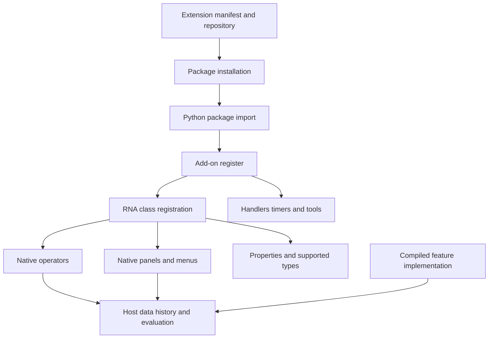
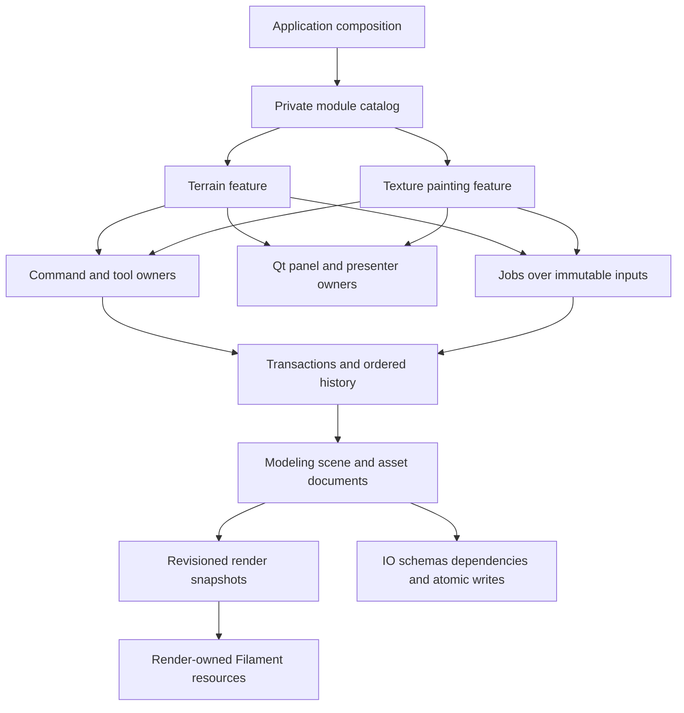

<!--
Copyright (c) 2026 Francesco Di Blasi. All rights reserved.
This document is part of Quader and is protected proprietary material.
-->

# Blender's extension architecture and private feature modules for Quader

Research date: 9 October 2026. Audience: Quader's development team.

This is a source-based research and future design document. It does not describe an implemented Quader plugin system or authorize the proposed implementation work.

## Recommendation

Build Quader's future plugin system as **private, first-party feature modules with explicit ownership and lazy activation**. Initially compile these modules with the application. Keep their expensive sessions, jobs and resources dormant until needed. Terrain authoring and texture painting can each be a cohesive module without requiring a public SDK, Python runtime, extension marketplace or dynamically unloaded DLLs.

Blender's most useful precedent is its separation between host-owned capabilities and feature contributions: operators, panels, properties, tools and render engines register through specific host systems. Its extension installer is a separate layer. Copying that installer would contribute little to Quader's actual requirement. Establishing safe command registration, document ownership, history integration, persistence and resource lifetimes would contribute much more.

The recommended starting point is therefore:

1. A small module descriptor and explicit application composition path.
2. Registration through existing command, tool, UI and service owners.
3. One activation scope that can retire every contribution it creates.
4. Lazy project/document sessions and host-owned background work.
5. Durable module data with explicit compatibility and missing-module behavior.
6. A restart boundary for binary replacement; no initial DLL hot-unload promise.

Private development removes the need for third-party compatibility guarantees. It does **not** remove the need to preserve projects, undo history, scene identity or resources referenced by in-flight work.

## 1. Scope, evidence and provenance

### 1.1 Source snapshot examined

The primary evidence is the existing local source tree:

`C:/Users/Drako/Desktop/_QUADER_DEV/resources/_SOURCE_CODE/blender-main`

Its [version header][B01] declares Blender **5.2.0 alpha**, patch 0, file subversion 26. It has no `.git` directory. Its directory name and filesystem timestamps are not sufficient to establish an upstream commit or release date. Consequently, this report attributes implementation findings to **this local snapshot**, not to an asserted current stable Blender release or an unverified Git revision.

Selected SHA-256 fingerprints make that limitation explicit and the evidence reproducible:

| File relative to the Blender root | SHA-256 |
| --- | --- |
| `source/blender/blenkernel/BKE_blender_version.h` | `3565dc6aa102751163295fcc6a97338275a8e3f1164f14351604201905803a81` |
| `scripts/modules/addon_utils.py` | `6f42772049978d96b80a2cb599067b3e32e75d5c0a744d6745895d6836fc84d0` |
| `scripts/addons_core/bl_pkg/cli/blender_ext.py` | `21a4a0a0923dc7054b77605dc7a48ebe585adaf4134b2169ace5f3c16b89e900` |
| `source/blender/python/intern/bpy_rna.cc` | `ebfff96c68230da2f8f87076f4d8de0d232b3b5bd4f10c5267b79be08157b405` |
| `source/blender/makesrna/intern/rna_wm.cc` | `629952ba6b21953e21733cf71661ea32e3169b5c7c56cead86a44febca7c11ed` |
| `source/blender/editors/space_image/image_undo.cc` | `362f3d0ef03285456281a75cd6e818c5ba240c650d248ecaa7013da5214857c6` |

Quader was examined in the current working tree, based on commit `72d353a0a0b36e68bdbe8f833a087ef639931093`, with substantial pre-existing uncommitted work. Quader observations describe the files read during this task; that commit alone is not an immutable reproduction of those observations. Existing work was preserved.

Official upstream documentation and the official source mirror were also checked for terminology and context. They are supplementary; moving web pages are not used to assign a revision to the local tree. In particular, Blender's [add-on guidelines](https://developer.blender.org/docs/handbook/extensions/addon_guidelines/) and [development setup](https://developer.blender.org/docs/handbook/extensions/addon_dev_setup/) describe namespace, packaging and installation expectations.

### 1.2 How to read the findings

- **Observed** means the named source implements the described behavior.
- **Implication** means a conclusion drawn from that implementation.
- **Proposal** means a future Quader design, not an existing capability.

The study follows registration, dispatch and teardown paths and examines representative native integrations. It is not an exhaustive review of Blender's codebase, a security audit, a benchmark or a runtime compatibility certification. Neither Blender nor Quader was compiled or launched for this research. Tests mentioned below were inspected, not executed.

No Blender implementation, shader or asset was copied into Quader. No temporary reference prototype was created. Recommendations are independently proposed contracts and ownership decisions. The inspected Blender files carry their own license notices, including GPL notices in core files and Apache-2.0 notices in the glTF hook files; conceptual research is not a dependency or code-import decision.

## 2. What Blender's “plugin system” actually comprises

Blender has several cooperating extension mechanisms. Treating all of them as one loader hides where the engineering work happens.

| Layer | Observed role | Relevance to Quader |
| --- | --- | --- |
| Extension package and repository | Manifest, compatibility, archive build/install, repositories, updates, bundled wheels | Mostly distribution infrastructure; a small private build manifest is initially sufficient |
| Python add-on lifecycle | Import module, call `register()`, later call `unregister()` | Useful conceptual activation boundary, but manual teardown and failure handling are insufficient as Quader's full contract |
| RNA/Python registration | Validate supported subclasses and connect their callbacks to native type systems | Strong precedent for explicit, typed host contribution points |
| Native editor/runtime owners | Dispatch operators, manage UI regions, tools, data, evaluation, undo and rendering | The capabilities terrain and painting actually need |
| Specialized native integration | Compiled implementations exposed through a Python facade, such as Cycles | Strong precedent for internally developed native functionality behind a coherent feature interface |
| Feature-specific hooks | A feature can expose its own narrow callbacks, as glTF import/export does | Useful when a concrete second consumer needs to extend a feature |

An extension of type `theme` does not acquire a Python add-on's executable lifecycle simply because both use the extension package format. Conversely, a compiled subsystem does not become an installable third-party binary plugin merely because Python exposes it. [B02], [B03], [B04]



The important dependency direction is from contributions into host services. An add-on is powerful because Blender already provides substantial modeling, image, rendering and editor machinery.

## 3. Packaging, discovery and activation in Blender

### 3.1 Legacy add-ons and extensions share a runtime

**Observed.** `scripts/modules/addon_utils.py` remains the central add-on lifecycle implementation. Legacy discovery can read `bl_info` without importing the full add-on, using a lightweight metadata path. Extension metadata comes from `blender_manifest.toml`; a compatibility `bl_info` can be derived internally. The enable path ultimately imports the module and calls its `register()` function in both cases. [B02]

The extension namespace is qualified as `bl_ext.<repository_module>.<extension_id>`. The junction-module machinery maps configured repository directories into that hierarchy. Relative package imports therefore matter: an add-on cannot safely assume it is always imported under one unqualified top-level name. Repository identity and extension identity are distinct. [B02], [B05]

**Implication.** Discovery should be cheap and separate from executing feature code. Quader can know that a terrain capability exists, and whether the current build allows it, without creating terrain documents, scanning resources or allocating GPU memory. Since the modules are internal, a generated or compiled descriptor table can provide this separation without directory scanning or a package server.

### 3.2 Manifest responsibilities

**Observed.** Blender's manifest template includes schema version, extension ID and version, name, maintainer, type, Blender minimum and optional maximum version, license, optional platforms, bundled Python wheels and permission declarations. The CLI validates package metadata and handles archive/repository operations. These fields describe several different compatibility dimensions; an extension version is not its document schema or the host's native ABI. [B03], [B04]

**Proposal.** Quader should preserve that separation with a much smaller private descriptor:

| Field | Intended meaning |
| --- | --- |
| Module ID | Stable internal identity, for example `quader.terrain` |
| Build identity | Exact application/module build compatibility if binaries are separate |
| Host contract revision | The feature-facing contract expected by the module |
| Required services/modules | Explicit dependencies checked before activation |
| Product availability | Which shipped profiles actually contain and permit the feature |
| Document schemas | Authored data versions the module can read/write |
| Contributions | Commands, tools, panel factories and optional domain adapters |

Do not introduce SemVer dependency solving merely to recreate extension packaging. One controlled source tree and release pipeline can produce an exact, tested dependency set.

### 3.3 Enablement is a sequence of fallible operations

**Observed.** `addon_utils.enable()` checks module state and compatibility, coordinates extension refresh when necessary, imports or reloads code, establishes registration ownership, invokes `register()`, then records enabled/persistent state. Its failure paths report exceptions and clean up selected module/preference/dependency state. [B02]

This is not a general transaction over everything an add-on may have done. If `register()` creates a handler, registers one class and then raises, the visible error path does not automatically reverse every preceding contribution. Native class registration itself can succeed before a later deferred-property or Python class callback fails. [B02], [B06]

**Proposal.** Quader activation should have an explicit registration scope. Each contribution returns a lifetime token owned by that scope. Failure retires successfully created contributions in reverse order and releases the candidate session. Any side effect outside those registries must participate in the activation contract explicitly. Ordinary feature activation should avoid authoring document mutations at all.

### 3.4 Disable, reload and replacement are different operations

**Observed.** `addon_utils.disable()` clears enabled/persistent flags and calls `unregister()`, catching exceptions. It does not provide process isolation or prove that all Python references, timers, native callbacks and external resources have disappeared. Reloading code is a separate operation, and Python import caching affects what is actually reloaded. [B02]

At installation time, the extension CLI stages extracted files and then replaces the old package directory. The examined final-rename failure path can fail after the previous installation has been removed or relocated. It should not be described as a fully transactional package replacement. Blender's own extension architecture notes also call out Windows DLL locks, deferred stale-file removal and unreliable replacement of extensions containing loaded DLLs. [B04], [B07]

**Proposal.** Keep four concepts separate in Quader: available in the build, registered with the host, active for a document, and resident in the process. A module can release a large terrain session while its compiled code remains resident. A binary update should use restart and a coherent versioned installation, not attempt to overwrite loaded code.

### 3.5 Dependencies and trust

**Observed.** Blender can bundle wheels with extensions. The examined wheel system combines requirements into a shared extension `site-packages` location. Its source documentation states that when multiple versions of the same wheel are present, the newest is chosen without full conflict resolution; this can break an extension requiring an older version. [B07], [B08]

Permission metadata describes intended filesystem, network and other resource use. The inspected validation and registration paths do not turn an in-process Python add-on into an OS sandbox. Official guidelines also ask add-ons to respect online-access settings and avoid global module-loading changes. [B03], [B04]; [official guidelines](https://developer.blender.org/docs/handbook/extensions/addon_guidelines/).

**Proposal.** Private Quader modules should use the application's pinned dependencies and existing opt-in network policy. They should be treated as trusted application code with constrained architectural interfaces. Calling those interfaces “capabilities” would express access discipline, not a security isolation guarantee. A separate process is the relevant later option for fault isolation or an incompatible external compute runtime.

## 4. Runtime extensibility: the substantial part

### 4.1 Registration connects Python classes to native owners

**Observed.** `pyrna_register_class()` validates a Python type against its registerable RNA base, calls the corresponding native registration function, installs the Python association and processes deferred properties. The base type determines what registration means. This is not a universal binary entry point capable of replacing any engine subsystem. [B06]

The useful abstraction is “a supported host contribution with a defined lifecycle.” An operator, panel and render engine each have different requirements. A single untyped callback registry would lose these distinctions.

### 4.2 Operators combine discoverability, interaction and execution

**Observed.** Operator RNA registration constructs a `wmOperatorType` and connects supported callbacks such as `poll`, `execute`, `invoke`, `modal` and `cancel`. The window manager owns dispatch and running operator state. Operator properties carry arguments; operator flags affect host behavior, including undo handling. [B09], [B10]

The roles are distinct:

| Mechanism | Responsibility |
| --- | --- |
| Poll | Whether the operation is valid in the current context |
| Invoke | Start an interactive operation from an event/context |
| Execute | Perform an operation with supplied arguments |
| Modal | Continue an interaction across events |
| Cancel | Release/restore the operation's pending state |
| Undo integration | Record supported authored changes through the host's history machinery |

**Implication.** A Blender operator is closer to a host-integrated command/tool lifecycle than a button callback. It does not follow that setting an undo flag makes arbitrary file writes, external service calls or plugin-owned memory reversible. Quader's module contracts should explicitly identify what is authored, what is preview state and what the history owner can restore.

For automation, Quader should continue exposing explicit typed arguments and handles. Reproducing Blender's broad ambient context as the primary module API would make headless testing and multi-document lifetime reasoning harder.

### 4.3 UI registration is constrained by the host's layout model

**Observed.** Panel registration in `rna_ui.cc` creates a native `PanelType` for an existing space/region and wires supported callbacks. Unregistration walks retained UI structures to remove references. Menus, UI lists and other supported types have their own registration paths. WorkSpaceTool registration is composed through the Python tool-system helpers and native tool structures. [B11], [B12]

The UI contribution supplies behavior and placement within Blender's supported structures. This should not be read as evidence that ordinary add-ons can define arbitrary native editor internals or replace all workspaces through one generic interface.

**Proposal.** Quader modules should supply panel factories and tool-option presenters through `src/ui`, using shared Qt theme, scale and lifetime rules. Algorithms and authored state should remain in domain/editor services. A panel closing should release presentation state, not delete the document data it was editing.

### 4.4 Properties and saved data are related, but not identical

**Observed.** RNA properties, Python-defined property groups and ID properties provide extensible data access over host-supported owners. Registering a Python class does not serialize that class's executable code into a `.blend` file. Custom data can outlive its Python type definition, but interpreting it again requires compatible definitions; storage depends on the owner and property kind. [B06], [B13]

**Implication.** “The add-on can attach properties” is not a full persistence design for a terrain heightfield, editable texture layers or a procedural graph. Quader must define schemas, references, migration, dependency discovery and behavior when the editing module is unavailable. UI registration and data compatibility require separate lifetimes.

### 4.5 Handlers, timers and subscriptions are resources

**Observed.** Blender exposes application handlers, timers and message-bus subscriptions through separate APIs. Their lifetime rules differ. For example, a message-bus subscription's `PERSISTENT` option relates to ID remapping; the source documentation says subscriptions still clear on file load. Persistent handlers and persistent timers have their own file-load behavior. [B14], [B15], [B16]

**Proposal.** Quader should return scoped tokens for callbacks and subscriptions, tied to the module and document generations. Callbacks must be detached before their target service dies. A generic boolean named `persistent` would be too ambiguous: distinguish application lifetime, project lifetime, document lifetime and active interaction lifetime.

### 4.6 Teardown must understand host resources

**Observed.** Operator unregistration clears the window manager's retained operator stack and removes matching operator handlers; this is not a claim that it clears document undo history. Panel unregistration traverses retained regions; render-engine unregistration stops render work and releases persistent engine data before removing the type. These are owner-specific operations. [B09], [B11], [B17]

**Implication.** Correct teardown is not simply “call unregister and free the module.” Quader will need to settle tools, drain or invalidate jobs, remove UI callbacks, release render submissions and preserve history/persistence services in the right order. Keeping native code resident simplifies this significantly.

### 4.7 Native performance lives below scripting

**Observed.** Cycles' Python integration exposes a render-engine/property/UI facade over `_cycles`. Blender initializes the compiled `_cycles` module through its Python interface when built with Cycles, and the Cycles Blender target is wired by CMake. This is a first-party compiled integration, not proof of a general stable Blender C++ plugin ABI. [B18], [B19]

Blender's local Python API documentation also explicitly warns against concurrent background Python threads using Blender's API. A native feature may use internal parallelism under its own rules, but that does not make arbitrary Python callbacks thread-safe. [B20]

**Proposal.** Quader should implement terrain sampling, erosion, brush evaluation, image compositing and baking in appropriate native domain services. Optional future scripting can orchestrate those services. Introducing Python simply to imitate Blender would create another runtime and binding maintenance burden without supplying the missing terrain or painting foundations.

### 4.8 Features can own narrower extension points

**Observed.** The glTF add-on's import/export hook dispatchers iterate configured extension objects, look up named hooks and distinguish critical failures from logged noncritical failures. This is an extension protocol inside a feature, separate from global Blender add-on registration. [B21], [B22]

**Proposal.** If terrain later needs several erosion implementations, define a small terrain-owned evaluator contract at that point. If painting needs several exporters, define that contract in painting/export ownership. Avoid a global service locator and arbitrary hook system in anticipation of every possible feature.

### 4.9 Painting demonstrates the limits of a generic plugin layer

**Observed.** Blender's image-paint operator delegates to native stroke behavior and explicitly brackets image undo. Its registration uses the blocking operator flag, while the painting implementation handles its specialized undo path. Image undo stores image buffers as shared tiles and records modified tiles for subsequent steps. [B23], [B24]

The lesson is architectural: high-volume authored data needs domain-specific history and invalidation. A registration framework does not automatically provide efficient brush undo. Quader needs its own painting data/history contracts; the Blender tile implementation is evidence of the requirement, not a template to transplant.

## 5. Quader's current starting point

The current source has strong owner boundaries and several useful internal interfaces. It does not yet expose a general feature-module host. In particular, naming a class “registry” does not imply that arbitrary modules can register with it dynamically.

| Area | What exists now | Gap relevant to modules |
| --- | --- | --- |
| Composition | `App` owns the principal application services; native packages are composed by CMake | No module descriptor/factory composition layer |
| Public intent | `QuaderEditorApi` covers whole-editor workflows; `QuaderApi` covers document/modeling intent | Existing C++ API, not a stable native plugin ABI |
| Commands | Internal `EditorCommandRegistry` holds command callbacks | Registration is private/hardcoded in `QuaderCommandsApi::Impl`; no module registration scope or unregister path |
| Tool lifecycle | `ViewportNativeToolLifecycleAdapter` supports activation, settlement, cancellation and pending state | Tool IDs/descriptors are fixed catalogs; coordinator members name concrete tool services |
| UI | Existing dock/panel owners and public show/hide/focus operations | Fixed panel catalog; no general module panel-factory contribution API |
| Events | Public subscription tokens and defined editor events | Fixed event vocabulary, not a general arbitrary event bus |
| Selection | Central selection service and sub-selection provider abstraction | Current sub-selection kind/provider arrangement is narrow; not a ready-made multi-plugin selection system |
| History | `EditorHistoryService`, transactions and undoable commands | Module commands and their data must outlive retained history references |
| Publication | Modeling/native publication coordinates multiple owners | New domains must participate deliberately; registration alone provides no mutation atomicity |
| Persistence | Versioned QDR container, typed scene inventory, project assets and dependencies | No demonstrated general module codec registry or opaque unknown-payload round-trip contract |
| Rendering | Immutable snapshots, revision gates, owned uploads and overlay coordination | Public render API is not an arbitrary Filament resource/provider registry |
| Scripting | `QuaderScript`, a compiled C++ automation DSL | Lua runtime/bindings are explicitly future work |

Evidence: [architecture map][Q01], [application composition][Q02], [editor API][Q03], [commands][Q04], [Q05], [tool runtime/catalogs][Q06], [Q07], [Q08], [UI][Q09], [Q10], [events][Q11], [selection][Q12], [history/publication][Q13], [Q14], [persistence][Q15], [Q16], [render ownership][Q17], [script contract][Q18].

### 5.1 The authoritative owners remain authoritative

The portable `quader::modeling` core owns modeling state. `ModelingSdkProjectionAdapter` and its native publication/binding collaborators connect it to scene entities and assets. A feature module must not create another editable mesh store that silently competes with that session. [Q01], [Q14]

`SceneDocument` owns the live scene and stable object identity. `SceneEntityState` is the durable component inventory used across history, rollback, clipboard and persistence. Adding a terrain field to a runtime object alone would not integrate it with those workflows. [Q01], [Q19]

`AssetRegistry` and project material/asset services own asset identity and authoring. `src/render` owns Filament resources. `src/ui` owns Qt widgets and raw-input translation. Encapsulation means a feature uses well-defined routes through these owners; it does not mean it owns a private renderer, scene and history stack. [Q01], [Q17]

### 5.2 Existing material structures are useful, but not a painter engine

The current `TextureAsset` contains usage/color-space metadata, dimensions, a source path and a generated flag. It is not a tiled editable image document. The material structures support ordinary material parameters and texture slots, while project material/evaluation payloads implement Standard material behavior. Reserved graph names or enum values do not establish a working node graph, layer compositor or baking engine. [Q20], [Q21], [Q22], [Q23]

A painting module therefore has a destination for evaluated outputs, but still needs its own deliberately integrated authoring domain.

### 5.3 Private development and public feature availability are separate

Quader already composes Full and Public executables with immutable release profiles. Both use shared implementation targets; a private module interface does not automatically decide which feature is available in which product. [Q24], [Q25]

For this proposal, **private** means developed and maintained by the Quader team, with no supported third-party authoring SDK or marketplace. A privately implemented feature could eventually ship in a public Quader build if explicitly selected. Owner-level release checks must still run before mutation, preview settlement and history creation. A hidden menu is not an availability boundary.

## 6. Proposed architecture for private feature modules

Everything in this section is a proposal.

### 6.1 What “encapsulated” should mean

A terrain module should collect terrain-specific algorithms, application services, editing interactions, presentation and tests under one feature ownership model. A painting module should do the same for texture authoring. Each should be buildable/testable at its natural boundaries, and changes to one should not require spreading its algorithms throughout unrelated owners.

The host still coordinates shared concerns. A feature that invents its own object IDs, file browser, keyboard dispatcher, undo stack or Filament device would be separated in code while becoming tightly coupled in behavior.

Use a small number of explicit host contracts. Avoid a “plugin context” exposing every internal manager through untyped lookup. A module-specific service can receive exactly the modeling, asset, job or transaction ports it needs at construction. Its UI adapter can receive a feature-facing facade rather than those same low-level ports.



The arrows represent responsibility flow, not unrestricted include permissions. A terrain domain library need not depend on Qt, Filament or the application shell.

### 6.2 Start with linked modules and lazy resources

| Approach | Benefits | Costs and suitable use |
| --- | --- | --- |
| Linked native feature targets | Same-build types, easy debugging, direct tests, existing dependency/deployment model | Code is part of the app image; separate release replacement is unavailable. Recommended first version |
| Private DLLs matched to one host build | Optional binary packaging and independent code loading | ABI/runtime ownership, deployment and lifetime complexity. Consider when a concrete distribution or memory requirement appears |
| External worker process | Crash containment and independent compute runtime | IPC, cancellation, serialization and large-data transfer costs. Consider for heavy or incompatible compute backends |
| Script-first features | Fast orchestration and customization once bindings exist | Requires a runtime and maintained API bindings; does not supply native domain performance or persistence. Optional later layer |

“On demand” initially means lazy session construction, resource loading, compute-job creation and GPU allocation. Linked code does not consume the same resources as a live terrain cache or many high-resolution texture sets. Measure startup time and committed CPU/GPU memory before deciding that DLL loading is necessary.

Keep the lightweight contribution catalog registered for process lifetime. Activation can then start a document editing session without changing stable command identity or tearing down type registries. Module shutdown remains testable even when production unloading only occurs at application exit.

### 6.3 Integrate incrementally with existing catalogs

Do not replace every enum/catalog with runtime reflection before implementing one feature. For the first vertical slice, typed IDs can be added to the existing catalogs while the implementation resides in a dedicated feature target. Add descriptor/factory contribution paths where the feature actually needs them.

When registration becomes extensible, existing owners should accept deterministic contributions with explicit module attribution. Reject duplicate IDs with a diagnostic; the current command registry's silent duplicate/empty-ID handling is insufficient for module integration. Keep namespaced stable IDs and typed C++ constants. Continue using the existing shortcut conflict, persistence, localization, menu and command behavior contracts. [Q04], [Q05], [Q26]

A useful module descriptor can remain ordinary C++ metadata. TOML/JSON parsing, binary scanning and public SDK headers are not prerequisites. Proposed target names such as `quader_feature_terrain` and `quader_feature_texture_paint` are illustrative; no such targets are introduced by this report.

### 6.4 Separate registration from editing sessions

| Lifetime | Contains | Must not accidentally own |
| --- | --- | --- |
| Application/module | Descriptor, command identities, factories, compatibility support | Active-scene pointers or all document data |
| Project | Feature asset catalog/dependency coordination, project preferences where appropriate | Every temporary brush operation |
| Document/asset | Authored terrain or paint document, revisions, durable references | Qt widgets or native GPU handles |
| Editing session | Active tool, draft options, selection presentation, preview checkpoints | A competing authoritative scene |
| Job | Immutable input pins, scratch, cancellation token, output candidate | Permission to publish into a retired document |
| Render presentation | Derived GPU caches, upload ownership and render completion tracking | The only surviving authored copy |

Painting may target a material asset shared by several scenes. Its document lifetime must not be assumed identical to the currently focused scene's lifetime. A preview seen in multiple viewports should be identified and invalidated consistently for every consumer.

### 6.5 Activation and deactivation contract

A practical state model is:

```text
Build available -> Descriptor registered -> Session inactive
                                          -> Activating -> Active
                                               failure -> Inactive + diagnostic
Active -> Settle pending interaction -> Quiesce work -> Session inactive
             failure -> Active with the accepted draft retained
```

Activation should:

1. Check product availability and required services before document mutation.
2. Validate document/schema compatibility and resolve stable handles.
3. Construct candidate session state and a contribution/resource scope.
4. Register session-scoped callbacks and presentation resources.
5. Publish active state only after all necessary preparation succeeds.

Failure should leave the previously usable editor state intact. Callback registration rollback is distinct from compensation for an authored transaction; both must use their relevant owners.

Deactivation should:

1. Stop admitting new feature interactions and job submissions.
2. Settle the current tool through Quader's established lifecycle. Leaving a pending valid operation normally accepts it; only explicit Cancel or document Discard rolls authored work back. Failed acceptance rejects the transition and retains the draft. [Q27]
3. Cancel pending work and join it, or invalidate its publication token while retaining safe input/output lifetimes until it completes.
4. Retire overlays, callbacks and panel bindings through their owners. Account for queued Qt events and deferred deletion.
5. Release heavy session caches after retained submissions/uploads are safe.
6. Keep durable data, required readers and any code needed by undo history available.

A timeout is not permission to destroy memory still referenced by a worker. The first implementation can retain safe background state until completion rather than promising immediate memory reclamation.

### 6.6 History must survive module inactivity

One scene's chronological history can contain mesh edits, a terrain stroke, a scene material assignment and another terrain stroke. Undo should traverse that order through the existing scene history owner. A hidden terrain panel cannot make older terrain edits non-undoable.

Shared paint assets need a separate ownership decision at the host level. Today `EditorHistoryService` belongs to `SceneSession`, while `StandardMaterialEditSessionService` belongs to the project and can outlive a focused scene. A material shared by several scenes cannot safely accept conflicting undo entries from independent scene histories. Before implementing shared painting, extend host ownership with an asset/project history domain or an explicit coordinated transaction policy; define which document receives Undo and what cross-domain operations do. This is a required new contract, not an existing generic project history feature or permission for the module to invent an isolated private undo stack. Closing a scene must not discard a shared paint asset's necessary history. [Q30], [Q31]

Use domain-specific payloads or immutable data revisions inside host history entries. Any polymorphic command object retained by history also retains a dependency on its implementation. This is another reason to keep code resident initially. Do not clear history automatically to permit deactivation.

For cross-owner operations, define a single user-visible transaction: for example terrain source changes plus regenerated geometry plus asset references. Failed candidate preparation must not publish half of that result. Extend the correct transaction/publication owner rather than putting rollback logic in a panel.

### 6.7 Jobs and previews need versioned publication

A worker should operate on immutable input with a document identity, document generation, relevant content revisions and module/session generation. On completion, the owner checks whether that result still belongs to the current document and input state. Cancellation alone is insufficient: a job can complete just as cancellation is requested.

For a terrain brush preview, filled geometry, wires, selection, depth, picking and bounds must describe the same accepted candidate. Quader's existing preview contract explicitly requires a preview-specific revision to pass through outer submission gates and inner caches. Updating an API getter while leaving retained viewport geometry stale is a failed implementation. [Q28]

For painting, apply equivalent revision discipline to evaluated texture content, material bindings and every viewport sharing the material. Avoid full layer scans, full image uploads or command enumeration on unchanged frames. Render-owned asynchronous uploads must retain their byte buffers until completion. [Q17]

### 6.8 If private DLLs become necessary later

Choose a deliberately narrow boundary. A same-build private C++ interface is possible when every binary shares compiler, runtime and dependency settings, but it is not a stable cross-version ABI. An exported C entry point with versioned function tables and opaque handles is a more controlled alternative when stronger separation is required. Neither is proposed for immediate implementation.

Specify allocation/destruction on the owning side, exception containment, callback lifetime, thread affinity, structure sizes and compatibility checks before calling feature code. Avoid passing Qt widgets, STL ownership or raw Filament pointers across an allegedly stable boundary. A panel factory returning a Qt object is a tightly matched same-build interface and should be described that way.

Unloading would require proving the absence of active tools, queued callbacks, worker code, history implementations, live document codec calls and GPU completion callbacks referring to the DLL. The simpler initial rule is: **deactivate sessions freely under their contracts; replace native binaries only at restart**.

## 7. Persistence is a first-class part of the module design

### 7.1 The current file container is not already a plugin-data solution

Quader's QDR format has chunk metadata, schema checks, checksums and typed scene serialization. Its reader rejects unknown critical chunk types. That does not establish that unknown noncritical data survives hydration and subsequent writing. No opaque module-payload retention contract was found in the examined document/writer path. [Q15], [Q16]

Therefore, do not append an arbitrary chunk and assume old or module-free builds can safely open and resave the scene. A readable container and a lossless editable document are different guarantees.

### 7.2 Recommended first persistence policy

Keep schema readers and dependency enumeration available even when the editing session is inactive. For the first private implementation, reject unsupported authored data before mutation if safe interpretation or preservation is unavailable. Report the required module/schema/build explicitly. This is safer and simpler than claiming a generic fallback prematurely.

If missing-module viewing or resaving later becomes a requirement, design it explicitly:

| Data category | Possible policy |
| --- | --- |
| Essential authored data whose meaning is unavailable | Reject editing/opening, or provide a deliberately read-only representation |
| Known module schema with inactive editing UI | Read normally; activate editing session when requested |
| Unknown payload with a tested preservation envelope | Retain exact bytes, stable identity, dependency metadata and schema requirements |
| Disposable derived cache | Discard and rebuild when its evaluator is available |
| Baked ordinary mesh/texture fallback | Display/export through standard owners, with clear separation from the unavailable editable source |

Opaque preservation is only valid if copy/duplicate, delete, dependency scanning, save, recovery and migration also preserve or deliberately reject that data. A byte blob alone does not reveal which texture or asset it references.

### 7.3 Authored versus evaluated data

The terrain heightfield/procedural parameters and a painter's layer stack are authored data. Display meshes, LODs, composited pixels and GPU textures are evaluated outputs. These need different revisions and storage policies.

Do not make a cache the only recoverable copy of authored work. Conversely, do not serialize transient brush pointers, GPU handles or worker state into the document. If ordinary mesh editing is permitted on generated terrain, define an explicit conversion/bake operation or a supported source-edit relationship; never silently allow two independent mutable authorities for the same surface.

### 7.4 Dependencies, migration and atomic saves

Use stable project asset IDs and project-relative resolution through existing owners. Moving a folder, duplicating a scene, deleting a material or saving a recovery copy must understand module references. A module's private directory cannot bypass project dependency checks.

For multi-file paint/terrain assets, distinguish per-file atomic replacement from a crash-atomic multi-file update. A proposed design can write immutable content generations, then atomically publish one manifest referencing the completed generation. Retain the previous valid generation until recovery/cleanup policy allows removal. Do not overwrite source tiles first and hope the final metadata save succeeds.

Schema migration should validate before publishing, preserve the original on failure, and record the required schema independently of the module's marketing/version number. Changing a brush algorithm may also change deterministic replay: durable tile/source results are a different promise from replaying a historical stroke with newer code.

This report changes no file format. These contracts need owner-level design and fixtures before either feature writes new authored data.

## 8. Worked design: a Terrain module

### 8.1 Choose the product contract before the infrastructure

“Terrain plugin” can mean two substantially different things:

| Initial product | Authored result | Architectural consequence |
| --- | --- | --- |
| Terrain mesh generator | An ordinary editable mesh produced from parameters or a heightmap | Can reuse much of the current modeling/document path; generator parameters need not remain editable unless promised |
| Persistent terrain authoring | A heightfield/procedural terrain source with sculpting, masks and later regeneration | Needs a new durable domain, specialized history, dependency tracking and evaluated outputs |

A generator is a useful low-risk first demonstration of module composition. It does not prove the architecture supports large tiled terrain editing. If persistent terrain is the actual intended feature, plan a small persistent heightfield slice early rather than hiding that requirement behind a one-shot generator demo.

### 8.2 Proposed ownership split

- **Terrain domain:** height samples, tile coordinates, resolution/extent, masks and deterministic generation operations. Keep this independent of Qt and Filament. A distinct heightfield document is legitimate new domain state, not a second copy of an editable mesh.
- **Terrain editor service:** tool state, brush settings, affected-region queries, preview/commit orchestration and history payloads. It submits ordinary scene/modeling intent through the relevant owners.
- **Terrain asset/document integration:** stable identity, serialization, dependencies and schema migration through asset/IO ownership. Hosting and persistence must be designed before claiming save/reopen support.
- **Terrain presentation adapter:** immutable evaluated geometry/material snapshots. Renderer resources remain in `src/render`.
- **Terrain UI:** native Qt options and panels, using the existing style and semantic tool-input path.

General mesh operations that already belong in the portable modeling core should remain there. Heightfield-specific algorithms do not all need to be forced into a polygon-editing API. The boundary is determined by the authoritative representation and reusable domain responsibility.

### 8.3 A concrete sculpt-stroke lifecycle

1. Invocation resolves the terrain document and validates profile, selection and current editability.
2. The tool opens one preview/history checkpoint and captures stable input revisions.
3. Pointer/pen input arrives as semantic brush samples through the viewport adapter. The panel does not capture raw input independently.
4. Evaluation changes only candidate affected tiles/regions and computes the needed derived geometry, normals and bounds.
5. Publication validates document/session generations and accepts a coherent candidate. Retained picking, depth and overlays receive the same preview revision.
6. Further samples refine the candidate while retaining the initial checkpoint; they do not add one global history entry per sample.
7. Acceptance records one user-visible stroke; explicit cancel restores the checkpoint and retires the candidate. Tool switching follows the existing settlement policy.
8. Undo/redo restores authored terrain and derived publication consistently, including after the terrain panel is closed.

The exact brush integration, tile size and mesh strategy require measurement and independent implementation. This sequence defines observable behavior, not an adaptation of Blender's brush algorithm.

### 8.4 Later complexity that the module boundary must accommodate

Large terrains introduce seams, border sample agreement, LOD transitions, normals, ray queries, collision/export data and memory residency. Erosion may run asynchronously and must not publish over a newer brush stroke. Masks may feed both terrain material evaluation and geometry generation. Multiple scenes can reference the same asset.

These are terrain-domain requirements, not reasons to add arbitrary hooks to every application package. Add narrow contracts when a working feature needs them. For example, a cancellable terrain evaluator is more precise than “plugins may execute during any frame stage.”

### 8.5 Suggested first acceptance slice

For a **persistent** terrain pilot: one modest heightfield, one raise/lower brush, bounded updates, one undo entry per stroke, save/reopen, duplicate/delete and ordinary viewport rendering. Verify edge samples, extreme/invalid input, cancelled strokes and stale worker completion. Defer streaming, erosion, vegetation, terrain-specific shader authoring and general graph evaluation until their product requirements are explicit.

This limited slice exercises the hard integration points without pretending to deliver a complete terrain editor.

## 9. Worked design: a Substance Painter-like texturing module

### 9.1 A painter is an authoring subsystem

A useful painter involves more than writing pixels or adding a dock. It can require texture sets, channels, UV-space and projected brush behavior, layers, masks, compositing, baking, color management, history, persistence and renderer integration. The existing Standard-material pipeline supplies part of the output path, not these authoring capabilities. [Q20], [Q21], [Q22], [Q23]

Keep the comparison functional. This proposal does not assume compatibility with Substance project formats, reproduction of its proprietary algorithms or a full feature-equivalent implementation.

### 9.2 Proposed durable paint document

A minimal durable model would identify its target material/texture set, resolution, channel semantics, source assets and layer data. Later layers/masks/procedural operators require stable IDs and explicit evaluation order. The paint document should be owned as an authored asset with host-managed identity, persistence and history integration.

Evaluated outputs should publish through stable texture/material references. Editing a layer should not constantly replace a texture with unrelated asset identities, nor should a GPU texture become the only source of the painted result. The document and its output textures can have related but distinct revisions.

Do not equate layer compositing with an arbitrary shader node graph. A fixed material model with evaluated base color, roughness, metallic and normal textures can support a useful painter before a general graph editor exists.

### 9.3 Brush and evaluation path

```text
Semantic stroke samples + target surface/UV information
    -> paint-session candidate changes
    -> dirty tiles/layers/channels
    -> native evaluator or render-owned compute path
    -> immutable evaluated texture update
    -> existing asset/material publication
    -> render-owned uploads and material binding refresh
```

The CPU/GPU split is a future implementation decision. If GPU composition is used, integrate it through `src/render` ownership and explicit resource lifetime. Do not create a second device/context in the plugin or assume an unused backend-specific Filament compute hook already exists.

Color and data channels need explicit conventions: base-color interpretation, linear compositing rules, scalar roughness/metallic behavior, normal-map handedness and normalization, opacity/mask treatment, mip generation and export encoding. These are testable authoring/output contracts, not UI details.

### 9.4 Memory and history are central constraints

One 4096 × 4096 RGBA16F image requires **128 MiB** for its base level: `4096 × 4096 × 4 × 2` bytes. That excludes mipmaps, CPU copies, GPU copies, masks, undo and temporary composition buffers. Five equally formatted full images would require 640 MiB before those additions. These are arithmetic illustrations, not measured Quader allocations or a recommendation to store every channel in RGBA16F.

Use a representation whose costs can be bounded: changed-tile history, immutable shared tile generations or another measured delta scheme. The appropriate host history domain should still see one stroke transaction. For shared material assets, resolve the routing and coordination contract in Section 6.6 first. A private paint undo stack that disagrees with scene/material undo would create confusing behavior.

Consider whether save needs a completed authored stroke, a completed evaluated texture generation, or both. A render preview can be temporarily ahead of the durable exported texture; that distinction must be explicit so a successful save does not conceal unsaved source data.

### 9.5 Surface and asset changes during painting

Define what happens when the mesh's UVs/topology change, its material assignment changes, the target is deleted, a shared material is edited in another scene, or the user switches documents mid-stroke. Stable handles and revision checks should prevent painting into a retired target.

UV seam handling, overlapping islands, mirrored UVs and projected brush occlusion also require explicit rules. Initially choose a narrow supported mapping and test it. Supporting every case by accident is not a coherent brush contract.

An evaluated preview should reach every viewport/material consumer with the right dirty revision. Current-material outlines, brush cursors and selection overlays remain host presentation concerns and must not bypass existing retained rendering contracts.

### 9.6 Suggested first acceptance slice

Start with one Standard material, one texture set, one paint layer, one base-color channel, one brush, undoable strokes, durable save/reopen and viewport preview. Include a bounded-memory case and cancellation while an evaluation job is pending.

Then add layers/masks and multiple channels, followed by explicit UV seam behavior, baking and richer procedural materials as separate feature work. Tiling/UDIMs, smart-material systems and high-resolution streaming should follow demonstrated product needs. A module framework should make these additions cohesive; it cannot make them inexpensive automatically.

## 10. What to adopt, simplify and deliberately avoid

| Blender mechanism | Quader decision | Reason |
| --- | --- | --- |
| Cheap metadata separate from execution | Adopt the principle | Makes feature availability cheap to query |
| Stable feature/operator identity | Adopt | Supports automation, bindings, diagnostics and compatibility |
| Contributions into native host owners | Adopt | Fits current APIs, transactions, rendering and UI boundaries |
| Explicit register/unregister lifecycle | Strengthen with scoped ownership | Partial activation and teardown need deterministic compensation |
| First-party native implementation behind a feature facade | Adopt | Suits terrain and painting performance needs |
| Properties as a convenient UI/data bridge | Use typed domain schemas instead of recreating RNA | Quader does not need general reflection to encapsulate two features |
| Separate feature-specific extension hooks | Add only on concrete demand | Keeps interfaces narrow and attributable |
| General repositories/marketplace/update UI | Omit initially | No public plugin ecosystem is requested |
| Shared wheels and highest-version selection | Do not reproduce | Controlled native builds can use exact dependency versions |
| Import/reload as a development workflow | Do not promise native hot reload | History, jobs, Qt callbacks and GPU work can retain code references |
| In-process execution | Accept for trusted first-party code | Simple integration; does not provide crash isolation |
| Broad context and native pointer bridges | Do not expose as the general module API | Conflicts with stale-handle safety and Quader ownership boundaries |

Internal modules still need contracts. They can evolve those contracts in lockstep with the application rather than carrying a permanent public compatibility burden.

## 11. A staged future implementation plan

This is a decision sequence, not an estimate or an active migration program.

| Stage | Work | Exit criterion |
| --- | --- | --- |
| 0. Select the pilot | Choose terrain generator, persistent heightfield, or minimal painter; define authored data and unavailable-module policy | A narrow observable feature contract with explicit persistence/history needs |
| 1. Establish composition | Add one private feature target, descriptor and explicit application composition; extend only required existing catalogs | Feature implementation is encapsulated; startup does not allocate its heavy editing resources |
| 2. Establish lifetime | Add lazy document/asset sessions, scoped registrations and failure compensation | Repeated activation/deactivation and partial activation failure leave no dangling contributions |
| 3. Deliver a vertical feature | Connect domain operation, tool/UI, history, persistence and retained viewport publication | One useful workflow survives cancel, undo/redo, save/reopen and document switching |
| 4. Add a second feature | Reuse the seams; generalize only repeated composition that now has evidence | Terrain and painting coexist without duplicate scene/history/render truth |
| 5. Reassess packaging | Measure startup/memory and determine whether optional binaries or worker isolation solve an actual problem | A documented reason to keep linked targets or introduce a narrow binary/process boundary |

Do not move every existing tool into modules as a prerequisite. Such a migration would enlarge the task substantially without proving the proposed feature contracts. The strongest proof is a small new feature that exercises them completely.

Avoid speculative directories full of abstract interfaces. Start with a descriptor, an explicit factory, the needed owner adapters and the actual feature domain. Split interfaces when dependency or testing needs demonstrate a boundary.

## 12. Verification contracts for the future implementation

### 12.1 What Blender's tests demonstrate

The inspected `bl_load_addons.py` repeatedly enables/disables add-ons, optionally reloads them, and reverses order to detect accidental ordering dependencies. Its checks focus mainly on enabled/preference state, so a passing run is not proof that every resource was reclaimed. The `bl_pkg` tests separately cover packaging, synthetic repositories, installation, platform/Python filtering, wheels, namespace violations, blocklists and themes. [B25], [B26], [B27]

Quader should adopt lifecycle permutations and add assertions appropriate to its native owners.

### 12.2 Behavior matrix

| Contract | Observable verification |
| --- | --- |
| Dormant feature | Opening an unrelated scene does not create feature sessions, scan layer graphs or upload feature textures |
| Activation rollback | Failure injected after each contribution leaves baseline registries, callbacks, document state and resource counts intact |
| Stable registration | Repeated activation and different valid feature orderings neither duplicate nor silently replace command/tool/panel IDs |
| Two-document isolation | Closing/switching one document invalidates its jobs and callbacks without damaging another document or a shared material asset |
| Tool transitions | Begin/update/accept/cancel and tool switching follow the existing settlement policy; failed acceptance preserves the accepted draft |
| Ordered history | Interleaved native and module operations undo/redo correctly after feature UI deactivation and across history branching |
| Shared asset history | Undo routing is explicit; two scenes cannot independently replay conflicting edits to one paint asset; closing a scene preserves the asset's required history |
| Structural operations | Duplicate, clipboard, delete, asset moves and reference cleanup preserve or intentionally reject module-authored data |
| Atomic publication | Failure between domain preparation and host publication leaves no half-updated assets, bindings, selection or visible geometry |
| Stale completion | A late terrain or paint result is rejected after input revision, document generation or editing session changes |
| Save and recovery | Save/reopen reproduces authored data; interrupted multi-file publication recovers a complete generation |
| Compatibility | Unsupported module/schema/build rejects before mutation; any promised fallback/opaque preservation round-trips without data loss |
| Product availability | Restricted builds reject feature authoring at the owner before settlement/history, even through automation |
| Native UI lifetime | Panels survive scale changes and close/reopen without stale owner access; focused drafts settle through existing rules |
| Actual viewport result | Real GPU checks cover accepted preview, cancel, commit, undo/redo, depth, picking and overlays; CPU getters alone are insufficient |
| Unchanged-frame cost | Counters prove no repeated expensive evaluation, snapshot construction or upload when relevant revisions are unchanged |
| Bounded storage | Large edits remain within chosen tile/cache/history budgets; release of temporary data is observable |

Use public API/`BehaviorScenario` workflows for inspectable editor behavior. Use real Qt/GPU checks for appearance and retained rendering. Follow the repository's scoped verification path; choose the full regression gate when shared history, selection, persistence or modeling foundations change. Feature/fix delivery then requires both canonical Release executables, but this documentation-only research does not. [Q29]

Tests should assert observable contracts and owner invariants, not duplicate implementation logic or pretend that source-text checks prove rendering.

## 13. Decisions to make when development starts

The source investigation answers how to structure the system, but these product choices remain open:

1. Is the first terrain feature a generator or a persistent editable heightfield?
2. Does a paint document belong to a project material asset, a scene-local material, or both under explicit rules?
3. Must projects remain viewable/resavable when an editing module is absent, or is a clear compatibility rejection acceptable initially?
4. Which feature/profile combinations ship, independently of the private module authoring model?
5. What measured startup, CPU-memory or GPU-memory budget would justify moving from linked modules to optional binaries?
6. Which long-running operations need a worker process rather than ordinary native jobs?

These are future implementation inputs. None prevented completing this research, and none justifies building a public extension ecosystem now.

## 14. Source navigation and validation record

### 14.1 Blender evidence map

Paths and line ranges refer to the local snapshot identified in Section 1. Links open the actual local files. Line ranges are navigation aids, not immutable upstream permalinks.

| Ref | File / key symbol | Examined location |
| --- | --- | --- |
| B01 | [Version header][B01] | Version markers, lines 23–37 |
| B02 | [Add-on lifecycle][B02] | `_initialize_once`, `_fake_module`, `check`, `enable`, `disable`; lines 56–616; extension setup later in file |
| B03 | [Manifest template][B03] | Identity, compatibility, platforms, wheels and permission fields |
| B04 | [Extension CLI][B04] | Manifest model 381–409; validators 1803–2077; install 4014–4162; download checks 4345–4439 |
| B05 | [Repository junction modules][B05] | `JunctionModuleHandle`, lines 52–165 |
| B06 | [Python/RNA class registration][B06] | `pyrna_register_class` 10359–10559; unregister 10615–10711 |
| B07 | [Extension architecture notes][B07] | Shared wheels and Windows stale files, lines 103–125 |
| B08 | [Wheel manager][B08] | Version comparison/deduplication, lines 447–529 and 567–585 |
| B09 | [Operator RNA integration][B09] | Callback bridges 1584–1758; register/unregister 1794–1960 |
| B10 | [Window-manager operator completion][B10] | `wm_operator_finished`, lines 1280–1341 |
| B11 | [UI RNA integration][B11] | Panel unregister/register 202–438; UI list/header/menu paths later |
| B12 | [Python tool registration][B12] | `register_tool` 1066–1191; `unregister_tool` 1194–1274 |
| B13 | [Property group example][B13] | Saved values versus runtime class definitions, lines 5–21; see also [native group registration][B28] |
| B14 | [Application handlers][B14] | Native hookup/reset 353–411; invocation 434–494 |
| B15 | [Application timers][B15] | Python timer registration and lifetime, lines 47–137 |
| B16 | [Message bus][B16] | Persistence semantics 195–215; ownership and clearing 296–305, 374–385 |
| B17 | [Render-engine RNA][B17] | Unregister 282–297; register 300–381 |
| B18 | [Built-in Python module setup][B18] | `_cycles` registration under `WITH_CYCLES`, lines 303–340 |
| B19 | [Cycles build][B19] | `bf_intern_cycles`, lines 109–111; [Python feature facade][B29] and [engine bridge][B30] |
| B20 | [Local Python threading guidance][B20] | Main-thread/API restrictions and independent-process alternative |
| B21 | [glTF export hooks][B21] | `export_user_extensions`, critical versus noncritical errors |
| B22 | [glTF import hooks][B22] | `import_user_extensions`, critical versus noncritical errors |
| B23 | [Native image paint operator][B23] | Stroke undo begin/update/done 345–473; operator registration 625–644 |
| B24 | [Image undo][B24] | Shared tile overview 8–20; undo type 1026 onward; begin/end 1095–1155 onward |
| B25 | [Add-on lifecycle tests][B25] | Enable/disable/reload/order permutations, lines 41–129 |
| B26 | [Extension CLI tests][B26] | Build/archive/repository fixtures, lines 402–762 onward |
| B27 | [Blender extension integration tests][B27] | Temporary environments 429–527; packages/wheels/platforms/namespace/theme cases 531 onward |

Additional useful paths: [restricted registration context][B31], [extension install/re-enable operations][B32], [manifest compatibility preflight][B33] and [Python operator invocation][B34]. The restriction wrapper discourages dependence on an active scene during registration; it is not a sandbox. The invocation bridge checks writable/context conditions before window-manager dispatch.

### 14.2 Quader evidence map

| Ref | Owner/source | Why it matters |
| --- | --- | --- |
| Q01 | [Architecture map][Q01] | Current ownership and dependency direction |
| Q02 | [App][Q02] | Application service composition |
| Q03 | [QuaderEditorApi][Q03] | Whole-editor public intent facade |
| Q04–Q05 | [Command registry][Q04], [command API implementation][Q05] | Internal registration and hardcoded composition |
| Q06–Q08 | [Tool runtime][Q06], [tool catalog][Q07], [coordinator][Q08] | Existing lifecycle seam and fixed composition |
| Q09–Q10 | [UI system][Q09], [panel manager][Q10] | Native panel ownership and fixed catalog |
| Q11–Q12 | [Events API][Q11], [sub-selection contract][Q12] | Callback tokens and selection integration |
| Q13–Q14 | [History][Q13], [modeling publication][Q14] | Chronological transactions and owner compensation |
| Q15–Q16 | [QDR contract][Q15], [binary scene codec][Q16] | Versioned serialization and unknown critical chunk handling |
| Q17 | [Render guide][Q17] | Snapshots, uploads, resource ownership and unchanged-frame gates |
| Q18 | [Compiled scripting contract][Q18] | Existing C++ DSL; Lua is future work |
| Q19 | [Scene entity state][Q19] | Durable inventory shared by multiple workflows |
| Q20–Q23 | [Texture asset][Q20], [material document][Q21], [project material document][Q22], [material evaluation snapshot][Q23] | Existing output representation and limits |
| Q24–Q25 | [CMake composition][Q24], [release features][Q25] | Build/deployment and availability policy |
| Q26–Q27 | [Input/command contract][Q26], [editor guide][Q27] | Bindings, dispatch and pending-operation settlement |
| Q28 | [Preview projection contract][Q28] | Retained geometry/picking/depth/overlay coherence |
| Q29 | [Test guide][Q29] | Placement, affected verification and behavior contracts |
| Q30–Q31 | [Scene session][Q30], [project session][Q31] | Scene-owned history versus project-owned material editing lifetime |

### 14.3 What was verified for this deliverable

- Read the referenced source paths and traced the principal package, registration and teardown functions.
- Recorded Blender version markers and SHA-256 fingerprints; explicitly retained the unknown upstream-commit limitation.
- Cross-checked Quader's present extension seams against current code and distinguished static catalogs from open registries.
- Reviewed the design for ownership, history, missing-module persistence, async completion and renderer lifetime risks.
- Checked this document's local links and Markdown structure.

No implementation, performance result, executable build or runtime plugin test is claimed. The daily Filament metadata check completed successfully without reported new output. Public manual changes are unnecessary: this is internal future-architecture research and changes no shipped feature, UI, binding or file behavior. The report is intentionally kept at the application repository root rather than published in the user manual.

[B01]: C:/Users/Drako/Desktop/_QUADER_DEV/resources/_SOURCE_CODE/blender-main/source/blender/blenkernel/BKE_blender_version.h
[B02]: C:/Users/Drako/Desktop/_QUADER_DEV/resources/_SOURCE_CODE/blender-main/scripts/modules/addon_utils.py
[B03]: C:/Users/Drako/Desktop/_QUADER_DEV/resources/_SOURCE_CODE/blender-main/scripts/templates_toml/blender_manifest.toml
[B04]: C:/Users/Drako/Desktop/_QUADER_DEV/resources/_SOURCE_CODE/blender-main/scripts/addons_core/bl_pkg/cli/blender_ext.py
[B05]: C:/Users/Drako/Desktop/_QUADER_DEV/resources/_SOURCE_CODE/blender-main/scripts/modules/_bpy_internal/extensions/junction_module.py
[B06]: C:/Users/Drako/Desktop/_QUADER_DEV/resources/_SOURCE_CODE/blender-main/source/blender/python/intern/bpy_rna.cc
[B07]: C:/Users/Drako/Desktop/_QUADER_DEV/resources/_SOURCE_CODE/blender-main/scripts/addons_core/bl_pkg/readme.rst
[B08]: C:/Users/Drako/Desktop/_QUADER_DEV/resources/_SOURCE_CODE/blender-main/scripts/modules/_bpy_internal/extensions/wheel_manager.py
[B09]: C:/Users/Drako/Desktop/_QUADER_DEV/resources/_SOURCE_CODE/blender-main/source/blender/makesrna/intern/rna_wm.cc
[B10]: C:/Users/Drako/Desktop/_QUADER_DEV/resources/_SOURCE_CODE/blender-main/source/blender/windowmanager/intern/wm_event_system.cc
[B11]: C:/Users/Drako/Desktop/_QUADER_DEV/resources/_SOURCE_CODE/blender-main/source/blender/makesrna/intern/rna_ui.cc
[B12]: C:/Users/Drako/Desktop/_QUADER_DEV/resources/_SOURCE_CODE/blender-main/scripts/modules/bpy/utils/__init__.py
[B13]: C:/Users/Drako/Desktop/_QUADER_DEV/resources/_SOURCE_CODE/blender-main/doc/python_api/examples/bpy.types.PropertyGroup.0.py
[B14]: C:/Users/Drako/Desktop/_QUADER_DEV/resources/_SOURCE_CODE/blender-main/source/blender/python/intern/bpy_app_handlers.cc
[B15]: C:/Users/Drako/Desktop/_QUADER_DEV/resources/_SOURCE_CODE/blender-main/source/blender/python/intern/bpy_app_timers.cc
[B16]: C:/Users/Drako/Desktop/_QUADER_DEV/resources/_SOURCE_CODE/blender-main/source/blender/python/intern/bpy_msgbus.cc
[B17]: C:/Users/Drako/Desktop/_QUADER_DEV/resources/_SOURCE_CODE/blender-main/source/blender/makesrna/intern/rna_render.cc
[B18]: C:/Users/Drako/Desktop/_QUADER_DEV/resources/_SOURCE_CODE/blender-main/source/blender/python/intern/bpy_interface.cc
[B19]: C:/Users/Drako/Desktop/_QUADER_DEV/resources/_SOURCE_CODE/blender-main/intern/cycles/blender/CMakeLists.txt
[B20]: C:/Users/Drako/Desktop/_QUADER_DEV/resources/_SOURCE_CODE/blender-main/doc/python_api/rst/info_gotchas_threading.rst
[B21]: C:/Users/Drako/Desktop/_QUADER_DEV/resources/_SOURCE_CODE/blender-main/scripts/addons_core/io_scene_gltf2/io/exp/user_extensions.py
[B22]: C:/Users/Drako/Desktop/_QUADER_DEV/resources/_SOURCE_CODE/blender-main/scripts/addons_core/io_scene_gltf2/io/imp/user_extensions.py
[B23]: C:/Users/Drako/Desktop/_QUADER_DEV/resources/_SOURCE_CODE/blender-main/source/blender/editors/sculpt_paint/mesh/paint_image_ops_paint.cc
[B24]: C:/Users/Drako/Desktop/_QUADER_DEV/resources/_SOURCE_CODE/blender-main/source/blender/editors/space_image/image_undo.cc
[B25]: C:/Users/Drako/Desktop/_QUADER_DEV/resources/_SOURCE_CODE/blender-main/tests/python/bl_load_addons.py
[B26]: C:/Users/Drako/Desktop/_QUADER_DEV/resources/_SOURCE_CODE/blender-main/scripts/addons_core/bl_pkg/tests/test_cli.py
[B27]: C:/Users/Drako/Desktop/_QUADER_DEV/resources/_SOURCE_CODE/blender-main/scripts/addons_core/bl_pkg/tests/test_cli_blender.py
[B28]: C:/Users/Drako/Desktop/_QUADER_DEV/resources/_SOURCE_CODE/blender-main/source/blender/makesrna/intern/rna_ID.cc
[B29]: C:/Users/Drako/Desktop/_QUADER_DEV/resources/_SOURCE_CODE/blender-main/intern/cycles/blender/addon/__init__.py
[B30]: C:/Users/Drako/Desktop/_QUADER_DEV/resources/_SOURCE_CODE/blender-main/intern/cycles/blender/addon/engine.py
[B31]: C:/Users/Drako/Desktop/_QUADER_DEV/resources/_SOURCE_CODE/blender-main/scripts/modules/_bpy_restrict_state.py
[B32]: C:/Users/Drako/Desktop/_QUADER_DEV/resources/_SOURCE_CODE/blender-main/scripts/addons_core/bl_pkg/bl_extension_ops.py
[B33]: C:/Users/Drako/Desktop/_QUADER_DEV/resources/_SOURCE_CODE/blender-main/scripts/addons_core/bl_pkg/__init__.py
[B34]: C:/Users/Drako/Desktop/_QUADER_DEV/resources/_SOURCE_CODE/blender-main/source/blender/python/intern/bpy_operator_function.cc
[Q01]: architecture-review.md
[Q02]: src/app/app.hpp
[Q03]: src/api/quader_editor_api.hpp
[Q04]: src/editor/commands/editor_command_registry.hpp
[Q05]: src/api/quader_commands_api.cpp
[Q06]: src/editor/tools/viewport_tool_runtime.hpp
[Q07]: src/editor/tools/base/viewport_tool_catalog.cpp
[Q08]: src/editor/tools/native_viewport_tool_coordinator.hpp
[Q09]: src/ui/ui_system.hpp
[Q10]: src/ui/ui_panel_manager.hpp
[Q11]: src/api/quader_events_api.hpp
[Q12]: src/editor/selection/editor_sub_selection_provider.hpp
[Q13]: src/editor/history/editor_history_service.hpp
[Q14]: src/editor/modeling/services/modeling_host_publication_transaction.hpp
[Q15]: src/io/qdr/README.md
[Q16]: src/io/qdr/qdr_scene_binary_codec.cpp
[Q17]: src/render/AGENTS.md
[Q18]: src/api/quader_script.hpp
[Q19]: src/scene/document/scene_entity_state.hpp
[Q20]: src/assets/texture_asset.hpp
[Q21]: src/assets/material_document.hpp
[Q22]: src/assets/project_material_document.hpp
[Q23]: src/render/material_evaluation_snapshot.hpp
[Q24]: CMakeLists.txt
[Q25]: src/core/release_features.hpp
[Q26]: INPUT_KEYBINDINGS.md
[Q27]: src/editor/AGENTS.md
[Q28]: src/editor/modeling/runtime/README.md
[Q29]: tests/AGENTS.md
[Q30]: src/editor/session/scene_session.hpp
[Q31]: src/editor/session/project_session.hpp
