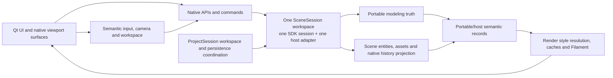
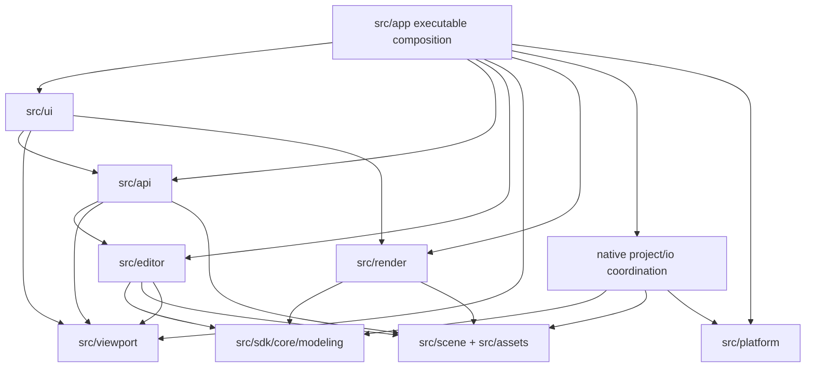

<!--
////////////////////////////////////////////////////////////////////////////////
Copyright (c) 2026 Francesco Di Blasi. All rights reserved.
This file is part of Quader and is protected proprietary source code.
No permission is granted to use, copy, modify, distribute, or sublicense this
file except through prior written authorization from Francesco Di Blasi.
////////////////////////////////////////////////////////////////////////////////
-->
# Refactoring Plan

## 1. Document status

| Field | Value |
| --- | --- |
| Project | Quader native Windows polygon-modeling editor and first-party portable modeling SDK |
| Audit date | 2026-07-17 (Europe/Rome) |
| Repository root | `C:/Users/Drako/Desktop/quader-windows/quader-app` |
| Branch | `main` |
| Audited revision | `f41414476d023d8603919629f84293a509c70dd2` |
| Version at audit | `0.1.45` |
| Audit mode | `AUDIT_AND_PLAN` |
| Audit organization | Six independent repository reviews, followed by coordinator validation and reconciliation |
| Production files changed during audit | None |
| Implementation authorization | Approved by the user on 2026-07-17 |
| Active implementation goal | `019f7113-3819-70c2-b236-a03d2ae38356` |
| Direction authority | `architecture-review.md` |
| Executable task/progress authority | This root-level `REFACTORING_PLAN.md` only |
| Verification cadence | Per the user's 2026-07-17 direction, finish all implementation in a phase before one consolidated phase-level build/test pass; do not run per-task test loops |
| Implementation ownership | Phase 0 may finish its already-active delegated work; Phase 1 through final completion is coordinator-only with no subagents, per the user's 2026-07-17 direction |
| Current implementation status | Phase 0 complete and verified at v0.1.55; Phase 1 complete and verified at v0.1.56; Phase 2 complete and verified at v0.1.57; Phase 3 complete and verified at v0.1.58; Phase 4 complete and verified at v0.1.59; Phase 5 complete and verified at v0.1.60; Phase 6 complete and verified at v0.1.62 under coordinator-only ownership |

Quader is a C++20 Windows desktop application. The shipping shell uses Qt Widgets with the Fusion style, native child `QWindow` viewport surfaces, Filament rendering, Win32 integration, CMake, vcpkg manifest features, FlatBuffers/Zstandard-backed QDR persistence, optional Lua scripting, spdlog/Sentry diagnostics, and GoogleTest. The audit covers the native application, the app-owned portable modeling SDK under `src/sdk/core/modeling`, examples, tests, benchmarks, build tooling, resources, and architecture documentation. Third-party source, generated build output, dependency caches, and packaged artifacts were excluded except where their configuration or generated linker evidence was needed to validate a build-system finding.

Exactly six independent reports were received: W1 architecture/dependencies, W2 duplication/complexity, W3 OOP/contracts/API design, W4 state/data flow/transactions, W5 tests/reliability, and W6 pragmatic simplification/integration risk. Each worker received the same repository baseline and assignment but not another worker's conclusions before submitting the independent report. The coordinator then directly re-inspected every accepted Critical/High issue and every proposed boundary change, merged systemic duplicates, and mapped all worker IDs in Section 6.

The audit was subsequently approved for implementation. P0-T00 is the first and only permitted task before other phase work: it reconciles the old phase/status vocabulary, keeps `architecture-review.md` as the fixed architecture-direction authority, and makes this document the linked, sole executable task/progress tracker. Historical `AR-*` phase labels in the direction document and the closed `refactor.md` ledger are evidence, not alternate task queues.

### Successful commands

The coordinator ran the following non-destructive checks against the audited worktree:

- `cmake --build --preset vs2026-debug --target quader`
  - Passed. `windeployqt` emitted a non-fatal warning about opening Qt translation `catalogs.json` despite the `--no-translations` deployment option.
- `cmake --build --preset vs2026-debug --target quader_tests --clean-first`
  - Passed and rebuilt the native test executable from a clean target state.
- `cmake --build --preset vs2026-debug --target quader_modeling_domain_tests quader_modeling_sdk_consumer_tests quader_guardrail_tests quader_modeling_sdk_parity_tests`
  - Passed.
- `ctest --preset vs2026-debug --output-on-failure`
  - Passed all six registered tests after the clean native-test relink: SDK consumer, SDK parity, modeling domain, guardrails, SDK-only configure/build/external-consumer verification, and native application tests. Total reported CTest time was 64.88 seconds.
- `powershell -NoProfile -ExecutionPolicy Bypass -File tools/affected_check.ps1 -PlanOnly -ChangedPath src/sdk/core/modeling/src/session.cpp`
- `powershell -NoProfile -ExecutionPolicy Bypass -File tools/affected_check.ps1 -PlanOnly -ChangedPath src/sdk/core/modeling/include/quader/modeling/session/modeling_session.hpp`
- `powershell -NoProfile -ExecutionPolicy Bypass -File tools/affected_check.ps1 -PlanOnly -ChangedPath tests/sdk/modeling_sdk_consumer_tests.cpp`
- `powershell -NoProfile -ExecutionPolicy Bypass -File tools/affected_check.ps1 -PlanOnly -ChangedPath tests/sdk/modeling_sdk_parity_tests.cpp`
  - These four plans directly confirmed the false-green routing described by `R-001`.
- Repository inventory, target, include, dependency, duplicate-header, source-size, and Git-status queries using existing PowerShell, Git, CMake files, and `rg`.

An earlier incremental `ctest --preset vs2026-debug --output-on-failure` run passed five of six entries but the freshly linked `quader_tests` process exited before GoogleTest enumeration with Windows status `0xC0000005`. `quader_tests --gtest_list_tests` failed the same way. A target-clean rebuild restored enumeration and execution; a subsequent full CTest run passed. This result is evidence for build-artifact unreliability (`R-003`), not evidence of a current source-code regression. Tracy remained enabled across the failure and recovery.

### Commands not run and audit limitations

- No Release or Ninja-MSVC build, Clang/GCC build, non-Windows build, sanitizer run, static analyzer, or warnings-as-errors configuration was available as a tracked standard gate and none was improvised.
- `python tools/check_cpp_style.py` was not run because repository policy reserves the style gate for commit/push or an explicit style audit; this audit changed no C++.
- Performance benchmarks were inventoried but not run. There is no tracked reference host or accepted threshold against which a one-off timing could be interpreted.
- `tools/boot_smoke.ps1` and manual Vulkan/window/GPU checks were not run. The audit therefore makes no new claim about pixel output, native window chrome, material appearance, swapchains, or driver behavior.
- No live production service, real credential, private project fixture, network fetch, dependency installation, formatter, generator, snapshot updater, or database-like mutation was used.
- The native product was verified only in the available Windows/MSVC environment. The portable SDK's non-Windows promise remains unverified in automation.
- The six reviews inspected the full repository at a high level and the assigned areas deeply, but did not line-review every operation implementation or third-party source file.
- There is no tracked CI workflow, so clean-machine reproducibility could be reasoned about and locally exercised only through existing CMake checks.

## 2. Executive summary

At the audit baseline, Quader already had a credible product architecture: a native Qt/Filament editor, explicit scene and asset owners, public editor facades, strong QDR transaction behavior, semantic input conversion, renderer revision gates, and an app-owned portable modeling SDK with its own install and external-consumer check. The repository was not a candidate for a rewrite. Its central audit finding was that the intended architecture and the runtime architecture had not yet converged: `src/sdk/core/modeling` was the future modeling source of truth while the shipping editor still owned a second, broad modeling session/runtime in `ModelingSessionService`. Phase 0-6 resolved that parallel truth; this section preserves the rationale for the completed work.

The first priority is not moving production code. It is making the safety signal trustworthy. `tools/affected_check.ps1` currently routes representative SDK production and SDK test changes without building or executing the relevant SDK test binaries (`R-001`). A widely used modeling-domain prerequisite helper can let callers continue after a fatal assertion (`R-002`). MSVC incremental linking has twice produced a native test executable that crashes before GoogleTest starts (`R-003`). The SDK-only check still performs native OpenMesh discovery (`R-004`), and no checked-in CI continuously enforces any of these boundaries (`R-005`). These defects could make a risky migration look green.

Once the gate is trustworthy, the SDK contract must become safe enough to own production state. Element ID allocation can rewind across undo branches while generations remain fixed, allowing a stale element identity to alias a replacement (`R-008`). Public preview handles maintain state separate from `ModelingSession::preview` and always allocate the same preview ID (`R-009`). Several public handles and facade entry points allow invalid or dangling access (`R-010`), and requested snapshot lifetime modes are reported without being implemented (`R-018`). These are bounded contract corrections, not a request for a generalized framework.

The migration then proceeds in characterized vertical slices. The first slice keeps `QuaderEditorApi`, `QuaderApi`, command IDs, scene entities, material assets, QDR project behavior, and user-visible history stable while routing the existing box/select/translate-preview transcript through one SDK-owned document/session. Each accepted slice must compare native and SDK receipts, errors, selections/remaps, dirty state, undo/redo, snapshots, and QDR behavior. The corresponding native semantic path is deleted after cutover; no adapter may become a third source of truth. This sequence shrinks `ModelingSessionService` by removing ownership rather than merely splitting a large file.

Later phases repair dependency direction and presentation boundaries. Qt remains the host UI, Filament remains the renderer, and existing editor/viewport/render owners absorb pure decisions currently coordinated by the thousand-line `QtViewportPanel::process_viewport_input`. The render scene fast path and pinned scene payloads are preserved; only the remaining authored-topology overlay seam is neutralized. CMake targets and dependency guardrails are then aligned with actual package ownership. Controlled mesh-header mirrors remain until consumers migrate and are removed last.

Expected outcomes are a trustworthy change gate, one modeling source of truth, truthful ID/preview/lifetime contracts, smaller mutation surfaces, an enforceable target DAG, narrower UI/render seams, more focused tests, and a migration that can stop after any completed phase. Explicitly excluded are a Qt/Filament/QDR/CMake/vcpkg replacement, a generic event bus, service locator, DI framework, repository layer, ECS rewrite, universal render graph, mass rename or formatting pass, speculative SDK breadth, and opportunistic changes to stable public compatibility syntax.

## 3. Repository and system map

### Product and composition roots

| Boundary | Primary locations | Responsibility |
| --- | --- | --- |
| Native executable | `src/main.cpp`, target `quader` | Process startup, logging/fatal-hook installation, native editor launch |
| Application composition | `src/app/app.*`, `src/editor/session/scene_session.*`, `src/editor/session/project_session.*` | Qt application/window lifecycle and construction/ownership of scene workspaces, editor, render, UI, and project services |
| Public native APIs | `src/api` | Stable user/editor-intent facades: `QuaderEditorApi`, `QuaderApi`, domain APIs, typed and string command contracts |
| Portable modeling SDK | `src/sdk/core/modeling`, umbrella `quader/modeling/modeling.hpp` | Portable documents, typed IDs, operations, sessions, previews/history, QDR document IO, neutral snapshots |

### Native packages and owners

| Package | Current owner role | Important integrations |
| --- | --- | --- |
| `src/editor` | Native editor services, modeling coordinator/adapters, commands, history, selection, metadata, pivot and tool workflows | Calls scene/assets/runtime and publishes intent/results to UI/render |
| `src/scene` | `SceneDocument`, entities, hierarchy, transforms, components, scene invariants | Host object identity and scene transaction state |
| `src/assets` | `AssetRegistry`, mesh/material asset identity and validation | Native asset ownership and material binding |
| `src/mesh` | Existing engine-clean geometry/polygon compatibility source | Transitional extraction source mirrored by canonical SDK-internal mesh headers |
| `src/io` | Native project/QDR adapters, hydration, durable writes, recovery, scene and asset integration | FlatBuffers, Zstandard, native filesystem/dialog boundary |
| `src/render` | Filament resources, extraction/snapshots/caches, scene bridge, overlays, viewport drawing | Consumes scene/modeling projections; must not mutate owner state |
| `src/viewport` | Toolkit-neutral workspace, camera/navigation, semantic input, shortcuts, SDK input adapter | Bridges UI events to editor/modeling intent and render preparation |
| `src/ui` | Qt Widgets shell, menus, panels, settings, localization, input translation | Presents retained state and dispatches intent |
| `src/platform` | Windows dialogs, support, Sentry bridge, fatal-error presentation | Volatile platform infrastructure |
| `src/core`, `src/math`, `src/diagnostics` | Shared logging, utilities, math, profiling/no-op instrumentation | Small cross-cutting foundations with explicit ownership |

The audited source inventory contained roughly 900 tracked files below `src`, with the greatest concentration in `src/editor`, followed by `src/sdk`, `src/render`, `src/ui`, and `src/api`. This is an inventory observation, not a quality metric. The concrete responsibility and dependency findings below—not file count alone—justify the proposed work.

### Build and dependency boundaries

- Root `CMakeLists.txt` defines native targets including `quader_modeling`, `quader_core_utilities`, `quader_assets`, `quader_document`, `quader_editor_services`, `quader_project_qdr_io`, `quader_project_session`, `quader_viewport_services`, `quader_api`, `quader_platform`, `quader_render`, `quader_ui`, `quader_app`, and the `quader` executable.
- `cmake/QuaderModeling.cmake` defines native geometry/polygon/runtime targets and SDK targets `quader_modeling_sdk_geometry`, `quader_modeling_sdk_polygon`, `quader_modeling_sdk_qdr_document`, `quader_modeling_sdk_runtime`, and interface target `quader_modeling_sdk`.
- `vcpkg.json` has an empty base dependency set and feature-scoped `native-app` and `tests` dependencies. Native dependencies include Qt Base Widgets, EnTT, FlatBuffers, GLM, lodepng, sentry-native, spdlog, stduuid, Taskflow, Zstandard, and zlib. Filament and OpenMesh are resolved through project-specific CMake/local evidence rather than ordinary SDK transitive links.
- CMake presets provide Visual Studio 2026 and Ninja-MSVC configurations using the Windows triplet. Root `VERSION` and `vcpkg.json` jointly own the application version.
- Runtime resources live under `resources`; examples under `examples`; performance harnesses under `benchmarks`; build and policy automation under `tools` and `cmake`; first-party dependency/license evidence under `thirdparty`.

### Persistence and side effects

- Portable QDR document semantics belong in the SDK QDR target.
- Native project hydration, atomic durable writes, backup/verification/recovery, project session state, file dialogs, scene entity wiring, and asset registry integration remain in `src/io`, `src/app`, `src/platform`, `src/scene`, and `src/assets`.
- `SceneDocument`, `AssetRegistry`, native project/session state, viewport workspace state, and render caches are separate host owners. Modeling state is currently duplicated between the native editor runtime and SDK sessions; eliminating that duplication is the roadmap's main architecture objective.
- Filament, Qt, Win32, Sentry, filesystem writes, and native dialogs are infrastructure boundaries. None belongs in the portable SDK.

### Test boundaries

The configured CTest graph has six entries:

1. `quader_modeling_sdk_consumer_tests`
2. `quader_modeling_sdk_parity_tests`
3. `quader_modeling_domain_tests`
4. `quader_guardrail_tests`
5. `quader_modeling_sdk_only_configure_build`
6. `quader_tests`

Developer-only modeling polygon, runtime, and metadata loop targets support focused prototyping. Root behavior tests exercise public APIs and synthetic editor workflows; `tests/modeling_domain` protects polygon/document/runtime modeling invariants; `tests/sdk` protects standalone SDK and parity contracts; guardrail tests protect source policy, CMake boundaries, naming, dependencies, and instructions. The native executable currently aggregates more than 1,400 tests, with especially large source files in `tests/core_tests.cpp`, `tests/editor_api_tests.cpp`, and `tests/render_extraction_tests.cpp`.

### Deployment and automation

The native app is a Windows deployment. `windeployqt`, app resources, Filament artifacts, and native platform integration are part of that boundary. No tracked GitHub Actions, Azure Pipelines, GitLab CI, Jenkins, Buildkite, or equivalent workflow was found. Existing local CMake/CTest checks therefore have no clean-checkout automation owner.

## 4. Current architecture

### Architecture that actually exists

The current product is a modular native application organized primarily by the first directory under `src`. User/editor intent generally enters through `QuaderEditorApi`, `QuaderApi`, typed command IDs, menus, shortcuts, or semantic viewport input. `App` (`src/app/app.*`), `ProjectSession`, and per-workspace `SceneSession` compose long-lived native owners. `SceneDocument` owns host scene structure, `AssetRegistry` owns assets/materials, editor services own command/history/selection/tool orchestration, and render code maintains Filament resources and revision-gated projections. Qt is kept at the presentation/input boundary and raw events are translated before lower layers consume them.

In parallel, an app-owned portable SDK has been built below `src/sdk/core/modeling`. It has a proper umbrella include, typed IDs, structured operation/result payloads, neutral input/snapshot types, document QDR IO, standalone consumer tests, install/export checks, and a dependency-isolation test. However, the shipping editor's modeling source of truth remains `quader_editor_core::EditorSession` and `EditorRuntime` held by `ModelingSessionService`. Production use of the SDK outside its own implementation is concentrated in QDR adaptation and viewport input conversion. The repository therefore has a declared migration architecture rather than a completed one.

### Current dependency and ownership inconsistencies

- `ModelingSessionService` coordinates modeling runtime, object mapping, scene/assets publication, hierarchy duplication, selection projection, overlays, commands, preview/modal tools, clipboard, history, checkpoints, and repeat behavior. Its implementation is about 6,700 physical lines. The problem is its mutation authority and cross-owner transaction load, not the line count by itself.
- `EditorSession` exposes mutable state/objects/lights; multiple services manually adjust revisions, selection, and dirty flags. This makes invariants depend on call ordering rather than one mutation boundary.
- `QtViewportPanel::process_viewport_input` spans roughly one thousand lines and coordinates input precedence, modal tools, selection, transforms, candidates, overlays, render preparation, and Qt presentation.
- The source/include graph contains editor-render-viewport cycles. CMake sometimes hides ownership by compiling a package's source into another target: render owns an API source, UI owns editor sources, and app owns editor API sources. The dependency policy contains stale target rows and can fail to notice missing policy coverage.
- Native QDR code includes `src/sdk/core/modeling/src/polygon_document_native.hpp`, crossing into a private SDK implementation header rather than a neutral public/import seam.
- Render scene extraction has healthy revision gates and pinned lifetimes, but overlay snapshots still expose `quader_poly::Document` and authored topology spans to render caches.
- Operation metadata, result projection, command/payload mapping, and transitional mesh definitions have multiple representations. Some are true duplicated knowledge; others are intentional native/portable distinctions and must not be falsely unified.

### Healthy patterns to preserve and reuse

- `App`, `ProjectSession`, and per-workspace `SceneSession` form explicit composition/lifecycle roots without a generic service locator.
- Native public APIs express user intent and hide `SceneDocument`, `AssetRegistry`, render caches, and platform windows.
- QDR durable write, backup, verification, rollback, and recovery paths have unusually strong negative-path and transaction coverage.
- Scene render extraction checks revisions before expensive geometry work, has a transform-only path, and pins geometry payloads. This path is a model for future unchanged-state gates.
- Qt input conversion, semantic viewport frames, explicit shortcut contexts, and keybinding persistence establish a sound input boundary.
- SDK install/export/external-consumer checks and the SDK umbrella include establish a real consumer boundary.
- Modeling-domain loops, synthetic behavior scenarios, malformed QDR coverage, and public API behavior tests provide substantial characterization material.
- Tracy profiling macros become compile-time no-ops when disabled; no replacement instrumentation layer is needed.
- The unusual native result compatibility layer deliberately supports both field and callable access and is protected behavior, not accidental complexity.

### State and side-effect flow

The intended owner flow is user intent -> native facade/command -> SDK modeling transaction -> host projection -> scene/assets -> renderer-neutral snapshot -> Filament. Today, user intent -> native modeling runtime -> scene/assets/render remains the dominant flow, while SDK sessions can independently model many of the same operations. Selection, dirty state, history, preview state, and ID remapping are consequently at risk of diverging during migration. A successful refactor must move those invariants together per vertical slice rather than moving isolated algorithms.

## 5. Refactoring principles and non-goals

### Project-specific principles

1. **Keep the native editor shipping.** Qt Widgets, Filament, Win32 integration, native project sessions, scene entities, material assets, and platform dialogs remain host concerns.
2. **Make `src/sdk/core/modeling` the sole modeling truth incrementally.** Each migrated workflow moves document mutation, operation result, selection remap, dirty state, preview/history semantics, and neutral snapshot production together.
3. **Preserve native facades.** `QuaderEditorApi`, `QuaderApi`, typed command IDs, stable string IDs, Lua-compatible user intent, result compatibility syntax, and public editor behavior do not change merely because their implementation owner moves.
4. **One truth during and after cutover.** A temporary adapter may translate IDs and payloads but may not hold a second document, preview, history, selection, or dirty state. Delete the replaced native semantic path after each verified slice.
5. **Trust verification before architecture work.** No migration phase relies on affected-check output until `R-001` is fixed and regression-tested.
6. **Correct contracts before adopting them.** SDK identity, invalid-handle, preview, result, borrowed-lifetime, and error semantics must be explicit and tested before native state depends on them.
7. **Shrink coordinators by moving ownership.** Extract a function only where a target owner and invariant already exist. Moving a large method to another file without changing authority is not progress.
8. **Put unchanged-state gates before work.** Preserve and extend revision gates before allocation, descriptor enumeration, snapshot construction, topology traversal, string formatting, or Qt setters.
9. **Distinguish duplicate knowledge from similar syntax.** Portable operation identity and authored-to-render mapping require one owner; native host errors and portable SDK errors may remain separate when their compatibility and consumers differ.
10. **Keep every phase reversible.** Characterize first, introduce a seam, migrate a bounded workflow, compare outputs, then remove the replaced path. Avoid cross-phase cleanup in the same change.
11. **Use existing repository abstractions first.** Prefer current scene, asset, command, selection, viewport, render extraction, and test support owners over new generic coordinators.
12. **Treat performance as behavior at hot boundaries.** Maintain cache counters, revision behavior, allocation invariants, and fixed-host benchmark evidence for UI/render/modeling changes.

### Non-goals

- No big-bang rewrite of the editor or modeling runtime.
- No restoration of the old external/copy-based SDK checkout, package names, presets, macros, or `QUADER_MODELING_SDK_DIR` wiring.
- No replacement of Qt/Fusion, Filament, QDR, CMake/vcpkg, GoogleTest, FlatBuffers, or the native public API architecture.
- No portability mandate for the native Windows editor; only the modeling SDK is intended to be portable.
- No generic event bus, service locator, dependency-injection framework, universal repository/unit-of-work layer, ECS migration, CQRS/event sourcing, or universal render graph.
- No implementation of speculative SDK features solely because `api-plan.md` lists them; that file is a review draft, not authority.
- No one-class-per-method decomposition of `ModelingSessionService`, `QtViewportPanel`, `UISystem`, `host_contract`, or API classes.
- No broad rename, formatting pass, include-order churn, or style modernization mixed with behavior-sensitive migration.
- No deletion of transitional mesh mirrors until all consumers have migrated and parity protection can be removed in the same phase.
- No opportunistic modernization of `QuaderApiFlag` or `QuaderApiResultValue<T>` compatibility semantics.
- No change to QDR format or user data without a separately approved compatibility decision, migration fixtures, and rollback plan.
- No arbitrary coverage percentage or unstable wall-clock assertion on shared CI.
- No performance optimization without a profile or deterministic hot-path invariant.

## 6. Consolidated findings

Severity describes the risk at the audited revision and along the approved migration path. A Critical verification finding can outrank a production architecture finding because it invalidates the evidence used to approve every later change. “Confirmed” means the coordinator directly checked the cited code or command behavior; it does not mean the failure has already occurred in a shipped build.

| ID | Severity | Confidence | Area | Location | Problem | Impact | Recommendation | Phase |
| --- | --- | --- | --- | --- | --- | --- | --- | --- |
| R-001 | Critical | Confirmed | Verification integrity | `tools/affected_check.ps1` | SDK source, public-header, consumer-test, and parity-test changes can be routed without building/running the owning SDK executable | A migration regression can receive a false-green affected check | Correct all SDK/test routes, build all CTest executables in full verification, and add plan-routing regression tests | 0 |
| R-002 | High | Confirmed | Test correctness | `tests/modeling_domain/test_support.hpp`, callers in `tests/modeling_domain` | `ASSERT_TRUE` inside ordinary `require_test` returns only from the helper; callers continue into unsafe dereferences | A useful assertion failure can become an access violation or abort the test process | Move fatal control to the caller or return explicit status; give scenarios independent failure boundaries | 0 |
| R-003 | High | Confirmed | Build reliability | `quader_tests` target, MSVC Debug link options, `memory.md` incident record | Incremental linking has repeatedly produced a test binary that crashes before GoogleTest starts | More than 1,400 native tests can become unavailable and trigger false source investigations | Disable incremental linking narrowly for affected test targets and measure/repeat-link verification | 0 |
| R-004 | High | Confirmed | SDK isolation | `cmake/QuaderModeling.cmake`, `cmake/QuaderSdkOnlyBuildCheck.cmake` | The SDK-only check still discovers native OpenMesh and declares native modeling targets | A clean portable consumer can fail before compiling SDK code | Disable native topology in the immediate check, then guard native dependency discovery/targets behind native-build options | 0 |
| R-005 | High | Confirmed | CI / portability | Repository root, CMake presets, SDK-only CTest | No tracked clean-checkout CI continuously enforces local gates or SDK portability | Boundary and compiler regressions depend on individual developer discipline | Add a Windows clean SDK/guardrail gate, then controlled native and cross-platform SDK jobs | 0–1 |
| R-006 | High | Confirmed | Architecture / state | Native `ModelingSessionService`/`EditorSession`; SDK `ModelingSession` | Native and SDK modeling sessions implement overlapping document, preview, selection, history, dirty, and operation semantics | Semantic drift grows with every feature; final migration becomes riskier | Freeze speculative SDK breadth and migrate characterized vertical slices through one adapter with deletion of replaced native truth | 2–3 |
| R-007 | High | Confirmed | Ownership / state | `modeling_session_service.*`, `EditorSession`, selection/modeling services | One native coordinator owns too many cross-domain mutations and exposes mutable runtime state | Correctness relies on temporal coupling across scene, assets, selection, history, overlay, and preview | Close mutable escape hatches and shrink the facade by delegating/deleting ownership per SDK slice | 2–3 |
| R-008 | High | Confirmed | Identity correctness | SDK `ids.hpp`, `polygon_document.cpp`, `session.cpp`, QDR ID persistence | Vertex/edge/face generations stay at 1 and undo can rewind element allocation high-water marks | A retained stale topology ID can alias a different element after undo and branch | Implement monotonic non-reuse with allocator state outside undo, explicit stale classification/scope, and QDR tests | 1 |
| R-009 | High | Confirmed | Preview state | SDK `public_api_detail.hpp`, `preview_api.cpp`, `mesh_handle.cpp`, selection operations | Operation `PreviewHandle`s and session transform previews are separate state machines; handles all use ID 1 | Multiple previews can claim activity and commit against an uncontrolled base revision | Use one context-owned preview registry/transaction owner with unique IDs, revision validation, and exactly-once commit/cancel | 1 |
| R-010 | High | Confirmed | Public API safety | SDK `mesh_handle.cpp`, `session/modeling_session.hpp`; native session-backed API construction | Invalid handles/facades can dereference null context and `document()` returns an invalidatable vector-element pointer | Normal invalid input or ordinary mutation can crash or dangle rather than return a structured error | Guard every public entry, remove invalid default construction paths, and replace/deprecate raw document borrowing with owned immutable access | 1 |
| R-011 | High | Confirmed | Dependency direction | Root CMake, editor/render/viewport includes, dependency guardrail tests | Source ownership and link targets mask editor-render-viewport cycles; policy contains stale/vacuous rows | Package boundaries cannot be reasoned about or enforced reliably | Rebaseline the desired DAG, make guardrails total, then move sources and neutral contracts in dependency order | 0 and 4–5 |
| R-012 | High | Confirmed | UI / viewport orchestration | `src/ui/qt_viewport_panel.cpp`, especially `process_viewport_input` | A Qt panel coordinates semantic input, modal tools, picking, selection, transforms, overlays, camera, and render preparation | UI edits can change domain/input precedence and the workflow is difficult to test in isolation | Move pure decisions and semantic records into existing editor/viewport/render owners; keep Qt sampling/presentation local | 4 |
| R-013 | High | Confirmed | Migration verification | `tests/sdk/modeling_sdk_parity_tests.cpp` | Native/SDK parity has only two high-level transcripts and mostly compares bounds/counts | Independently tested runtimes can still drift in the semantics needed for cutover | Build a normalized transcript harness covering receipts, errors, remaps, dirty/history, topology, preview, and QDR | 1–3 |
| R-014 | Medium | Confirmed | Contract design | SDK `result.hpp`, typed selection wrappers; native/runtime command result projections | Result arm access, selection-kind construction, defaults, and manual projections are inconsistent | Callers can create semantically invalid values or silently translate fields differently | Make SDK variants discriminated and typed selections unforgeable; centralize only proven cross-boundary projections | 1 and 5 |
| R-015 | Medium | Confirmed | Duplicated knowledge | Native and SDK operation metadata/catalog/dispatch | Portable operation identity, descriptors, and dispatch facts are repeated | Adding or renaming an operation requires synchronized edits and can drift | Establish one portable operation descriptor source and derive native host presentation/dispatch mappings | 3 |
| R-016 | Medium | Confirmed | SDK boundary | `src/io/qdr/qdr_scene_binary_codec.cpp`, private SDK `polygon_document_native.hpp` | Native QDR code includes SDK implementation-private document representation | Internal layout becomes an accidental integration contract | Expose a narrow neutral import/export view in the public/internal-supported SDK boundary and remove the private include | 1–2 |
| R-017 | Medium | Confirmed | Render boundary | `src/render/overlay/render_overlay_snapshot.*` and overlay caches | Overlay snapshots expose `quader_poly::Document` and authored topology spans | Render remains coupled to the modeling representation despite the neutral-snapshot direction | SDK/scene owners emit semantic state/geometry records; render resolves style and compiles render DTOs while preserving revision/cache policy | 4 |
| R-018 | Medium | Confirmed | Lifetime contract | SDK render payload/options and `scene_snapshot` | Compile options are ignored and snapshots echo `Pinned`/`BorrowedSameFrame` while always owning vectors | Consumers cannot trust reported caching/lifetime semantics | Report only `Owned` now and reject unsupported requests; add alternatives only with real storage mechanics | 1 |
| R-019 | Medium | Confirmed | Migration debt | `src/mesh/**`, `src/sdk/core/modeling/internal/mesh/**` | Twenty-nine byte-identical native/canonical mesh headers remain and many callers use the native path | Include ownership is ambiguous and every definition change needs parity | Retain equality guardrails during migration, then rewrite consumers and delete mirrors together | 6 |
| R-020 | Medium | Confirmed | UI ownership | `UISystem` material-editor workflow | UI owns material workflow/controller behavior beyond retained presentation | Material mutations and UI state are harder to characterize and reuse | Move intent/state mutation to the existing editor/asset owner; leave widget synchronization in UI | 4 |
| R-021 | Medium | Confirmed | API cohesion | `CommandsApi`, `session.hpp`, `modeling_types.hpp`, granular SDK headers | Command registry/keybinding policy and large API/type catch-alls expose broad contracts; “granular” headers include a monolith | Small consumers depend on unrelated concepts and changes have wide rebuild/review scope | Split only along existing owner/consumer seams and keep a stable umbrella; avoid pass-through classes | 5 |
| R-022 | Medium | Confirmed | Test architecture / governance | Large test files, source-text tests, stress fixture, fatal-handler checks, `architecture-review.md` | Test ownership is coarse, some policy checks are misplaced/stale, a private-path stress test silently skips, and fatal checks mostly search tokens | Failures are broad or misleading and the execution plan can commission already-complete work | Rebaseline architecture status, move pure policy checks, split by owner, make fixtures explicit, and add behavior probes | 0 and 5–6 |
| R-023 | Medium | Confirmed | Simplification / dependencies | Unsupported pivot/profiling SDK APIs, unused `BakeBackend`/`UIPanel`, Taskflow/QDR helper | Public placeholders and unused private abstractions/dependencies create obligations without behavior | Consumers see unsupported capability and builds carry unnecessary surface | Quarantine/deprecate public placeholders and remove private dead code/dependencies only after compatibility/consumer checks | 1 and 6 |
| R-024 | Medium | Confirmed | Performance safety | `benchmarks/modeling`, profile macros, hot UI/render paths | Useful benchmarks exist but reproducible command/scene/raw-baseline policy is not recorded | A correct refactor can regress frame/modeling cost without an interpretable signal | Keep deterministic counters in normal tests and record same-host commands/raw comparisons; automate only after repeated need | 0, 4, 6 |
| R-025 | Low | Confirmed | Local duplication | Filament overlay mappings, lowercase helpers, Qt UTF-8/localization helpers | A few same-knowledge mappings/utilities are repeated locally | Minor drift and maintenance friction | Deduplicate only where semantics and at least two consumers are proven; otherwise leave local code alone | 5 or deferred |
| R-026 | High | Confirmed | SDK transaction safety | `src/sdk/core/modeling/src/batch_api.cpp` | Arbitrary batch callbacks can invoke undo/redo/nested mutation; rollback assumes history was not rewound and no-ops are marked changed | A callback can corrupt pre-batch history or report an incorrect atomic result | Add a narrow session transaction guard, reject forbidden reentrancy, validate rollback, and consume real receipts | 1 |
| R-027 | Medium | Confirmed / threading contract open | Asset state / persistence | `AssetRegistry::mesh() const`, QDR deferred mesh/write snapshot paths | A const lookup mutates deferred stores without an explicit thread contract; save materializes all meshes and can omit failed loads without `Result` | First-read races are possible if shared; save defeats laziness or loses structured failure | Declare/enforce UI-thread confinement or synchronize narrow publication; make write extraction fallible and preserve encoded data when practical | 2–3 |
| R-028 | Medium | Confirmed | Performance | `SceneSession::content_revision_stamp`, modeling selection summary | Dirty polling builds a full selection summary to read one revision already available directly | Repeated status polling scales with selected scene content | Use the constant-time owner revision; add a source/behavior guard against enumeration | 0 |
| R-029 | Medium | Confirmed | Transaction correctness | `SceneContentDocument::upsert_objects` and QDR caller | Bulk upsert can commit early records then return total failure on a later record | A caller can believe an import was atomic while state, indexes, IDs, and revisions partially changed | Preflight all records for atomic commit or return an explicit partial result; use atomic semantics for QDR import | 1–2 |
| R-030 | Medium | Confirmed | Project transaction boundary | `ProjectSession::open` | A late failed project replacement can preserve the old workspace but cancel its active previews first | Failed open is not fully non-destructive to the current user workflow | Decide the contract and defer cancellation until install is guaranteed or restore transient preview state | 2 |

### Traceability to independent worker findings

| Canonical ID | Source findings |
| --- | --- |
| R-001 | W5-F001 |
| R-002 | W5-F002 |
| R-003 | W5-F003 |
| R-004 | W5-F005 |
| R-005 | W5-F004, W6-F008 |
| R-006 | W1-F001, W2-F001, W4-F005, W6-F002 |
| R-007 | W1-F003, W2-F002, W3-F001, W3-F002, W6-F005 |
| R-008 | W4-F001, W6-F004 |
| R-009 | W4-F002 |
| R-010 | W3-F004, W3-F007, W3-F008, W4-F004 |
| R-011 | W1-F004, W1-F005, W1-F006, W5-F008, W6-F009 |
| R-012 | W1-F009, W2-F003, W3-F010, W6-F006 |
| R-013 | W1-F011, W5-F006 |
| R-014 | W2-F005, W3-F005, W3-F006 |
| R-015 | W1-F002, W2-F004 |
| R-016 | W1-F007 |
| R-017 | W1-F010, W4-F006, W6-F007 |
| R-018 | W4-F003 |
| R-019 | W1-F008, W2-F006, W6-F011 |
| R-020 | W2-F009, W3-F011 |
| R-021 | W2-F008, W3-F003, W3-F009, W3-F012 |
| R-022 | W5-F007, W5-F011, W5-F012, W6-F001, W6-F010 |
| R-023 | W3-F013, W5-F010, W6-F003 |
| R-024 | W5-F009 |
| R-025 | W2-F007, W2-F010, W2-F011 |
| R-026 | W4-F011 |
| R-027 | W4-F007, W4-F008 |
| R-028 | W4-F009 |
| R-029 | W4-F010 |
| R-030 | W4-F012 |

All material worker findings are represented above or in the explicit rejected/protected decision below. W6-F012 is intentionally not an actionable finding: the coordinator accepted its evidence as a protected compatibility decision to leave `QuaderApiFlag` and `QuaderApiResultValue<T>` unchanged. The worker concern that all render snapshots rebuild every frame was rejected as stale for the scene path; only the narrower overlay topology seam is retained as `R-017`. The transient `quader_tests` crash was rejected as a current source defect but retained, with repeated historical evidence, as the build-artifact reliability finding `R-003`.

### R-001 — SDK changes can bypass their owning tests

- **Evidence:** `tools/affected_check.ps1` has explicit SDK routing for selected internal geometry, polygon, and QDR paths, but representative `src/sdk/core/modeling/src/session.cpp` and public SDK headers fall through to generic `src/` handling. Representative `tests/sdk/modeling_sdk_consumer_tests.cpp` and parity source are treated as `quader_tests` inputs, so an SDK suite filter is applied to the wrong executable and may select zero tests. `Add-FullVerification` builds native guardrail, native application, and modeling-domain targets before CTest, but not both SDK executables. The coordinator reproduced all four plans with `-PlanOnly`.
- **Affected symbols:** path-routing branches and `Add-FullVerification` in `tools/affected_check.ps1`; targets `quader_modeling_sdk_consumer_tests` and `quader_modeling_sdk_parity_tests`.
- **Root cause:** target ownership is manually encoded as incomplete path regexes, and the script conflates a test source's suite name with the executable that owns it. CTest is treated as a builder even though it only executes existing configured binaries.
- **Recommended solution:** first add complete, explicit routes for `src/sdk/core/modeling/**`, public SDK includes, `tests/sdk/modeling_sdk_consumer_tests.cpp`, and `tests/sdk/modeling_sdk_parity_tests.cpp`. Build the owning target and run its executable or exact CTest entry. Make full verification build every configured CTest executable before invoking CTest. Add script-level PlanOnly fixtures/assertions for representative internal source, public header, each SDK test, shared modeling source, CMake file, and unknown path. Only after this repair should declarative target ownership be considered.
- **Rejected alternatives:** running only the whole native suite for every SDK edit still omits the SDK consumer contract; always running every target would be safe but needlessly slows focused iteration; replacing the script immediately with a new build graph framework adds risk before the concrete false-green is closed.
- **Compatibility constraints:** preserve the current polygon/runtime/metadata developer loops and the ability to focus native public API, UI, render, and QDR changes. Do not rename existing CTest entries as part of the repair.
- **Required tests:** PlanOnly expected-plan tests, one intentionally broken SDK compile in a disposable branch/worktree during implementation to prove the target is built, zero-match filter rejection, and full-verification target enumeration. Run the final script against every changed path in its own implementation change.
- **Dependencies:** none. This is the critical-path first task.
- **Risk:** implementation risk Low–Medium; leaving it unresolved makes every later phase High risk.
- **Expected outcome:** an SDK source or SDK test change cannot report affected-check success unless the relevant executable was built and the intended tests actually ran.

### R-002 — Modeling-domain prerequisite failures can continue unsafely

- **Evidence:** `tests/modeling_domain/test_support.hpp::require_test` calls `ASSERT_TRUE` inside a normal `void` helper. GoogleTest fatal assertions return from that helper, not its caller. Approximately 720 call sites across 11 files can subsequently execute `.front()`, indexing, or optional dereferences whose prerequisite failed. Several large scenario aggregators place many workflows inside a single `TEST`, enlarging the failure domain.
- **Affected symbols:** `require_test`; scenario functions in modeling-domain mesh UV, runtime lifecycle, overlay, picking, geometry, and characterization tests.
- **Root cause:** assertion control flow is hidden behind a helper API whose signature does not tell the caller it must stop. Large aggregator tests rely on that hidden temporal contract.
- **Recommended solution:** convert prerequisite helpers to return an explicit status/result and put `ASSERT_TRUE` plus caller-level early termination in the `TEST`/scenario boundary, or wrap scenario calls with `ASSERT_NO_FATAL_FAILURE` where retaining functions is useful. Migrate call sites in bounded files and split logically independent scenario registrations so a prerequisite failure cannot execute the remainder.
- **Rejected alternatives:** changing `ASSERT_TRUE` to `EXPECT_TRUE` makes unsafe continuation more likely; catching access violations masks the original failure; a wholesale custom test framework is unnecessary.
- **Compatibility constraints:** preserve scenario inputs, expected diagnostics, test ownership, and operation behavior. This is test-harness correction, not production error handling.
- **Required tests:** deliberately fail representative object/face/optional prerequisites and assert that the dereference path does not execute, the failure message remains primary, and a subsequent independent test still runs. Verify test-count preservation when aggregators are split.
- **Dependencies:** precedes test sharding, parallel execution, and parity expansion that reuse modeling-domain support.
- **Risk:** Medium because of call-site volume; migration should be mechanical by file with focused suites after each batch.
- **Expected outcome:** an unmet modeling-domain prerequisite yields one deterministic GoogleTest failure instead of undefined access or process termination.

### R-003 — MSVC incremental linking destabilizes the native test executable

- **Evidence:** after an incremental build, `quader_tests` exited with `0xC0000005` before `--gtest_list_tests` and made one of six CTest entries fail. A clean rebuild of only that target restored enumeration and execution; the full suite then passed. `memory.md` records an earlier identical pre-main failure resolved by removing only the target EXE/ILK/PDB and exclusive relinking. The generated Debug project enables incremental linking and the link command contains `/INCREMENTAL`; presets allow 24 parallel jobs. Tracy was enabled both before and after recovery.
- **Affected symbols/configuration:** CMake link properties for `quader_tests` and, conditionally, any test target that reproduces the same failure; generated `.vcxproj`/`.tlog` are evidence, not edit targets.
- **Root cause:** the evidence supports corrupt or inconsistent MSVC incremental-link artifacts under this large test target. It does not support a production static-initialization bug or Tracy failure.
- **Recommended solution:** set `/INCREMENTAL:NO` (through CMake target properties/options) narrowly for `quader_tests` in affected MSVC Debug-like configurations. Record clean and repeated incremental link durations and perform edit/build/`--gtest_list_tests` loops. Apply the same setting to parity or other targets only if they reproduce the symptom. Retain parallel compilation.
- **Rejected alternatives:** disabling all build parallelism, cleaning the full build tree on every edit, removing Tracy, or adding a source workaround without a clean-build reproduction would treat the symptom at the wrong boundary. An automated artifact deletion/relink fallback is secondary to deterministic target configuration.
- **Compatibility constraints:** no executable behavior or ABI change; local link time may increase. Release linker policy is unchanged unless it reproduces.
- **Required tests:** repeated no-op and one-source incremental build/list-tests cycles, clean link comparison, full CTest, and measured before/after target link duration. A pre-main failure must never be silently retried as a passing source test.
- **Dependencies:** none; can run in parallel with `R-001`/`R-002` but integration must preserve script target names.
- **Risk:** Low implementation risk; local iteration cost must be measured.
- **Expected outcome:** the native GoogleTest process starts deterministically after routine incremental development.

### R-004 — The SDK-only build is not isolated from native OpenMesh configuration

- **Evidence:** OpenMesh discovery in `cmake/QuaderModeling.cmake` runs when `QUADER_USE_OPENMESH_TOPOLOGY` is enabled, native geometry/modeling targets are declared before SDK targets, and `cmake/QuaderSdkOnlyBuildCheck.cmake` disables the app but not native topology. A clean machine without the developer-local OpenMesh source or opted-in network fetching can fail configuration. The SDK polygon target itself does not link OpenMesh.
- **Affected configuration:** OpenMesh discovery and native target declarations in `cmake/QuaderModeling.cmake`; configure arguments in `cmake/QuaderSdkOnlyBuildCheck.cmake`.
- **Root cause:** `QUADER_BUILD_NATIVE_APP=OFF` is not yet a complete target/dependency boundary; optional native implementation discovery is performed globally.
- **Recommended solution:** immediately pass `-DQUADER_USE_OPENMESH_TOPOLOGY=OFF` in the SDK-only check. Then restructure CMake so native geometry/runtime targets and native-only dependency discovery occur only for native builds while SDK target declaration remains independent. Verify install/export and an external consumer from a directory with no native dependency checkout.
- **Rejected alternatives:** removing OpenMesh from the shipping native implementation without equivalence/performance evidence changes a separate architecture decision; allowing automatic network fetch hides rather than fixes the consumer boundary.
- **Compatibility constraints:** native OpenMesh behavior remains enabled by current native presets until an independently justified replacement. SDK exported targets must not gain native include/link requirements.
- **Required tests:** SDK-only configure/build/install/external-consumer check with network fetching disabled and no OpenMesh path; normal native configure/build/modeling-domain tests; CMake guardrail asserting no native target/dependency appears in SDK-only graph.
- **Dependencies:** script-only fix can land immediately; structural target gating should coordinate with `R-011`. It enables portable CI in `R-005`.
- **Risk:** Low for the check argument, Medium for CMake declaration restructuring.
- **Expected outcome:** a clean third-party SDK consumer reaches and builds only portable dependencies.

### R-005 — Repository gates have no checked-in CI owner

- **Evidence:** no tracked workflow for GitHub Actions or another CI system exists. The repository has local Visual Studio/Ninja-MSVC presets and six useful CTest entries, including an external-consumer SDK-only test, but no clean-checkout job. No Clang/GCC, sanitizer, or portable SDK matrix is configured.
- **Affected boundary:** repository automation, CMake presets/checks, controlled Filament and vcpkg provisioning.
- **Root cause:** verification evolved as local developer tooling while the portable SDK and architecture migration added clean-machine requirements.
- **Recommended solution:** check in the smallest reliable sequence: a Windows job that configures the tests feature, builds all CTest-backed targets, runs SDK-only/external-consumer verification and guardrails, and archives concise failure diagnostics. Add the full native `quader` build/tests only after the pinned Filament SDK can be provisioned legally and reproducibly. After `R-004`, add a non-Windows Clang or GCC job for SDK-only targets; do not port the native editor.
- **Rejected alternatives:** a broad OS/compiler matrix before one reliable clean Windows gate would create maintenance noise; forcing native Qt/Filament onto Linux conflicts with product scope; a CI-specific test path would duplicate local truth.
- **Compatibility constraints:** use existing CMake/CTest commands, pinned vcpkg baseline, and current SDK install/export contract. Do not expose private artifact credentials in logs or configuration.
- **Required tests:** validate the workflow from a clean checkout/cache miss, prove missing SDK executables fail the job, and document the controlled Filament artifact/cache policy. Later SDK portable jobs must run with native app disabled.
- **Dependencies:** `R-001` and `R-004`; controlled native artifact decision for the native job.
- **Risk:** Medium because environment provisioning, cache policy, and private artifact access are operational concerns.
- **Expected outcome:** every change receives a clean, repeatable signal for the boundaries it can affect; SDK portability no longer depends on one workstation.

### R-006 — Modeling truth is duplicated across native and SDK sessions

- **Evidence:** `ModelingSessionService` owns `quader_editor_core::EditorSession` and `EditorRuntime` in the shipping path; `src/sdk/core/modeling/src/session.cpp` implements a separate `ModelingSession` with operations, objects, selection, history, preview, dirty state, and snapshots. Outside the SDK, direct use is concentrated in QDR topology adaptation and viewport input conversion. The parity executable has two transcripts. Architecture policy nevertheless names the SDK as the future source of modeling truth.
- **Affected symbols:** `ModelingSessionService`, `EditorSession`, `EditorRuntime`, SDK `ModelingSession`, native QDR adapter, SDK viewport input adapter, public native modeling/command facades.
- **Root cause:** SDK breadth was developed before a production vertical slice delegated its state end to end. Algorithms and APIs exist on both sides while host projection responsibilities have not been isolated from native modeling semantics.
- **Recommended solution:** stop adding unsupported breadth. After Phase 1 contract fixes, make each `SceneSession` workspace own exactly one adapter and one SDK `ModelingSession`; the adapter holds workspace-scoped identity mapping and projects results to scene/assets/history/render without duplicating modeling state. Route the already-characterized box -> select -> translate-preview commit/cancel transcript through it behind unchanged native APIs. Compare behavior, cut over that workflow, and delete its native semantic implementation. Repeat operation families only after the pattern proves stable.
- **Rejected alternatives:** a big-bang runtime replacement has unbounded compatibility risk; permanent dual writes require reconciliation and create three truths; placing scene/assets/UI into the SDK breaks portability; expanding every planned SDK API before adoption increases stranded surface.
- **Compatibility constraints:** preserve `QuaderEditorApi`, `QuaderApi`, typed/string command IDs, scene entity and asset identity, material assignment, history labels/order, repeat behavior, selection projection, QDR bytes/semantics, dirty state, render deltas, scripts, and undo/redo.
- **Required tests:** normalized native/SDK transcript parity, existing public API/synthetic behavior scenarios, preview and memento rollback, selection remap, command receipt/error, QDR roundtrip, render snapshot delta, and manual GPU smoke only after the native adapter changes render-visible behavior.
- **Dependencies:** `R-001`, `R-008`, `R-009`, `R-010`, `R-013`, `R-026`, and an explicit ID/entity/history ownership decision.
- **Risk:** High per vertical slice and Very High as a cumulative program; bounded cutovers and deletion keep it reversible.
- **Expected outcome:** each completed operation family has exactly one SDK-owned modeling state/semantic path and one native host projection, with no parallel implementation to synchronize.

### R-007 — The native modeling coordinator and mutable session form an oversized mutation boundary

- **Evidence:** `src/editor/modeling/services/modeling_session_service.cpp` coordinates scene/assets, object mapping, mesh synchronization, hierarchy duplication, selection/projection, overlays, command execution, previews/modal tools, clipboard, history/checkpoints, repeat, and native runtime ownership. `src/editor/modeling/runtime/session.hpp` exposes mutable state/objects/lights through `EditorSession`, and callers manually update revisions, selections, and dirty flags. Multiple reviewers independently identified the same mutation concentration.
- **Affected symbols:** `ModelingSessionService`, `EditorSession`, `ModelingSessionServices`, selection services, native modeling runtime and history/checkpoint hooks.
- **Root cause:** the coordinator grew as the only place able to preserve cross-domain ordering, while domain owners lacked narrow mutation results needed by callers. Direct mutable access then became a convenience path around invariants.
- **Recommended solution:** retain `ModelingSessionService` as the compatibility facade while each SDK vertical slice moves one complete invariant owner below it. Add narrow owner commands/results where a real caller need is proven; make session state inspection const/read-only and route mutation through operations that update revisions/remaps/history atomically. Delete migrated native members and branches. Only after authority moves should consumer-specific facade extraction be considered.
- **Rejected alternatives:** splitting the `.cpp` into arbitrary files, introducing generic managers, or wrapping every method in an interface leaves the same authority and increases navigation. Moving host scene/assets/history into the portable SDK is forbidden.
- **Compatibility constraints:** memento restore, preview checkpointing, scene publication rollback, selection projection, repeat-last, hierarchy duplication, history labels, material binding, and render invalidation order are behavior contracts.
- **Required tests:** public API behavior and focused synthetic scenarios for each moved responsibility; transaction rollback on scene/assets publication failure; revision/dirty assertions; no duplicate history entries; selection/remap parity; service-level compile guard preventing restored mutable escape.
- **Dependencies:** begins with the first slice in `R-006`; each mutation closure depends on its SDK contract and parity transcript.
- **Risk:** High. The safe unit is one full workflow, not one method category.
- **Expected outcome:** the facade becomes smaller because it no longer owns modeling truth, while host orchestration remains explicit and testable.

### R-008 — Topology IDs can alias replacement elements after undo branching

- **Evidence:** SDK `VertexId` and `FaceId` values are emitted with generation 1; polygon validation rejects any other generation and the stale-ID consumer test manufactures generation 2 rather than exercising a lifecycle. Polygon documents carry `next_vertex_id`/`next_face_id` inside copied/restored session state. Undo can therefore rewind those allocators, after which a different branch may reuse the same raw element identity. Object allocation already keeps `next_object_index` outside undo state, demonstrating the intended high-water behavior.
- **Affected symbols:** typed IDs in `src/sdk/core/modeling/include/quader/modeling/ids.hpp`; polygon ID allocation/validation in `src/sdk/core/modeling/src/polygon_document.cpp`; `SessionState` history/restore in `src/sdk/core/modeling/src/session.cpp`; QDR ID fields in `src/sdk/core/modeling/src/qdr_document.cpp`.
- **Root cause:** the public shape advertises generational IDs, but element allocation implements a fixed-generation monotonic counter whose high-water mark is part of undoable document state. Identity lifetime has not been specified across branch, copy, and serialization boundaries.
- **Recommended solution:** implement the chosen monotonic non-reuse policy in one SDK owner. Keep per-document/session high-water allocation outside undo snapshots, retain enough issued/tombstone information to classify a previously issued absent ID as stale, define copy/session/QDR identity scope, and make the generation/non-reuse contract truthful. Cover edge IDs derived from vertex/face topology and review QDR compatibility before changing serialized incarnation/generation values. Do not add slot reuse until a measured requirement triggers D-004's revisit condition.
- **Rejected alternatives:** simply accepting generations greater than 1 without owning a generation table does not prevent aliasing; separate native/adapter generation maps would recreate duplicate identity truth; a full slot-map is unnecessary if non-reuse meets scale requirements.
- **Compatibility constraints:** QDR roundtrips generation/index fields, object/element IDs appear in receipts and selection remaps, and native adapters will map them to scene/assets. Existing valid files and monotonic IDs must remain loadable.
- **Required tests:** retain IDs, mutate, undo, create a different branch, and prove old vertex/edge/face IDs are stale rather than resolving to replacements; delete/recreate; copy/combine; undo/redo; standalone document copies; QDR save/load; maximum/high-water behavior; stale-vs-invalid diagnostics.
- **Dependencies:** precedes preview registry identity, transcript normalization, and any native delegation.
- **Risk:** High because identity errors are silent; implementation effort ranges from Medium for non-reuse to Large for true reuse.
- **Expected outcome:** an ID issued for one topology element can never silently identify another element within its documented lifetime.

### R-009 — Preview operations have two conflicting state owners

- **Evidence:** operation `PreviewHandle`s hold a detached `ModelingPreviewState`, every handle is created as `PreviewId{1,1}`, and commit rebuilds from the then-current session document. `PreviewApi::active`, `summary`, `commit`, and `cancel` see only the separate `ModelingSession` preview transaction used by transform tools. Multiple handles can independently report active while the session API reports no preview.
- **Affected symbols:** preview state in `src/sdk/core/modeling/src/public_api_detail.hpp`; preview construction in `src/sdk/core/modeling/src/selection.cpp` and `src/sdk/core/modeling/src/mesh_handle.cpp`; `PreviewApi` in `src/sdk/core/modeling/src/preview_api.cpp`; session preview transaction in `src/sdk/core/modeling/src/session.cpp`.
- **Root cause:** two preview implementations were added for different operation families without a common transaction owner or base-revision contract.
- **Recommended solution:** put preview records in one context/session-owned registry. Each record receives a unique typed ID, captures the document/object and base revision, owns the operation parameters or neutral preview delta, and has a single active/committed/canceled lifecycle. `PreviewHandle` becomes an ID/context reference and all `PreviewApi` queries/commit/cancel delegate to the registry. Default policy should allow only combinations explicitly proven safe; start with mutual exclusion. Commit must fail with a structured stale-base error if intervening mutation invalidates it.
- **Rejected alternatives:** incrementing a global counter but leaving detached active flags does not unify truth; an application-wide state machine/event bus is unnecessary; silently recomputing against current state changes preview semantics.
- **Compatibility constraints:** preserve visible preview geometry, transform ordering, cancellation restoration, history checkpoint timing, selection, command results, and native modal-tool behavior. Copying a handle must not create a second transaction.
- **Required tests:** two requested previews, session API visibility, copied/moved handles, normal mutation and undo during preview, stale base, commit/cancel exactly once, destruction policy, error diagnostics, native preview transcript parity.
- **Dependencies:** `R-008` identity policy and `R-026` transaction guard; before first native slice.
- **Risk:** High due to state/history coupling.
- **Expected outcome:** at any instant the SDK can answer authoritatively which previews exist and can guarantee exactly-once commit/cancel against a validated base.

### R-010 — Public handle, facade, and document lifetime contracts permit crashes or dangling access

- **Evidence:** several `MeshHandle` mutators such as rename, destroy, duplicate, and combine dereference `context_` without an invalid-handle guard. A publicly default-constructible native API session can be used to construct `QuaderApi`/`QuaderEditorApi`, after which internal scene-session access can dereference an absent binding. `ModelingSession::document()` returns a pointer to a `SessionObject::document` inside a `std::vector`; add/remove/combine and undo/redo can reallocate or replace it. Current consumers use the pointer immediately, but no contract enforces that discipline.
- **Affected symbols:** public SDK `MeshHandle` methods in `src/sdk/core/modeling/src/mesh_handle.cpp`; SDK `ModelingSession::document` in `src/sdk/core/modeling/include/quader/modeling/session/modeling_session.hpp` and `src/sdk/core/modeling/src/session.cpp`; native binding construction/access in `src/api/quader_api_session.hpp`, `src/api/quader_api_session_internal_access.hpp`, and `src/api/quader_api_mutation_runner.cpp::scene_session`.
- **Root cause:** default/invalid values exist for ergonomic handle types, but public methods assume internal construction. Borrowed storage escapes without an invalidation model. Error-result conventions are not uniformly applied at the public boundary.
- **Recommended solution:** audit every public handle/facade entry and return the existing structured invalid-handle/unbound-session error before context access. Make invalid native API construction impossible for public consumers or make every access return a failed result. Promote `document_copy()` or an owning immutable snapshot/view as the primary SDK API; deprecate/remove the raw pointer before external stabilization. If a borrow remains temporarily, document and dynamically guard a revision-scoped callback/visitor instead of exposing storage.
- **Rejected alternatives:** relying on reserved vector capacity or caller discipline is not a lifetime contract; throwing ad hoc exceptions would conflict with structured result conventions; a shared pointer to mutable `PolygonDocument` would leak mutation authority.
- **Compatibility constraints:** preserve valid handle syntax and result payloads, native API source compatibility where already public, immediate read use cases, and SDK portability. Determine whether the SDK has external compatibility commitments before removal; deprecate additively if necessary.
- **Required tests:** default/invalid handle calls for every method, destroyed/stale handle calls, unbound native API calls, retained document access across add/remove/combine/undo/redo, compile tests for the chosen owned API, and no-crash fuzzed invalid IDs.
- **Dependencies:** compatibility decision; `R-014` can improve result representation after safety guards land.
- **Risk:** High for latent consumers, Medium implementation complexity.
- **Expected outcome:** public invalid state produces a deterministic structured error, and ordinary session mutation cannot leave a documented SDK object dangling.

### R-011 — The target graph does not reliably express package ownership

- **Evidence:** editor, render, and viewport sources/includes have bidirectional relationships. Root CMake compiles some API source into render, editor sources into UI, and editor API source into app targets, masking the source package's true owner. `tests/dependency_matrix_guardrail_tests.cpp` contains policies for retired/nonexistent targets such as `quader_commands`, `quader_editor_input`, `quader_editor_modeling`, `quader_io_qdr`, `quader_math`, `quader_polygon`, and `quader_viewport`; it checks actual edge -> policy but not policy -> live target. A viewport guard queries absent `quader_viewport` and can pass vacuously while the current target is `quader_viewport_services`.
- **Affected boundaries:** CMake targets `quader_editor_services`, `quader_viewport_services`, `quader_api`, `quader_render`, `quader_ui`, `quader_app`, and dependency/build guardrail tests; corresponding include relationships.
- **Root cause:** target consolidation and feature growth were not followed by an explicit desired DAG update. Compiling a source under a convenient consumer target avoided link cycles but erased ownership evidence.
- **Recommended solution:** in Phase 0, list every live first-party target and encode a desired dependency policy that fails for stale rows, unlisted live targets, and unknown project edges; document temporary exceptions with owner and removal task. In Phase 4, neutralize overlay/viewport contracts that cause real cycles. In Phase 5, move each source into its owning target and link consumers in one direction. Keep the `quader_core` interface aggregator as a composition convenience only where it does not hide forbidden transitive dependencies.
- **Rejected alternatives:** generating allowed policy directly from current links merely blesses accidents; a wholesale target-per-class scheme fragments the build; forward declarations alone do not repair responsibility; deleting the guardrail discards a useful enforcement mechanism.
- **Compatibility constraints:** public include/install paths, SDK independence, runtime initialization order, native resources, and executable behavior must remain stable. CMake changes require final native app build and SDK-only consumer verification.
- **Required tests:** guardrail self-tests for stale/missing/unknown targets, exact target inventory, desired forbidden edges, compile/link of every moved target, affected-check routing updates, SDK-only CMake test, full CTest, native app build.
- **Dependencies:** policy rebaseline begins after `R-001`; actual cycle removal depends on `R-017` and `R-012` extractions.
- **Risk:** High if sources and links move together broadly; Medium when one edge is corrected per change.
- **Expected outcome:** the CMake graph and source tree tell the same ownership story, and a new reverse dependency cannot enter unnoticed.

### R-012 — `QtViewportPanel` is a cross-domain workflow coordinator

- **Evidence:** `src/ui/qt_viewport_panel.cpp` is about 3,500 lines; `QtViewportPanel::process_viewport_input` spans roughly lines 2371–3408 and coordinates semantic frames, shortcuts, navigation suppression, modal tools, hover/picking, selection fallback, transform interaction, point-light candidates, pivot/array handles, overlays, render preparation, camera framing, and Qt focus/presentation. Existing services already own many of these policies, but the panel sequences them directly.
- **Affected symbols:** `QtViewportPanel::process_viewport_input`, panel retained state/caches, editor modeling/tool services, `ViewportInputRouter`, workspace/camera services, render overlay builders.
- **Root cause:** host-level interaction sequencing accumulated where Qt events and native surfaces were available. Pure interaction decisions and semantic output were not moved back to owners as workflows grew.
- **Recommended solution:** first characterize the exact precedence table. Extract private named phases inside the same class only to create testable seams without behavior change. Then move pure candidate enumeration, tool decision, selection/transform intent, and semantic overlay record creation into the existing editor/viewport/render owner that owns each invariant. The panel retains raw Qt sampling, widget geometry/focus, pane/native surface lifecycle, presentation, and dispatch of semantic frames. Introduce a small frame coordinator only if two or more extracted workflows still share unavoidable orchestration after those moves.
- **Rejected alternatives:** a generic UI event bus, parallel viewport state store, universal `UIContext`, replacement input framework, or immediate rewrite risks changing subtle precedence. File splitting alone is not the objective.
- **Compatibility constraints:** MMB/Shift+MMB/wheel navigation, keybinding contexts, text focus, active pane, pointer capture, navigation suppression, selection fallback, gizmo consumption, preview lifecycle, overlay cache keys, camera behavior, and retained-control performance.
- **Required tests:** source/behavior regression for phase order; synthetic viewport input, modal tool, selection, transform, preview, undo/redo, camera, multi-pane, focus, and cache-counter tests; unchanged-state gate assertion; native build; manual window/GPU smoke for surface and input behavior.
- **Dependencies:** stable modeling adapter for migrated workflows, `R-017` semantic overlays, and Phase 0 performance baseline.
- **Risk:** High because ordering is user-visible and timing-sensitive.
- **Expected outcome:** the Qt panel translates/presents host state while domain owners make testable interaction decisions.

### R-013 — Parity evidence is too shallow for source-of-truth migration

- **Evidence:** `tests/sdk/modeling_sdk_parity_tests.cpp` has two tests: a box/select/move transcript emphasizing counts/bounds and a preview commit/cancel bounds comparison. It does not compare typed ID lifecycle, operation receipts/errors, selection remaps, dirty flags, deletion/copy/combine, undo/redo details, authored topology, failure paths, or equivalent QDR persistence.
- **Affected tests/contracts:** parity target, native and SDK transcript adapters, renderer-neutral snapshots, receipts/errors, selection/history/dirty interfaces.
- **Root cause:** parity began as a proof of concept rather than an executable compatibility contract. Native and SDK unit coverage does not establish equivalence between their public semantics.
- **Recommended solution:** build a small table-driven transcript vocabulary around user/editor intent and normalized observations. Run the same transcript through native and SDK adapters and compare operation success/error code, `changed`, dirty bits, selection/remap, history depth/labels or normalized effects, canonical topology/snapshot, and QDR roundtrip. Normalize intentionally unspecified ID numbers and container ordering. Add one transcript immediately before each migrated vertical slice and retain it through deletion.
- **Rejected alternatives:** duplicating every unit test doubles maintenance and locks internals; raw byte or incidental ID equality is too strict; bounds-only comparison is too weak.
- **Compatibility constraints:** parity defines behavior already promised by the native editor; it must not accidentally elevate unspecified ordering or private implementation values to public contract.
- **Required tests:** success and structured failure for object lifecycle, selection, translate preview, commit/cancel, undo/redo, stale ID, topology-changing representative operations, selection remap, dirty flags, and QDR. Verify the affected-check selects the parity binary.
- **Dependencies:** `R-001`; ID/preview/result semantics from Phase 1.
- **Risk:** Low production risk, Medium test-design effort.
- **Expected outcome:** each migration cutover is backed by a focused executable statement of native behavior that the SDK must preserve.

### R-026 — SDK batch callbacks can escape their transaction

- **Evidence:** `BatchApi::with_mesh` accepts an arbitrary `std::function<void(MeshHandle)>`. The callback can use captured APIs to call undo/redo, start a nested batch, or mutate unrelated state. Rollback uses `rollback_undo_since(mark)` and ignores failure, assuming history has not moved below the mark. The batch fabricates `changed=true` and topology/geometry dirty flags even for a no-op callback.
- **Affected symbols:** batch execution and rollback in `src/sdk/core/modeling/src/batch_api.cpp`; public callback signature in SDK API headers; session history/transaction operations.
- **Root cause:** a convenience callback is treated as if it were a constrained mesh edit, but it has the full ambient session capability and returns no receipt describing what occurred.
- **Recommended solution:** add a narrow session transaction guard active only during batch execution. Reject undo/redo, nested batch, preview commit, and unrelated session mutation while guarded; verify history depth before rollback/squash; make rollback failure explicit. Change or add the callback contract to return an `OperationReceipt`/`Result`, and aggregate real `changed`/dirty/remap data. If source compatibility exists, add a checked API and deprecate the unconstrained overload before removal.
- **Rejected alternatives:** a general unit-of-work/repository framework is disproportionate; documenting “do not re-enter” without enforcement leaves correctness dependent on callers; catching exceptions alone does not restore rewound history.
- **Compatibility constraints:** preserve all-or-nothing batch semantics, error diagnostics, history squash behavior, object identity, selection remaps, and supported callback source compatibility during deprecation.
- **Required tests:** no-op callback, real receipt aggregation, undo below mark, redo, nested batch, unrelated captured mutation, exception after history manipulation, rollback failure, and subsequent session usability.
- **Dependencies:** before wider production use of SDK batches; coordinate with `R-009` preview exclusion and `R-014` receipt/result contracts.
- **Risk:** High because failure can corrupt history assumptions.
- **Expected outcome:** a batch either commits the exact reported edits as one history transaction or restores the pre-batch state with a structured failure.

## 7. Target architecture

The target is the repository's stated direction made operational, not a new named architecture. It is a native host around one portable modeling core, with explicit projection boundaries and existing domain owners retained.

The first diagram is runtime intent/data flow only. Its arrows do **not** authorize compile/link dependencies.



The second diagram is the target compile/link DAG. An arrow `A --> B` means **A may compile/link depend on B**. It is intentionally not a complete list of foundation libraries, but every displayed direction is normative.



`src/viewport` emits toolkit-neutral input/state and never depends on the whole native API facade. `src/render` never depends on UI or editor mutation owners. `src/platform` remains a lower infrastructure dependency and does not own project orchestration. `src/sdk/core/modeling` has no native outgoing dependency. Runtime frame presentation from render to UI does not reverse any compile arrow.

### Responsibilities and allowed directions

#### Portable modeling core — `src/sdk/core/modeling`

- Owns portable mesh documents, polygon operations, operation identity/metadata, structured results/errors, typed IDs and their lifecycle, modeling-object/component selection/remap, validation, modeling sessions, preview transactions, modeling undo/redo, modeling dirty flags, portable QDR document IO, and renderer-neutral modeling snapshots. General scene selection for host-only roots, groups, lights and other non-modeling entities remains native.
- Exposes the stable umbrella `quader/modeling/modeling.hpp`; narrower headers may exist only when they reduce real consumer dependencies rather than re-exporting one monolith.
- Depends on C++ and its explicitly portable first-party/third-party foundations only. It has no Qt, Filament, Win32, native dialogs/resources, `SceneDocument`, `ProjectSession`, `AssetRegistry`, native command IDs, or editor/UI types.
- Owns one identity allocator and one preview/history transaction model. Public invalid values return structured errors; snapshot lifetime labels match actual storage.

#### Native editor/API adapter — `src/editor` and `src/api`

- `QuaderEditorApi` and `QuaderApi` remain the stable whole-editor/document facades. Commands remain the user-intent route and typed/string IDs remain compatible.
- Every `SceneSession` workspace owns exactly one native modeling adapter and exactly one SDK `ModelingSession`. That adapter maps SDK document/object/element IDs to that workspace's native scene entities and mesh/material asset identities, translates portable results into native API results, and publishes scene/assets/render changes transactionally. It is never process-global and is never moved between workspaces when the active view changes.
- The adapter does not own a second modeling document, selection, preview, history, dirty state, operation implementation, or metadata catalog. Mapping/projection state is host integration state, not modeling truth.
- Native history may retain whole-editor grouping around scene/asset changes, but the ownership contract must define how one SDK modeling transaction corresponds to one native undoable action. It must not independently recompute modeling semantics.

#### Scene, assets, and project boundaries

- `SceneDocument` owns entities, hierarchy, transforms, components, and scene revisions. `AssetRegistry` owns native asset/material identities and immutable/pinned geometry payload publication.
- `ProjectSession` owns workspaces, native file lifecycle, replacement/save-as transactions, durable writes, backups, verification, rollback, and recovery. QDR project hydration adapts portable SDK documents to native scene/assets.
- Lazy asset materialization has an explicit thread-affinity or synchronization contract, and persistence snapshot extraction returns structured failures rather than silently omitting assets.
- QDR format compatibility and user data are preserved. Portable document encoding may move behind an SDK API, but native project manifests, dialogs, and recovery stay native.

#### Viewport and UI boundaries

- `src/viewport` owns toolkit-neutral viewport state, semantic input routing, keybinding context resolution, camera/navigation, and workspace/pane state.
- SDK operations own portable modeling snapshot and semantic modeling-overlay data. Native scene/editor projection owns workspace identity mapping and host semantic records. Those producer records express semantic role/state, not render materials or style. `src/render` owns render-input compilation, presentation style resolution, caches and GPU resources. `QtViewportPanel` samples Qt events, manages widget/focus/native surfaces, dispatches semantic frames, and presents retained state.
- `UISystem` and panels do not mutate modeling, material, selection, scene, render, or command truth directly. They call native APIs/commands or narrow existing services.
- Retained control synchronization is event/revision gated before broad catalog queries, allocation, formatting, or Qt setters.

#### Render boundary — `src/render`

- Owns all Filament objects, renderer caches, render materials, render snapshot compilation, overlay draw policy, and performance counters.
- Consumes owned or explicitly pinned renderer-neutral scene/modeling records. It never includes or traverses mutable `quader_poly::Document`, SDK private documents, editor services, or UI state in the final boundary.
- Preserves existing scene revision gates, transform-only refresh, binding keys, pinned geometry, and cache-hit behavior. It cannot mutate scene/assets/SDK state.

#### Build boundary

- Each source compiles in the target that owns its first-directory package or a documented narrower owner. Link direction follows only the compile/link DAG, never the runtime-flow diagram.
- SDK targets configure/build/install without native dependencies or targets. Native targets may consume SDK public targets; SDK targets never consume native aggregate targets.
- Guardrails enumerate every live first-party target and every allowed edge, reject stale policy rows and unknown edges, and carry time-bounded exceptions for incomplete migration.

### State, transaction, and error conventions

- IDs have a documented lifetime and cannot alias replacement objects/elements. One owner allocates and validates each identity family.
- A modeling operation returns a structured `Result<OperationReceipt>` (or the existing equivalent) that says whether state changed and carries dirty flags, diagnostics, selection remap, and affected IDs. Access to the wrong result arm is prevented or explicitly checked.
- Preview and batch operations are session-owned transactions with captured base revisions, reentrancy rules, exactly-once commit/cancel, and explicit rollback failure.
- Cross-owner native publication stages SDK changes, scene/assets projection, and history so a failure restores the previous observable state. No API reports total failure after an undocumented partial commit.
- Exceptions remain for truly exceptional C++ failures at internal boundaries; public SDK/native actions use structured errors. Fatal runtime handling remains platform-owned.
- Borrowed spans/pointers exist only where their owner and validity window are explicit and testable. Public defaults are owned immutable snapshots.

### Testing boundaries

- SDK unit/consumer tests link only portable SDK targets and exercise invalid IDs, results, previews, transactions, snapshots, QDR, and operation semantics.
- Native/SDK parity transcripts define the behavior required during migration without comparing unspecified representation details.
- Modeling-domain tests protect low-level native compatibility until each path is removed.
- Native public API and `BehaviorScenario` tests protect editor intent, scene/assets/history/selection/render projection, and failure rollback.
- Render tests protect neutral record equivalence, revision gates, cache counters, and payload lifetimes.
- Guardrail tests protect source/CMake/instruction architecture and affected-check plans. CI executes the same local commands from a clean checkout.
- Manual smoke remains limited to native window/GPU/driver behavior that headless tests cannot inspect.

### Public contracts that remain stable

- Native `QuaderEditorApi`, `QuaderApi`, object handles/batches, typed and stable string command IDs, command palette/scripts, keybinding persistence, project/QDR compatibility, scene/material behavior, tool/input precedence, and undo/redo user semantics.
- `QuaderApiFlag` field-and-call syntax and `QuaderApiResultValue<T>` inheritance/callable value compatibility.
- The Qt/Fusion shell, one-to-four embedded viewport model, Filament output, native Windows lifecycle, and public app versioning rules.
- Existing SDK contracts remain compatible where they have been externally released; unsafe contracts are changed additively/deprecated unless an explicit pre-release compatibility decision permits correction.

### Areas intentionally left in the current design

- `App`, `ProjectSession`, and per-workspace `SceneSession` composition, domain-specific `ProjectSession::save_as` transaction flow, QDR binary backing-store/checksum model, asset copy-on-write payloads, scene-qualified handles, render scene fast paths, Qt input adapter, existing profiling macros, and native public facade structure.
- Transitional mesh header mirrors remain equality-guarded until Phase 6.
- Native OpenMesh implementation remains until a separate correctness/performance decision; making SDK-only configuration independent does not select a new native topology engine.

## 8. Phase-by-phase roadmap

Phase numbers express integration order, but a whole earlier phase is not an automatic dependency for every later task. A later task may begin only when its explicit task prerequisites and named phase gate are satisfied; central integration still follows Section 9. A phase may not be signed complete until every task checkbox in that phase is completed or explicitly deferred/accepted with an owner, reason, detection mechanism, and revisit condition. P0-T00 is the sole exception to overlap: it must complete before any other implementation task so plan authority and phase vocabulary are unambiguous.

### Phase 0 — Make the verification signal trustworthy

#### Outcome

Every changed path selects and builds its owning tests, prerequisite failures stop safely, the native test binary links deterministically, the SDK-only boundary is genuinely native-free, architecture policies describe live targets, and a minimal clean-checkout CI gate exists. Later phases can rely on green results.

#### Why this phase occurs now

`R-001` can hide exactly the SDK regressions that the migration will introduce. `R-002` can turn expected red tests into process crashes, and `R-003` can make all native tests unavailable. Fixing production boundaries before these gates would create unverifiable progress. The tasks below change tooling/tests/configuration and one proven constant-time query; they do not move modeling ownership.

#### Prerequisites

- P0-T00 has no prerequisite and is the only implementation task that may start before governance reconciliation.
- Preserve the audited branch/worktree and record a fresh status before each implementation change.
- Agree that CI configuration may be checked in and identify where the pinned Filament artifact can legally live; lack of a native artifact does not block the initial SDK/guardrail job.
- Retain the clean passing baseline recorded in Section 1.

#### Scope

`tools/affected_check.ps1`, modeling-domain test support/callers, MSVC test target link configuration, `cmake/QuaderModeling.cmake`, `cmake/QuaderSdkOnlyBuildCheck.cmake`, dependency/build guardrails, `architecture-review.md`, `SceneSession` dirty polling, benchmark evidence policy, and new CI configuration.

#### Tasks

- [x] **P0-T00 — Reconcile the active architecture plan and task authority**
  - **Locations:** `architecture-review.md`, this `REFACTORING_PLAN.md`, and any guardrail that binds execution-status language.
  - **Related findings:** `R-022`.
  - **Action:** Keep `architecture-review.md` as the fixed architecture-direction authority, add a dated Complete/Partial/Open status map from its existing phases/tasks to canonical findings and tasks here, and state that this file is the approved implementation/progress tracker. Replace ambiguous references such as “Phase 1” in active guidance with the document name plus stable task ID where needed.
  - **Reason:** Two documents currently use different Phase 0–6 meanings; implementation cannot safely select work until authority and ID mapping are explicit.
  - **Behavior to preserve:** All fixed root architecture decisions, old completed-work evidence, and repository instruction precedence.
  - **Tests:** Update and run architecture/instruction guardrails that intentionally bind the roadmap; verify every still-open old task maps to one canonical finding/task or an explicit rejection/defer decision.
  - **Dependencies:** None; must precede P0-T01 and all other implementation tasks.
  - **Risk:** Low.
  - **Effort:** S.
  - **Suggested owner profile:** Lead architecture/governance.
  - **Completion evidence:** One cross-reference table resolves every old phase/status and both documents name one implementation tracker without contradictory active instructions.
  - **Completion record (2026-07-17):** The dated AR-0 through AR-10 phase and numbered-action
    crosswalk names canonical tasks or explicit dispositions; root guidance and the closed historical
    ledger defer execution/progress to this tracker; PlanOnly routing selects the owning guardrails;
    the focused governance suite passed 14/14 and the complete CTest matrix passed 6/6.

- [x] **P0-T01 — Correct affected-check ownership and prove non-zero SDK execution**
  - **Locations:** `tools/affected_check.ps1`; a focused guardrail/test file owned by `quader_guardrail_tests`.
  - **Related findings:** `R-001`.
  - **Action:** Add explicit routes for all SDK implementation/public-header paths and each `tests/sdk` executable. Make full verification build every executable that owns a registered CTest entry, then execute all registered CTest entries, including script-driven checks. Fail when an intended GoogleTest filter selects zero tests. Add table-driven PlanOnly expectations for representative paths.
  - **Reason:** Current green plans can omit the owning SDK binary.
  - **Behavior to preserve:** Existing focused polygon/runtime/metadata loops and native package routing.
  - **Tests:** PlanOnly path matrix; deliberately invalid target/filter fixture; run the affected check for the four audited representative paths and `CMakeLists.txt`.
  - **Dependencies:** P0-T00.
  - **Risk:** Medium; a routing mistake can slow or omit checks.
  - **Effort:** M.
  - **Suggested owner profile:** Test/build tooling.
  - **Completion evidence:** Expected target/executable/filter is asserted for each path; full verification builds the five executable owners present at the audit baseline and executes all six registered entries, including the script-driven SDK-only check; an SDK compile failure makes the check fail.
  - **Completion record (2026-07-17):** Table-driven PlanOnly subprocess tests cover SDK runtime,
    public headers, canonical shared polygon source, both `tests/sdk` owners, CMake, and unknown-path
    fallback. Focused runs execute the SDK consumer/parity binaries and reject missing commands,
    missing test executables, and zero-selected filters. A temporary public-header `#error` failed
    in the SDK consumer owner as required and was removed; the repaired CMake-path workflow then
    built all five executable owners and passed all six CTest entries.

- [x] **P0-T02 — Repair fatal prerequisite control flow in modeling-domain tests**
  - **Locations:** `tests/modeling_domain/test_support.hpp` and the 11 caller files found by `rg "require_test" tests/modeling_domain`.
  - **Related findings:** `R-002`.
  - **Action:** Replace hidden helper-level fatal control with explicit return status and caller-level assertions/early exits. Register independent workflows separately where one `TEST` currently invokes many unsafe scenarios.
  - **Reason:** A failed precondition must not execute later indexing or dereference code.
  - **Behavior to preserve:** Scenario data, operation expectations, and diagnostic wording.
  - **Tests:** Add a deliberately failing prerequisite test; build/run `quader_modeling_domain_tests`; verify test registration count before/after.
  - **Dependencies:** P0-T00; coordinate shared test support with P0-T01 only at integration.
  - **Risk:** Medium due to roughly 720 call sites.
  - **Effort:** L.
  - **Suggested owner profile:** Modeling test infrastructure.
  - **Completion evidence:** No ordinary helper contains a fatal assertion whose caller can continue; injected prerequisite failure leaves later sentinel code untouched and the process continues to the next test.
  - **Completion record (2026-07-17):** `require_test` now returns an `AssertionResult`; all roughly
    720 callers either assert at the caller boundary or propagate failure explicitly, and aggregate
    scenario runners were split into independent registrations. The injected-failure sentinel and
    subsequent independent test passed 2/2; modeling-domain registrations increased deliberately
    from 529 to 630, the main/polygon/runtime executables passed, and the full CTest matrix passed
    6/6.

- [x] **P0-T03 — Stabilize MSVC linking for the native test target**
  - **Locations:** CMake definition of `quader_tests`; optional target-local CMake helper if one already owns MSVC options; `memory.md` after the result is proven.
  - **Related findings:** `R-003`.
  - **Action:** Disable incremental linking only for `quader_tests` in the reproducing MSVC configurations. Compare clean and incremental link time, then perform repeated edit/build/`--gtest_list_tests` cycles. Extend to another target only on reproduction.
  - **Reason:** Target-local deterministic startup is cheaper than recurring full cleans and false crash investigations.
  - **Behavior to preserve:** Parallel compilation, test inventory, Tracy setting, and Release policy unless reproduced.
  - **Tests:** Clean build, at least five incremental relink/enumeration loops, isolated native CTest, then full CTest.
  - **Dependencies:** P0-T00.
  - **Risk:** Low; potential local link-time increase.
  - **Effort:** S.
  - **Suggested owner profile:** Windows/MSVC build engineer.
  - **Completion evidence:** Generated link command contains the intended non-incremental option and all repeated processes enumerate tests without pre-main failure; measured cost is recorded.
  - **Completion record (2026-07-17):** `quader_tests` alone receives `/INCREMENTAL:NO` in
    MSVC Debug; generated properties and the link tlog prove the option while Release and
    RelWithDebInfo policy remain unchanged and Tracy stays enabled. Five real edit/relink/list
    cycles passed with an identical 164-suite/1,226-test inventory (mean 16.968 s); the
    artifact-clean link improved from 12.935 s to 10.040 s, and isolated native CTest passed 1/1.

- [x] **P0-T04 — Make SDK-only configuration independent of native modeling dependencies**
  - **Locations:** `cmake/QuaderSdkOnlyBuildCheck.cmake`, `cmake/QuaderModeling.cmake`, related CMake guardrails.
  - **Related findings:** `R-004`, `R-011`.
  - **Action:** First pass `QUADER_USE_OPENMESH_TOPOLOGY=OFF` to the isolated check. Gate native geometry/runtime/OpenMesh discovery and native modeling-domain test declarations behind the existing native-app boundary so `QUADER_BUILD_NATIVE_APP=OFF` leaves SDK consumer, SDK-only, and guardrail checks available without native modeling. Test two supported matrices now: SDK/no-native-app and full native. Introduce a separate native-modeling-without-app option only in a later reviewed change if a demonstrated CI or consumer need cannot use either matrix.
  - **Reason:** A portable consumer check must not require a native implementation checkout.
  - **Behavior to preserve:** Native OpenMesh behavior and normal native preset defaults.
  - **Tests:** SDK-only configure/consumer/script/guardrail checks from a clean temporary build/install/consumer tree with network fetching off; normal full native configure/modeling tests/app build; boundary guardrails proving native target discovery is absent with the app off.
  - **Dependencies:** P0-T01 for reliable route coverage.
  - **Risk:** Medium for CMake target gating.
  - **Effort:** M.
  - **Suggested owner profile:** CMake/SDK packaging.
  - **Completion evidence:** SDK/no-native-app configure graph contains no OpenMesh/native modeling/domain-test target and its external consumer passes without a local OpenMesh path; the full-native matrix retains its intended target set and behavior. No new build option exists without a recorded consumer.
  - **Completion record (2026-07-17):** The isolated check forces native app and OpenMesh
    topology/fetch off, inspects the CMake file-api graph and CTest inventory, and contains only SDK,
    guardrail, consumer, example, and generator targets. It built and passed its two executable
    tests, installed the SDK, and built/ran a clean external consumer without OpenMesh. The full
    native graph retained OpenMesh and every native modeling/domain owner; 630 domain and 55 SDK
    consumer tests passed. The user-owned running Debug app was left untouched, so its final
    executable relink remains a phase-level verification item rather than an SDK-boundary blocker.

- [x] **P0-T05 — Rebaseline and make the dependency guardrail total**
  - **Locations:** `tests/dependency_matrix_guardrail_tests.cpp`, `tests/build_guardrail_tests.cpp`, actual targets in root CMake and `cmake/QuaderModeling.cmake`.
  - **Related findings:** `R-011`, `R-022`.
  - **Action:** Replace retired target rows with every live first-party target, assert policy-row -> live-target and live-target -> policy coverage, reject unknown project edges, and repair the vacuous viewport assertion. Record current cycle exceptions with owner and Phase 4/5 removal task.
  - **Reason:** A partial allowlist currently passes while describing targets that no longer exist.
  - **Behavior to preserve:** Explicit allowed-edge enforcement and “declared exception must be used” behavior.
  - **Tests:** Parser/self-test fixtures for stale, missing, unknown, conditional, and forbidden edges; build/run `quader_guardrail_tests`.
  - **Dependencies:** P0-T04 target inventory should land first or be reconciled in the same integration change.
  - **Risk:** Medium; encoding the desired graph incorrectly can block valid builds or bless a cycle.
  - **Effort:** M.
  - **Suggested owner profile:** Architecture/build guardrails.
  - **Completion evidence:** Every configured first-party target has exactly one policy entry and each known temporary exception points to a roadmap task.
  - **Completion record (2026-07-17):** The parser derives all 65 concrete/templated first-party
    targets and 93 direct project edges from the live CMake sources. Policy coverage is bidirectional,
    unknown/stale/missing/forbidden edges fail, and four used reverse-owner exceptions name an owner
    plus P4-T05/P5-T01 removal. Six parser fixtures and the formerly vacuous viewport assertion run
    in `quader_guardrail_tests`; the consolidated Phase 0 matrix passed.

- [x] **P0-T06 — Remove selection enumeration from dirty polling**
  - **Locations:** `src/editor/session/scene_session.cpp::content_revision_stamp`, modeling content-revision/selection summary accessors, focused session tests.
  - **Related findings:** `R-028`, `R-024`.
  - **Action:** Read the existing constant-time `content_revision()` directly instead of allocating/traversing `selection_summary()` merely for its revision.
  - **Reason:** This is a proven local hot-path simplification with no new state owner.
  - **Behavior to preserve:** Selection-only changes remain excluded from content-dirty semantics; preview remains clean until commit.
  - **Tests:** Behavior test for dirty/selection/preview semantics and a source or counter assertion that the query does not enumerate selection.
  - **Dependencies:** P0-T00.
  - **Risk:** Low.
  - **Effort:** S.
  - **Suggested owner profile:** Editor session/performance.
  - **Completion evidence:** Same dirty-state outcomes, constant-time owner query in source, and focused native tests pass.
  - **Completion record (2026-07-17):** `SceneSession::content_revision_stamp` now reads the
    constant-time modeling content revision directly. Dirty polling masks only an expected,
    uncontaminated preview that began clean; selection and live preview stay clean, commit becomes
    dirty, and an intervening edit cannot be masked. The source guard and five focused behavior
    tests passed, followed by isolated `quader_tests` CTest 1/1.

- [x] **P0-T07 — Check in the first clean verification workflow**
  - **Locations:** repository CI configuration, existing presets/CMake scripts, concise developer documentation.
  - **Related findings:** `R-005`, `R-001`, `R-004`.
  - **Action:** Add a no-Filament Windows clean-checkout job with the native app disabled that builds/runs the SDK consumer, script-driven SDK-only external consumer, and guardrails. Add a separate native-modeling-without-app mode/job only if a measured CI need is documented and its OpenMesh/GTest inputs cannot be covered by the controlled native job. Parity, `quader_tests`, native modeling-domain tests, the app build, and full CTest belong to the controlled native job because parity links `quader_runtime` and therefore Filament. Configure cache keys from vcpkg baseline/toolchain inputs, not mutable developer paths.
  - **Reason:** The repaired local gates need an automated owner.
  - **Behavior to preserve:** Existing commands remain runnable locally; no CI-only test implementation.
  - **Tests:** Run each enabled matrix from cache miss and cache hit; intentionally break a guardrail/SDK compile in a temporary branch to prove failure; inspect logs for secrets/path leakage; assert the no-Filament job never configures parity or native runtime targets.
  - **Dependencies:** P0-T01, P0-T04; native portion also needs an artifact decision.
  - **Risk:** Medium.
  - **Effort:** M.
  - **Suggested owner profile:** Build/release.
  - **Completion evidence:** A clean repository revision produces an auditable green no-Filament job with its intended owners built and all registered entries for that matrix executed; parity/native results are never claimed until the separately provisioned native job runs them.
  - **Completion record (2026-07-17):** `.github/workflows/windows-sdk.yml` uses the official
    `windows-2025-vs2026` image, immutable hosted-vcpkg revision plus manifest inputs for caching,
    native/OpenMesh-off configuration, explicit owner builds, and unfiltered SDK-only CTest. Its
    guardrail rejects native/parity claims and filtered/unchecked execution. The equivalent local
    SDK-only configure/install/external-consumer entry passed inside the six-entry phase matrix;
    controlled native CI remains deliberately assigned to P6-T04's Filament artifact decision.

- [x] **P0-T08 — Finish detailed architecture status cleanup and relocate only pure policy checks**
  - **Locations:** `architecture-review.md`; source/CMake text assertions in root behavioral test files; owning guardrail files.
  - **Related findings:** `R-022`.
  - **Action:** Mark roadmap statements Complete/Partial/Open using current evidence; remove stale claims about scene render gates, SDK results/IDs/input DTOs, and absent seeded/golden tests. Move only pure source/CMake assertions to `quader_guardrail_tests`; keep executable behavior with domain tests.
  - **Reason:** Stale execution guidance and mixed test ownership can commission duplicate work and hide guardrail failures in the large native binary.
  - **Behavior to preserve:** Fixed architecture direction, current behavior tests, test names used by tooling where practical.
  - **Tests:** Both owning test targets, affected-check route tests, exact count/list of moved assertions.
  - **Dependencies:** P0-T00, P0-T01, P0-T05.
  - **Risk:** Low–Medium.
  - **Effort:** M.
  - **Suggested owner profile:** Architecture/test governance.
  - **Completion evidence:** No accepted execution item contradicts audited current code; pure policy failures run in guardrails without reducing behavior coverage.
  - **Completion record (2026-07-17):** The roadmap now distinguishes live typed IDs/results,
    SDK input DTOs, scene/render reuse gates, and existing QDR golden/seeded coverage from the
    remaining semantic work. Exactly 17 source/CMake policy tests moved from math (3), QDR (4), and
    render (10) behavioral sources into `quader_guardrail_tests`; executable behavior tests stayed
    in `quader_tests`. Both owners built and the complete phase matrix passed.

- [x] **P0-T09 — Define performance evidence for migration hot paths**
  - **Locations:** existing modeling benchmarks, render/UI cache counter tests, `tools/affected_check.ps1 -MeasureFull` workflow, `memory.md` only for durable measured invariants.
  - **Related findings:** `R-024`, `R-012`.
  - **Action:** Select deterministic counters/revisions/allocations for ordinary tests and record the exact existing commands, build configuration, scenes/fixtures, warm-up, hardware and raw baseline results for modeling session, viewport steady state and overlay extraction. Do not build a result schema/comparator or set shared-CI millisecond limits in this phase.
  - **Reason:** Later UI/modeling extractions must not exchange correctness for frame or iteration regressions.
  - **Behavior to preserve:** Existing opt-in benchmark executables and Tracy no-op behavior.
  - **Tests:** Repeat each recorded command on the same host to expose ordinary variance; add only deterministic counter/checksum assertions to normal tests.
  - **Dependencies:** Deterministic-counter work is independent; a timing baseline is required only before the specific hot-path task that cites it.
  - **Risk:** Low.
  - **Effort:** M.
  - **Suggested owner profile:** Performance/test infrastructure.
  - **Completion evidence:** Each hot migration task can name a reproducible command/scene/raw baseline and a deterministic regression assertion; no new benchmark framework exists without repeated need.
  - **Completion record (2026-07-17):** Existing Release harnesses were run on one recorded
    Ryzen 9 7900X/Windows/MSVC host with one discarded warm-up and two immediate raw samples.
    The 100,344-triangle modeling scene and 256-object render fixture cover session preview,
    navigation, snapshot reuse, overlay extraction, picking, and preview caches; all A/B checksums
    matched and observed raw timing pairs/commands are recorded in `memory.md`. Existing ordinary
    revision/cache tests are the deterministic gates. No comparator, result schema, or shared-CI
    millisecond threshold was added.

#### Parallel work opportunities

After P0-T00, P0-T01, P0-T02, P0-T03, and P0-T06 touch independent areas. P0-T04 and P0-T05 should have different owners but integrate serially because both change target inventory policy. P0-T07 can prepare workflow scaffolding while those land, then bind to their final commands. P0-T08 should wait for routing/guardrail names. P0-T09 is independent except for final documentation.

#### Integration order

1. P0-T00, resolving document authority and phase vocabulary.
2. P0-T01, so all later changes select the right checks.
3. P0-T02 and P0-T03, establishing trustworthy processes.
4. P0-T04, then P0-T05 against the final target graph.
5. P0-T06 and P0-T09.
6. P0-T08's detailed status cleanup and test relocation.
7. P0-T07 as the clean-checkout integration proof.

#### Compatibility and migration

These changes are additive tooling/test/build corrections except P0-T06's behavior-preserving query simplification. Keep existing target/test names where external scripts may rely on them. If the CI cannot access Filament, ship the SDK/guardrail workflow first and track the native job explicitly rather than weakening the job or fetching unpinned binaries.

#### Validation

```powershell
powershell -NoProfile -ExecutionPolicy Bypass -File tools/affected_check.ps1 -PlanOnly -ChangedPath src/sdk/core/modeling/src/session.cpp
powershell -NoProfile -ExecutionPolicy Bypass -File tools/affected_check.ps1 -PlanOnly -ChangedPath src/sdk/core/modeling/include/quader/modeling/session/modeling_session.hpp
powershell -NoProfile -ExecutionPolicy Bypass -File tools/affected_check.ps1 -PlanOnly -ChangedPath tests/sdk/modeling_sdk_consumer_tests.cpp
powershell -NoProfile -ExecutionPolicy Bypass -File tools/affected_check.ps1 -PlanOnly -ChangedPath tests/sdk/modeling_sdk_parity_tests.cpp
cmake --preset vs2026
cmake --build --preset vs2026-debug --target quader_guardrail_tests quader_modeling_domain_tests quader_modeling_sdk_consumer_tests quader_modeling_sdk_parity_tests quader_tests
ctest --preset vs2026-debug --output-on-failure
cmake --build --preset vs2026-debug --target quader
```

For the clean SDK check, execute its registered CTest entry through the full CTest command above and in a clean CI workspace. Run `python tools/check_cpp_style.py` only at commit/push review per repository policy.

#### Risks and rollback

- An overbroad affected route can slow iteration; roll back only the overbroad regex while retaining correct target ownership.
- Target gating can change native configuration; revert the structural gating independently while keeping the SDK-only explicit OFF argument.
- `/INCREMENTAL:NO` can increase link time; if unacceptable and reliability is proven another way, revert only that target option after recorded repeated-link evidence.
- CI artifact provisioning may block the native job; retain a green SDK/guardrail job and do not substitute unpinned downloads.

#### Explicitly out of scope

Production modeling migration, SDK API redesign, test executable sharding, native topology replacement, non-Windows native app work, broad benchmark optimization, and mass movement of source files.

#### Exit criteria

- Representative SDK paths build/run the correct executable and zero selected tests is an error.
- Deliberate modeling-domain prerequisite failure cannot continue to unsafe access.
- Repeated incremental `quader_tests` links enumerate and execute reliably, with measured cost recorded.
- SDK-only verification succeeds without OpenMesh/native target discovery.
- Dependency guardrails are total over all live targets and contain no stale/vacuous row.
- CI runs the achievable clean-checkout gates.
- P0-T00's authority map is active and every Phase 0 task is complete or explicitly dispositioned under the global phase rule.
- The native app build and all registered CTest entries in the approved inventory (six at the audit baseline) pass from the same revision.

### Phase 1 — Make portable contracts safe and migration-ready

#### Outcome

SDK identities cannot alias, preview and batch transactions have one enforceable owner, public invalid/lifetime contracts are truthful, result/selection values cannot represent contradictory states, native QDR no longer reaches a private SDK document header, and parity can depend on stable semantics.

#### Why this phase occurs now

The native editor must not adopt contracts that are known to dangle, alias, re-enter history, or misreport lifetime. These changes are easier and safer while SDK production usage is limited. Phase 0 supplies the reliable SDK gate needed to change them.

#### Prerequisites

- P0-T00 and P0-T01 are complete; P0-T02 is complete before modeling-domain support is reused; P0-T04 is complete before SDK-only/external-consumer sign-off. Other Phase 0 work may finish in parallel but Phase 0 itself is not signed complete until its global disposition rule is met.
- Written compatibility answer: whether any external SDK consumer has source or binary stability guarantees. If unknown, use additive APIs plus deprecation.
- Apply settled decision D-004: monotonic non-reuse, with the implementation task documenting exact document/session/copy/QDR identity scope before changing serialization.
- Written preview concurrency decision; default to one active preview per session/document unless a current consumer proves otherwise.

#### Scope

SDK IDs, polygon/session history, preview API/handles, batch API, public invalid-handle/session access, document views, structured results, typed selections, render snapshot lifetime request, operation receipts, SDK/native QDR import seam, unsupported public placeholders, and atomic scene bulk upsert.

#### Tasks

- [x] **P1-T01 — Establish one truthful topology identity lifecycle**
  - **Locations:** SDK `ids.hpp`, `polygon_document.cpp`, `session.cpp`, `qdr_document.cpp`, consumer tests.
  - **Related findings:** `R-008`.
  - **Action:** Implement monotonic non-reuse in one SDK allocator/validator: keep high-water state outside undo snapshots, retain issued/tombstone information needed for stale diagnostics, and define document-copy/session/QDR scope. Apply consistently to vertex, edge, and face IDs. Do not implement slot reuse in this refactor.
  - **Reason:** Undo branching currently permits a retained element ID to identify replacement topology.
  - **Behavior to preserve:** Existing valid QDR files, deterministic operation results, current object ID behavior unless deliberately unified.
  - **Tests:** Undo branch, delete/recreate, copy/combine, edge derivation, document clone, session undo/redo, QDR reload, invalid vs stale errors.
  - **Dependencies:** P0-T01/P0-T04 and settled decision D-004; document its exact copy/session/QDR scope in the implementation review before changing serialization.
  - **Risk:** High.
  - **Effort:** L.
  - **Suggested owner profile:** SDK state/identity.
  - **Completion evidence:** No issued topology ID can resolve to a different element in its documented lifetime; serialized fixtures and consumer tests prove the rule.

- [x] **P1-T02 — Unify all previews in one session transaction registry**
  - **Locations:** SDK `public_api_detail.hpp`, `selection.cpp`, `mesh_handle.cpp`, `preview_api.cpp`, `session.cpp`.
  - **Related findings:** `R-009`, `R-008`.
  - **Action:** Store preview records in the session/context, allocate unique typed IDs, capture base revision and targets, and make handles delegate query/commit/cancel. Enforce approved concurrency and stale-base policy.
  - **Reason:** Detached operation handles and transform previews disagree about active state and commit base.
  - **Behavior to preserve:** Preview geometry, commit/cancel result, history timing, selection, and transform/tool semantics.
  - **Tests:** Concurrent request, copied handle, API visibility, intervening mutation/undo, stale base, commit/cancel/destruction exactly once.
  - **Dependencies:** P1-T01; coordinate P1-T03 transaction exclusion.
  - **Risk:** High.
  - **Effort:** L.
  - **Suggested owner profile:** SDK transactions/history.
  - **Completion evidence:** One registry is the only active-state source and all preview entry points report the same lifecycle.

- [x] **P1-T03 — Constrain batch callbacks to an atomic session transaction**
  - **Locations:** SDK `batch_api.cpp`, public callback declaration, session undo/redo/batch entry points.
  - **Related findings:** `R-026`, `R-014`.
  - **Action:** Add a narrow transaction guard that rejects forbidden reentrancy, validates history depth/rollback, and aggregates returned real receipts. Add/deprecate API overloads as required by compatibility policy.
  - **Reason:** Arbitrary callbacks can rewind history below the batch mark or mutate unrelated state while the batch claims atomic success.
  - **Behavior to preserve:** Supported batch edits, one undo entry, all-or-nothing failure, diagnostic context.
  - **Tests:** No-op, real dirty/remap aggregation, nested batch, undo/redo, unrelated mutation, exception, rollback failure, subsequent reuse.
  - **Dependencies:** P1-T01 and the core single-operation receipt contract from P1-T05; transaction rules coordinated with P1-T02. This batch-specific task is not a prerequisite for non-batch parity or adapter publication.
  - **Risk:** High.
  - **Effort:** M–L.
  - **Suggested owner profile:** SDK transaction/test specialist.
  - **Completion evidence:** Reentrant histories cannot cross the guard and every reported receipt matches the committed state.

- [x] **P1-T04 — Make every public invalid and document access safe**
  - **Locations:** SDK handle implementations and `ModelingSession::document`; native API session/facade binding construction; consumer and public API tests.
  - **Related findings:** `R-010`.
  - **Action:** Add uniform context/id/session validation before dereference, eliminate or fail unbound native facade construction, promote owned immutable document access, and deprecate the raw pointer if compatibility requires a transition.
  - **Reason:** Public default/invalid values and ordinary vector mutation currently reach null or dangling storage.
  - **Behavior to preserve:** Valid handle fluency, valid facade behavior, immediate read results, structured error style, compatibility syntax.
  - **Tests:** Matrix of invalid/destroyed/stale handles over every method; unbound API; retained document across all vector/history mutations; compile consumer for deprecated/additive API.
  - **Dependencies:** External compatibility decision; P1-T01 for stale classification.
  - **Risk:** High.
  - **Effort:** M.
  - **Suggested owner profile:** Public API/contracts.
  - **Completion evidence:** No public invalid path dereferences context/storage; no supported document view dangles under its documented use.

- [x] **P1-T05 — Make result, receipt, and typed-selection states internally consistent**
  - **Locations:** SDK `result.hpp`, typed selection wrappers/unions, single command/operation receipt types; focused native projection helpers.
  - **Related findings:** `R-014`.
  - **Action:** Use discriminated storage or otherwise enforce result arm validity without requiring a default `T`; make typed selection constructors set/validate their kind and prevent mismatches; define single-operation receipt defaults consistently. Centralize only the native/SDK field projection used by at least two adapter consumers. Batch receipt aggregation remains in P1-T03 and consumes this core contract rather than defining it.
  - **Reason:** Current values can expose error/value simultaneously or encode a typed selection with the wrong runtime kind.
  - **Behavior to preserve:** Public error codes/messages, callable helpers, native result compatibility layer, source compatibility per approved SDK policy.
  - **Tests:** Compile-time construction constraints, wrong-arm access, non-default-constructible `T`, typed-kind mismatch rejection, receipt projection success/failure/unchanged cases.
  - **Dependencies:** P1-T04 compatibility decision. It has no dependency on P1-T03; P1-T03 depends on this core receipt shape.
  - **Risk:** Medium–High for public templates.
  - **Effort:** M.
  - **Suggested owner profile:** C++ API/type design.
  - **Completion evidence:** Invalid type states are unrepresentable or deterministically rejected and all existing consumer code is migrated deliberately.

- [x] **P1-T06 — Tell the truth about renderer-neutral snapshot lifetime**
  - **Locations:** SDK render payload/options, `mesh_handle.cpp::compile_mesh`, `mesh_sync_io_api.cpp::scene_snapshot`, consumer tests.
  - **Related findings:** `R-018`.
  - **Action:** Return/report `Owned` for current vector-owning payloads and reject `Pinned`/`BorrowedSameFrame` requests with structured unsupported errors. Remove ignored options or document them as reserved only through an explicit compatibility path.
  - **Reason:** Echoing a requested lifetime that was not implemented creates unsafe consumer caching assumptions.
  - **Behavior to preserve:** Mesh contents, ordering guarantees, owned snapshot usability, render neutrality.
  - **Tests:** Every lifetime request, storage independence after source mutation/destruction, compile option behavior, error code/message.
  - **Dependencies:** P1-T05 result semantics.
  - **Risk:** Medium if consumers request unimplemented modes.
  - **Effort:** S.
  - **Suggested owner profile:** SDK/render contract.
  - **Completion evidence:** Reported lifetime always matches demonstrated storage; unsupported modes never masquerade as success.

- [x] **P1-T07 — Replace the native QDR private-header dependency with a supported neutral seam**
  - **Locations:** `src/io/qdr/qdr_scene_binary_codec.cpp`, SDK QDR/document public or supported adapter headers, CMake/include guardrails.
  - **Related findings:** `R-016`, `R-011`.
  - **Action:** Choose one explicit supported seam: preferably an installed public SDK-neutral authored-topology import/export API; if that would expose host-only concerns, use an app-owned adapter outside SDK private `/src` that consumes existing public SDK views. Migrate the codec and remove inclusion of `src/sdk/core/modeling/src/polygon_document_native.hpp`. Do not create a semi-public SDK-internal header.
  - **Reason:** Native persistence currently relies on SDK implementation layout.
  - **Behavior to preserve:** QDR bytes/roundtrip, element IDs, topology, diagnostics, material/scene hydration, malformed-file handling.
  - **Tests:** Golden/seeded QDR, malformed data, native/SDK roundtrip, ID preservation, compile guard against SDK `src/` includes outside the SDK.
  - **Dependencies:** P1-T01 identity; P1-T05 results.
  - **Risk:** Medium–High due to persistence.
  - **Effort:** M.
  - **Suggested owner profile:** QDR/SDK boundary.
  - **Completion evidence:** Native targets include only a supported SDK boundary and all persistence fixtures remain compatible.

- [x] **P1-T08 — Quarantine unsupported public SDK placeholders and private dead abstractions**
  - **Locations:** SDK modeling API pivot/profiling surfaces, `tools_api.cpp`; unused `BakeBackend`/`UIPanel` after refreshed reference search.
  - **Related findings:** `R-023`.
  - **Action:** Determine external usage. Remove pre-release placeholders or move them behind an explicitly experimental namespace/header; otherwise deprecate with an error contract and removal version. Delete genuinely private unused abstractions separately.
  - **Reason:** An always-unsupported pivot and empty profiling facade create permanent expectations without portable behavior.
  - **Behavior to preserve:** Native pivot tool and native profiling; umbrella compilation for supported SDK capabilities.
  - **Tests:** External-consumer compile, deprecated symbol compile if retained, umbrella/header inventory, native pivot tests.
  - **Dependencies:** Compatibility answer; P0-T04 external consumer.
  - **Risk:** Medium for external source compatibility.
  - **Effort:** S–M.
  - **Suggested owner profile:** SDK API governance.
  - **Completion evidence:** Public stable headers advertise only supported behavior or clearly versioned experimental/deprecated behavior.

- [x] **P1-T09 — Make scene bulk upsert atomic for import callers**
  - **Locations:** `src/scene/document/scene_content_document.cpp::upsert_objects`, QDR codec caller, scene/QDR tests.
  - **Related findings:** `R-029`.
  - **Action:** Preflight all identities, parent/reference constraints, and allocation effects before mutation, then commit the batch; alternatively expose a partial-result API but keep QDR import on the atomic path.
  - **Reason:** A later invalid record can currently return total failure after earlier scene/index/revision mutation.
  - **Behavior to preserve:** Valid batch ordering, generated scene editor IDs, revision semantics, QDR hydration.
  - **Tests:** Valid first + invalid later leaves document/index/counters/revision byte-for-byte equivalent; valid batch; duplicate/conflict; failure diagnostics.
  - **Dependencies:** None, but QDR integration should follow P1-T07.
  - **Risk:** Medium.
  - **Effort:** M.
  - **Suggested owner profile:** Scene transactions/QDR.
  - **Completion evidence:** Atomic API failure has no observable partial state and QDR tests prove it.

#### Parallel work opportunities

P1-T01 is the identity foundation. While it runs, separate owners may prepare P1-T06 tests and investigate P1-T08, but P1-T06 implementation waits for P1-T05 result semantics. After P1-T01, P1-T02 and P1-T04 can proceed in parallel in non-overlapping files; P1-T05 establishes the core result/selection/single-operation receipt shape after the compatibility decision. P1-T03 then coordinates session transaction state and batch-only aggregation after P1-T02 and P1-T05. P1-T06 may proceed with P1-T03 in separate files. P1-T07 and P1-T09 can run together with separate SDK-QDR and scene-QDR ownership but must share fixture review.

#### Integration order

1. P1-T01.
2. P1-T02 and P1-T04 in their separate files.
3. P1-T05 core result/selection/single-operation receipt contract with any compatibility shims.
4. P1-T03 batch guard/aggregation and P1-T06 lifetime truth can integrate independently after their named prerequisites.
5. P1-T07, then P1-T09's QDR integration.
6. P1-T08 after final external-consumer evidence.

#### Compatibility and migration

Prefer additive safe methods (`document_copy`/immutable snapshot, checked batch callback) plus deprecation when the SDK is already consumed. If the SDK has not shipped, correct unsafe contracts before declaring stability and document the break. QDR changes are internal representation changes only; serialized compatibility is a hard gate. Keep temporary deprecated overloads in a clearly owned compatibility header with Phase 6 removal criteria and tests.

#### Phase 1 implementation review (2026-07-17)

- **Compatibility answer:** no authoritative external source/binary compatibility promise was found in the repository, so external usage remains unknown. Unsafe access was corrected additively: `document_snapshot()` and `with_mesh_checked()` are the supported paths, while the borrowed document pointer and void batch callback remain deprecated compatibility shims. The unsupported pivot/profiling entries remain callable only as versioned deprecated shims scheduled for removal in 0.2.0; pivot is no longer advertised by the supported tool catalog. Phase 6 must either remove these shims after a refreshed consumer search or record a deliberate supported owner/version.
- **Topology identity scope:** vertex and face indices are monotonic and never reused within one polygon-document lineage. A standalone document copy retains all IDs and its current allocation cursors, then advances independently. A session object adds a lifetime high-water mark outside undo/redo snapshots; restored/copy-out documents are reconciled upward and an older copy cannot overwrite a later high-water state. QDR authored topology persists the exact cursors, so reload continues the same lineage boundary. Edge identity is the canonical endpoint pair: invalid endpoint generations or never-issued endpoint indices are invalid, while a missing pair formed from issued endpoint identities is stale. Object copies/duplicates are new independent lineages even when their initial numeric element IDs match.
- **Preview concurrency:** exactly one preview may be active per `ModelingSession`. Direct translate previews and public `PreviewHandle` operations allocate unique typed IDs from the same registry, capture one base identity/revision, reject batch/concurrent/intervening mutation, and commit/cancel/destruct through that registry exactly once. Concurrent disjoint previews remain out of scope until a concrete consumer proves the need.
- **Batch boundary:** callbacks may mutate only the scheduled target or consume one explicitly authorized creation step. Undo/redo, nested batches, previews, unscheduled creation, unrelated mutation, duplicate/combine and history helpers violate the guard. The additive checked callback returns a real receipt, which is compared with the session change journal before aggregation; all failure paths close the guard, roll back to the original history mark, and expose no rolled-back mesh aliases.
- **Snapshot and QDR seams:** current renderer-neutral payloads are owned vectors only. `Pinned` and `BorrowedSameFrame` now fail with `UnsupportedOperation`; no request is echoed as a false lifetime promise. Native QDR imports/exports exact public `AuthoredTopology` and no longer includes an SDK `/src` header. Scene bulk upsert builds all identity/index/allocation state off to the side and commits only after the entire batch preflights.
- **Verification cadence:** per the user's direction, the task-specific tests were authored with the complete phase and will run only in the consolidated Phase 1 command block below. The per-file affected-check loop is intentionally superseded for this phase by one build of every owning executable, full registered CTest (including the SDK-only external consumer), and the final native app build.
- **Closure:** verified at app version `0.1.56`. The five owning test executables built; the complete registered suite passed after correcting declaration documentation found by the architecture guard; the guardrail and isolated SDK-only external-consumer checks then passed together; and the native `quader` executable linked and deployed. The existing Qt translation-catalog warning remained non-fatal.

#### Validation

```powershell
cmake --build --preset vs2026-debug --target quader_modeling_sdk_consumer_tests quader_modeling_sdk_parity_tests quader_modeling_domain_tests quader_guardrail_tests quader_tests
ctest --preset vs2026-debug --output-on-failure
cmake --build --preset vs2026-debug --target quader
```

For every SDK file changed, also execute `tools/affected_check.ps1` with that exact `-ChangedPath` after P0-T01. Run the registered SDK-only CTest to prove installed-header and external-consumer compatibility.

#### Risks and rollback

- Identity and preview changes can alter persisted IDs/history. Land decisions and characterization tests first; roll back implementation without removing tests/decision record if fixtures disagree.
- Public contract changes can break unknown consumers. Retain additive/deprecated shims until external usage is known.
- QDR neutralization can change file bytes. Compare normalized documents and golden fixtures; revert the adapter while retaining the public seam if output differs.
- Atomic preflight can reject a batch previously partially accepted. QDR expects atomicity; any other caller needing partial semantics must use an explicit separate API.

#### Explicitly out of scope

Native runtime cutover, new modeling operations, true borrowed/pinned snapshot implementation, native OpenMesh removal, generic transaction frameworks, and broad public API naming changes.

#### Exit criteria

- Stale topology IDs never alias after undo branching or QDR reload.
- All preview entry points share one active registry and revision contract.
- Batch reentrancy cannot corrupt history; no-op and dirty receipts are accurate.
- Invalid public handles/facades and retained document access cannot crash or dangle.
- Result/selection states and lifetime labels are truthful.
- Native QDR includes no SDK implementation-private document header and bulk import is atomic.
- SDK consumer, parity baseline, SDK-only external consumer, full CTest, and native app build pass.

### Phase 2 — Prove one production SDK-owned vertical slice

#### Outcome

The shipping native facade routes one existing box/select/translate-preview workflow through an SDK-owned session/document, projects it transactionally to native scene/assets/history/render state, and contains no parallel native semantic implementation for that slice. A reusable parity harness and explicit identity/transaction map make the pattern reviewable before broader migration.

#### Why this phase occurs now

Phase 1 makes the portable contracts safe; this phase tests whether the proposed owner boundary works in the real editor before investing in broad migration. The selected transcript already exists in parity tests, exercises creation, selection, preview, commit/cancel, dirty state, history, scene projection, and rendering, and is smaller than a high-risk topology operation.

#### Prerequisites

- P0-T00/P0-T01 and P1-T01, P1-T02, P1-T04, P1-T05, and P1-T06 are complete. P1-T03 and P1-T07 through P1-T09 may finish independently unless the first-slice implementation actually invokes their batch, QDR, or bulk-upsert seam; any such dependency is documented before integration rather than inferred from the phase number.
- An approved one-page ownership contract for SDK document/object/element IDs, native scene entities, mesh/material assets, native history grouping, selection projection, and failure rollback. It states that each `SceneSession` workspace owns exactly one adapter and one SDK `ModelingSession`; mappings are workspace-scoped and active-view changes never transfer SDK state.
- Baseline transcript observations and fixed-scene render/performance counters.
- No unresolved Critical finding on the explicit first-slice dependency chain, and no unaccepted High finding whose evidence affects the selected SDK/session/adapter/preview/public-result paths. Unrelated High work does not become a blanket phase gate; the coordinator records the applicability review.

#### Scope

`tests/sdk/modeling_sdk_parity_tests.cpp`, a per-`SceneSession` native adapter below `src/editor/modeling`, native public modeling/command paths for box creation, selection and translation preview, scene/asset publication, native history integration, renderer-neutral snapshot/delta projection, relevant QDR roundtrip, and focused synthetic behavior tests. The failed project replacement preview contract may be resolved independently once Phase 1 preview semantics exist.

#### Tasks

- [x] **P2-T01 — Build a normalized native/SDK transcript harness**
  - **Locations:** `tests/sdk/modeling_sdk_parity_tests.cpp`, narrowly shared parity support under `tests/sdk` or `tests/support` according to ownership.
  - **Related findings:** `R-013`, `R-006`.
  - **Action:** Define user-intent steps and normalized observations for result/error, changed/dirty bits, selected/remapped IDs, history effect, canonical authored topology and renderer-neutral bounds/data. Port the two existing tests, then add failure, stale-ID, undo/redo, and QDR steps needed by the first slice.
  - **Reason:** Bounds/counts alone cannot authorize production cutover.
  - **Behavior to preserve:** Do not compare unspecified raw IDs, container order, or implementation-only history storage.
  - **Tests:** Harness self-tests for normalization and intentional mismatch diagnostics; both adapters execute the same transcript table.
  - **Dependencies:** P1-T01/P1-T02/P1-T04/P1-T05/P1-T06 and the P0-T01 route. P1-T03 is required only for a transcript that invokes batch callbacks.
  - **Risk:** Medium test-design risk.
  - **Effort:** M.
  - **Suggested owner profile:** Migration test/contracts.
  - **Completion evidence:** An intentionally perturbed receipt/remap/history/snapshot fails with a localized diff and the real transcript passes both engines.

- [x] **P2-T02 — Specify and implement the native modeling projection adapter**
  - **Locations:** new narrowly named adapter in `src/editor/modeling` alongside existing modeling services; `ModelingSessionService` integration; scene/assets/history interfaces.
  - **Related findings:** `R-006`, `R-007`, `R-011`.
  - **Action:** Make every `SceneSession` construct/own exactly one adapter and one SDK `ModelingSession`; scope all SDK-to-native identity mappings to that workspace. Translate a committed SDK receipt/snapshot into staged scene entity, mesh asset/material, selection, history, and render invalidation updates. The adapter holds mapping/projection state only, never a duplicate mesh/document/preview/history, and `ProjectSession` creates/replaces adapters with their workspaces rather than moving state on active-view changes.
  - **Reason:** A deliberate host seam is required before a production command can delegate safely.
  - **Behavior to preserve:** Stable native object handles, scene editor IDs, material binding, hierarchy defaults, history labels/order, public errors, render revisions.
  - **Tests:** Mapping lifecycle, projection idempotence, missing asset/entity, failed publication rollback, session/project replacement, undo/redo mapping restoration.
  - **Dependencies:** P2-T01 observation contract; ownership decision.
  - **Risk:** High.
  - **Effort:** L.
  - **Suggested owner profile:** Native/SDK architecture integration.
  - **Completion evidence:** Adapter contract documents every piece of owned state and its `SceneSession` cardinality; two simultaneous workspaces have distinct SDK sessions/mappings, active-view switching transfers none, and tests prove no copied modeling document or independent selection/history exists.

- [x] **P2-T03 — Cut over box creation through the SDK and remove its native semantic branch**
  - **Locations:** native create-box public/command route, `ModelingSessionService`, SDK operation, adapter, metadata/receipt mapping, focused tests.
  - **Related findings:** `R-006`, `R-007`, `R-015`.
  - **Action:** Keep the native command/facade entry, invoke SDK box creation, stage/project the receipt, and commit one native history action. Delete or make unreachable the replaced native box semantic implementation after parity and rollback pass.
  - **Reason:** This is the smallest complete object-creation cutover and establishes deletion discipline.
  - **Behavior to preserve:** Primitive defaults, naming, placement, material, selection, command result, dirty flags, history label, repeat-last behavior if currently supported.
  - **Tests:** Public API and command transcript, invalid parameters, scene/assets publication failure, undo/redo, save/reload, render extraction, parity.
  - **Dependencies:** P2-T02 and completed P2-T05 atomic staging/rollback evidence.
  - **Risk:** High.
  - **Effort:** M–L.
  - **Suggested owner profile:** Modeling domain + native integration.
  - **Completion evidence:** Production trace enters SDK for box semantics, all host state derives from its result, and source/guardrail proves the old semantic branch is absent.

- [x] **P2-T04 — Cut over selection and translate preview/commit/cancel for the slice**
  - **Locations:** native selection/transform command and tool paths, SDK preview registry, adapter selection/remap/history projection, viewport synthetic tests.
  - **Related findings:** `R-006`, `R-007`, `R-009`, `R-013`.
  - **Action:** Route selection and translation preview for SDK-backed objects through SDK state, present neutral preview deltas, and project commit/cancel exactly once. Remove native per-object semantic preview state for the migrated slice.
  - **Reason:** Object creation alone does not prove interactive state, rollback, or history ownership.
  - **Behavior to preserve:** Input precedence, gizmo/tool capture, selection fallback, preview visuals, cancel restoration, transform math, one undo item, dirty-on-commit only.
  - **Tests:** Synthetic selection/tool/viewport scenarios, preview base invalidation, cancel/commit, undo/redo, project/session replacement, native/SDK transcript, render delta/cache behavior.
  - **Dependencies:** P2-T03, completed P2-T05, and P1-T02.
  - **Risk:** High.
  - **Effort:** L.
  - **Suggested owner profile:** Modeling/viewport integration.
  - **Completion evidence:** Both public commands and tool interaction observe one SDK preview/selection source for the object and old state members/branches are removed.

- [x] **P2-T05 — Make cross-owner publication fail atomically**
  - **Locations:** adapter staging/commit, `ModelingSessionService` checkpoint/memento hooks, scene/assets/history publication tests.
  - **Related findings:** `R-006`, `R-007`, `R-029`.
  - **Action:** Define commit order and compensation for SDK transaction, scene entity, asset payload/material, selection, history, and render invalidation. Inject failure at each boundary and restore all semantic/user-observable SDK and host state without duplicate revision/history effects. Explicitly exempt the monotonic SDK allocator high-water mark: an aborted attempt may consume IDs, which remain absent/stale and are never rewound or reused.
  - **Reason:** A single modeling truth is insufficient if native projection can partially publish.
  - **Behavior to preserve:** Existing error messages/codes where public, selection/history before failure, asset/scene IDs, and repeat state.
  - **Tests:** Deterministic failure injection after every staged step; before/after normalized state comparison; retry succeeds with no leaked scene/asset/mapping state. Monotonic SDK ID gaps after an aborted staged attempt are permitted and must never be rewound/reused.
  - **Dependencies:** P2-T02 and P1-T05 receipt contracts. P1-T03 is required only if the chosen adapter invokes SDK batch callbacks; P1-T09 is required only if the projection directly uses bulk upsert.
  - **Risk:** High.
  - **Effort:** L.
  - **Suggested owner profile:** Transaction/reliability.
  - **Completion evidence:** Every injected failure leaves modeled geometry, selection, history, dirty/revision state, host scene/assets/mappings, and render invalidation equivalent to pre-command state and reports one structured error; the sole permitted difference is forward-only SDK allocator state whose consumed IDs resolve as stale/absent and can never alias later topology.

- [x] **P2-T06 — Make failed project replacement preserve its documented transient state**
  - **Locations:** `src/editor/session/project_session.cpp::open` and workspace tests.
  - **Related findings:** `R-030`.
  - **Action:** Decide whether a failed open must preserve active previews. Preferred: load/validate/install candidate prerequisites before canceling the current workspace, or capture/restore a preview memento around the late commit. Document any deliberate destructive boundary before the user confirms replacement.
  - **Reason:** A late install/manifest failure currently leaves the old workspace but can cancel its in-progress operation.
  - **Behavior to preserve:** Successful replacement cleanup, malformed/occupied early failure behavior, workspace identity, recovery and file ownership.
  - **Tests:** Inject late install/manifest failure with active preview and compare old workspace; success path still cancels old transients exactly once.
  - **Dependencies:** P1-T02 preview lifecycle; existing persistence failure injection.
  - **Risk:** Medium.
  - **Effort:** M.
  - **Suggested owner profile:** Project session/reliability.
  - **Completion evidence:** The chosen contract is user-visible/documented and tests cover both late failure and success.

- [x] **P2-T07 — Measure and approve the first vertical slice**
  - **Locations:** affected-check, parity/public behavior tests, existing modeling/render benchmarks and counters, `memory.md` for durable measured invariant.
  - **Related findings:** `R-013`, `R-024`.
  - **Action:** Run same-build/same-scene before/after checks for operation time, allocations/counters, preview/render cache behavior, and native test compile/link impact. Investigate regressions before declaring cutover complete.
  - **Reason:** The adapter must not add duplicate per-frame synchronization or topology compilation.
  - **Behavior to preserve:** Revision gates, transform-only render refresh, UI responsiveness, deterministic snapshot checksum.
  - **Tests:** Deterministic counters in ordinary tests plus fixed-host benchmark comparison defined in P0-T09.
  - **Dependencies:** P2-T03 through P2-T05.
  - **Risk:** Low measurement risk; may reveal high implementation risk.
  - **Effort:** S–M.
  - **Suggested owner profile:** Performance/integration review.
  - **Completion evidence:** Raw before -> after data, deterministic counters and observed same-host variance are recorded; any material regression is optimized, rolled back, or explicitly accepted with rationale.

#### Parallel work opportunities

P2-T01 and the contract/design portion of P2-T02 can proceed in parallel, but adapter implementation must consume the finalized observation vocabulary. P2-T06 is an independent project-state workstream. P2-T03 and P2-T04 must be serial because they share central session/adapter paths. P2-T05 is developed alongside the adapter and must fully satisfy its completion evidence before production cutover. P2-T07 is independent analysis after code integration.

#### Integration order

1. P2-T01.
2. P2-T02.
3. Complete P2-T05 staging, rollback and every failure-injection assertion.
4. P2-T03.
5. P2-T04.
6. P2-T06 independently once its preview prerequisite is met.
7. P2-T07 and coordinator architecture review.

#### Compatibility and migration

The native API/command remains the only public route. A test-only dual execution comparator may run both implementations on independent fixture state, but production must not dual-write. If a temporary internal compile-time switch is necessary for rollback, it must select exactly one owner, be off by default after cutover, have an owner/removal task, and never persist divergent state. Remove the native semantic branch within the phase once the SDK path passes all gates.

#### Validation

```powershell
powershell -NoProfile -ExecutionPolicy Bypass -File tools/affected_check.ps1 -ChangedPath src/editor/modeling/services/modeling_session_service.cpp
cmake --build --preset vs2026-debug --target quader_modeling_sdk_parity_tests quader_modeling_sdk_consumer_tests quader_modeling_domain_tests quader_tests quader_guardrail_tests
ctest --preset vs2026-debug --output-on-failure
cmake --build --preset vs2026-debug --target quader
```

Run `tools/affected_check.ps1 -MeasureFull` for the actual adapter/session paths when compile/test speed claims are made. Run `tools/boot_smoke.ps1` after the render-visible cutover and execute the repository Manual Smoke Checklist.

#### Risks and rollback

- Mapping loss can orphan scene/assets after undo or reload. Keep staged mapping tests and roll back to the one selected native owner before accepting new user files.
- Partial publication can make SDK and scene disagree. P2-T05 is a hard gate; do not ship compensating background reconciliation.
- A temporary switch can become permanent dual architecture. Give it a deletion date/task and prohibit dual writes.
- Interactive precedence can regress. Roll back P2-T04 independently while retaining SDK box creation only if the resulting ownership remains coherent; otherwise revert the whole slice.

#### Explicitly out of scope

Other primitives, topology-changing tools, whole runtime replacement, Qt panel refactor, render overlay topology extraction, public feature additions, and header mirror cleanup.

#### Exit criteria

- The normalized transcript covers all first-slice semantics and fails on deliberate drift.
- Box creation, selection, and translate preview/commit/cancel use one SDK source of truth in production.
- Every `SceneSession` owns its own adapter/SDK session; multi-workspace and active-view tests prove state is never process-global or transferred.
- Native scene/assets/history/render projection is atomic under every injected failure.
- The replaced native semantic branches and temporary dual comparison path are removed or test-only.
- The failed-open transient contract is explicit and tested or P2-T06 is explicitly dispositioned without blocking the first slice.
- Same-scene performance evidence is approved, all registered CTest entries in the approved inventory pass, the native app builds, and the manual smoke checklist passes.

#### Completion evidence (2026-07-17, v0.1.57)

- The normalized native/SDK transcript, deliberate mismatch diagnostic, per-workspace adapter,
  production box/select/translate-preview cutover, atomic failure boundaries, history/QDR restore,
  and failed-open transient preservation are covered by ordinary tests.
- The consolidated `vs2026-debug` CTest preset passed 6/6: SDK consumer, parity, modeling domain,
  guardrails, 1,221 native tests, and isolated SDK-only configure/install/external-consumer build.
- Fixed-host Release raw samples are preserved under `build/perf-vs2026/p2-t07`. Against P0-T09,
  transform-preview time moved from `287.5700/309.2713 ms` to `216.6368/204.4622 ms`; object
  overlay from `5195.2893/5314.4647 ms` to `3996.2134/3943.2595 ms`; all-face overlay from
  `9069.4068/8914.4497 ms` to `6669.8136/6640.7399 ms`. Render reuse and all workload checksums
  remained deterministic, so the slice is approved without a performance exception.

### Phase 3 — Migrate modeling ownership by operation family

#### Outcome

All shipping modeling document mutation, modeling-object/component selection/remap, preview, and modeling undo/redo semantics are owned by `quader::modeling`. Native services retain host-only scene selection, host mapping, commands, scene/assets/materials, tools, and whole-editor transaction projection. `ModelingSessionService` no longer holds an independent `EditorSession`/`EditorRuntime` modeling truth, and every replaced native operation path is deleted.

#### Why this phase occurs now

The first production slice has proved the adapter, failure, parity, and rollback pattern. Broad migration before that proof would be a rewrite; delaying after the proof would let two runtimes continue drifting. The order below moves low-coupling object/session behavior before topology-changing and modal tool workflows.

#### Prerequisites

- P2-T01 through P2-T05 and P2-T07 are complete and the coordinator has approved the first slice's raw/deterministic evidence. Independent P2-T06 project-transient work need not block operation migration.
- A per-slice checklist template copied from P2-T03/P2-T04: characterization, parity, adapter, atomic failure, cutover, native deletion, performance, full validation.
- Operation inventory mapping every native registry/schema/tool entry to an SDK operation, an intentionally host-owned action, or an explicitly deferred unsupported action.
- No new public SDK breadth unrelated to a scheduled native slice.

#### Scope

Native runtime files under `src/editor/modeling/runtime`, native operation files under `src/editor/modeling/operations`, `ModelingSessionService`, SDK session/operation/selection/tool APIs, native command/history/selection projection, QDR/runtime compatibility tests, metadata catalogs, and the adapter established in Phase 2.

The following is the minimum audited slice ledger. Unqualified operation filenames resolve under `src/editor/modeling/operations`; unqualified runtime filenames resolve under `src/editor/modeling/runtime`; named SDK operations resolve in `src/sdk/core/modeling/src/operations_api.cpp`, `selection.cpp`, or `mesh_handle.cpp`. Each canonical semantic row is a separate review/merge unit with its own characterization, SDK call, host projection, applicable P3-T05 tool/command conversion, and P3-T08 deletion proof. Rows explicitly marked **alias/preset** co-land with their named canonical row and retain only distinct command ID/default/availability policy; they are not second algorithm migrations. A **host-owned** row is a classification/policy review, not an SDK cutover. Before the first Phase 3 production edit, compare the ledger with `EditorOperationId`, command/tool registries and runtime tests; any newly discovered semantic unit receives the next stable `P3-Oxx`/`P3-Uxx` ID rather than being folded into an unrelated row.

| Slice ID | Native semantic/deletion target | SDK owner/entry | Focused evidence that must run |
| --- | --- | --- | --- |
| P3-L01 Rename object | `src/editor/modeling/runtime/session_lifecycle.cpp` and service branch | `MeshHandle::rename` | lifecycle/public API parity, invalid/stale handle, undo/QDR |
| P3-L02 Duplicate/copy object | `duplicate_meshes_operation.cpp`, runtime lifecycle/copy branch | `MeshHandle::duplicate`, `OperationsApi::duplicate_meshes` | `qdr_modeling_runtime_operation_duplicate_tests.cpp`, `qdr_modeling_runtime_operation_copy_tests.cpp` |
| P3-L03 Destroy/delete object | runtime lifecycle/delete branch | `MeshHandle::destroy`, object selection delete | `qdr_modeling_runtime_operation_delete_tests.cpp` plus parity/QDR |
| P3-L04 Combine objects | runtime lifecycle/combine branch | `MeshHandle::combine_with`, `OperationsApi::combine_meshes` | `qdr_modeling_runtime_operation_combine_mesh_tests.cpp` |
| P3-X01 Translate | `session_operations.cpp`, `session_transform_bounds.cpp` | `OperationsApi::translate_selection`, `MeshTransform::translate` | `qdr_document_operation_translate_selection_tests.cpp`, runtime translate tests |
| P3-X02 Rotate/scale/apply transform | `session_operations.cpp`, `session_transform_bounds.cpp` | `MeshTransform::rotate`, `scale`, `apply` | `qdr_document_operation_transform_selection_tests.cpp`, runtime transform tests |
| P3-X03 Transform preview/gizmo | `session_preview_transactions.cpp`, `transform_gizmo.cpp` | unified SDK preview registry + transform APIs | runtime transform-preview and transform-gizmo tool tests |
| P3-O01 Bridge | `bridge_operation.cpp` | edge/face `bridge*` APIs | runtime bridge test and all four `qdr_document_operation_bridge_*_tests.cpp` files |
| P3-O02 EdgeBevel | `edge_bevel_operation.cpp` | `OperationsApi::bevel_edges` | document bevel-edges and runtime edge-bevel tests |
| P3-O03 Thicken | `thicken_operation.cpp` | `OperationsApi::thicken_faces` | document thicken-faces and runtime thicken tests |
| P3-O04 SliceQuad | `slice_quad_operation.cpp` | `OperationsApi::slice_quad` | document slice-quad and runtime slice-quad tests |
| P3-O05 MergeByDistance | `merge_by_distance_operation.cpp` | `OperationsApi::merge_by_distance` | document merge-vertices-by-distance and runtime merge-by-distance tests |
| P3-O06 HalfCut | `half_cut_operation.cpp` | `OperationsApi::plane_cut` with characterized half-cut options | document plane-cut and runtime half-cut tests |
| P3-O07 RemoveDoubles — preset of P3-O05 | `selection_operations.cpp` command/default branch; no second merge algorithm may remain | `OperationsApi::merge_by_distance` with the characterized RemoveDoubles selection/default preset | P3-O05 document/runtime tests plus distinct command ID, availability and default-parameter tests |
| P3-O08 BevelVertices | `bevel_vertices_operation.cpp` | `OperationsApi::bevel_vertices` | document bevel-vertices and runtime bevel-vertices tests |
| P3-O09 DuplicateMeshes — alias of P3-L02 | registry/command branch only; semantic deletion target is owned by P3-L02 | same `OperationsApi::duplicate_meshes` call and receipt as P3-L02 | registry routes once to P3-L02; command ID/default/repeat and object-mapping parity |
| P3-O10 ConnectVertices | `selection_operations.cpp` | `OperationsApi::connect_vertices` | document connect-vertices and runtime command tests |
| P3-O11 DissolveVertices | `selection_operations.cpp` | `OperationsApi::dissolve_vertices` | document dissolve-vertices and runtime command tests |
| P3-O12 ConnectEdges | `selection_operations.cpp` | `OperationsApi::connect_edges` | document connect-edges and runtime command tests |
| P3-O13 SplitEdges | `selection_operations.cpp` | `OperationsApi::split_edges` | document split-edges and runtime command tests |
| P3-O14 DissolveEdges | `selection_operations.cpp` | `OperationsApi::dissolve_edges` | document dissolve-edges and runtime command tests |
| P3-O15 MergeEdges | `selection_operations.cpp` | `OperationsApi::merge_edges` | document merge-edges and runtime merge-edges tests |
| P3-O16 CollapseEdges | `selection_operations.cpp` | `OperationsApi::collapse_edges` | document collapse-edges and runtime command tests |
| P3-O17 FillHole | `selection_operations.cpp`/runtime session operation | `OperationsApi::fill_hole` | document fill-hole and runtime fill-hole tests |
| P3-O18 CombineFaces | `selection_operations.cpp` | `OperationsApi::combine_faces` | document combine-faces and runtime command tests |
| P3-O19 CollapseFaces | `selection_operations.cpp` | `OperationsApi::collapse_faces` | document collapse-faces and runtime command tests |
| P3-O20 RadialAlign | `selection_operations.cpp` | typed vertex/edge/face radial-align APIs | document radial-align-selection and runtime command tests |
| P3-O21 FlipFaceNormals | `selection_operations.cpp` | face `flip_normals`/`OperationsApi::invert_faces` | document flip-normals and runtime normal tests |
| P3-O22 ShadeFacesSmooth | `selection_operations.cpp` | face `shade_smooth` | document normal-shading and runtime normal-shading tests |
| P3-O23 ShadeFacesFlat | `selection_operations.cpp` | face `shade_flat` | document normal-shading and runtime normal-shading tests |
| P3-O24 HardenEdgeNormals | `selection_operations.cpp` | edge `harden_normals` | document normal-shading and runtime command tests |
| P3-O25 SoftenEdgeNormals | `selection_operations.cpp` | edge `soften_normals` | document normal-shading and runtime command tests |
| P3-O26 CombineMeshes — alias of P3-L04 | registry/command branch only; semantic deletion target is owned by P3-L04 | same `OperationsApi::combine_meshes` call and receipt as P3-L04 | registry routes once to P3-L04; command ID/default/repeat and mapping/history parity |
| P3-O27 ExtractFaces | `selection_operations.cpp`/runtime session operation | `OperationsApi::extract_faces` | document extract-faces and runtime command tests |
| P3-O28 DetachFaces | `selection_operations.cpp`/runtime session operation | `OperationsApi::detach_faces` | document detach-faces and runtime command tests |
| P3-O29 SnapVerticesToActive | `selection_operations.cpp` | `OperationsApi::snap_vertices_to_active` | document snap-vertices-to-active and runtime command tests |
| P3-O30 SnapEdgesToActive | `selection_operations.cpp` | `OperationsApi::snap_edges_to_active` | runtime snap-edges-to-active and command tests |
| P3-O31 MergeVerticesToActive | `selection_operations.cpp` | `OperationsApi::merge_vertices_to_active` | document merge-vertices-to-active and runtime command tests |
| P3-O32 MergeVerticesToCenter | `selection_operations.cpp` | `OperationsApi::merge_vertices_to_center` | document merge-vertices-to-center and runtime command tests |
| P3-O33 RecalculateFaceNormals | `selection_operations.cpp`/runtime normals branch | face `recalculate_normals` | document recalculate-normals and inside/outside runtime tests |
| P3-O34 AssignMaterial — host-owned | `assign_material_operation.cpp`; retain native asset/material policy and delete only duplicated portable slot mutation/mapping | Intentionally native editor/asset operation; SDK owns only portable material-slot facts | assign-material-slot document/runtime, asset policy, undo and project material behavior tests |
| P3-O35 DeleteSelection | `selection_operations.cpp`/runtime delete branch | `OperationsApi::delete_selection` | document delete-selection and runtime delete/public behavior tests |
| P3-U01 Cut/plane tool | runtime cut tool/session operation | `OperationsApi::plane_cut` | document plane-cut and runtime cut-tool tests |
| P3-U02 Knife segment/stroke | runtime knife tool/session operation | SDK knife segment/stroke APIs | document knife segment/stroke and runtime knife-tool tests |
| P3-U03 Insert edge loop | runtime tool/session operation | `OperationsApi::insert_edge_loop` | document insert-edge-loop and runtime tool tests |
| P3-U04 Extrude | runtime extrude tool/session operation | face/operations extrude APIs | document extrude tests and runtime extrude-tool tests |
| P3-U05 Inset | runtime poly tool/session operation | face/operations inset APIs | document inset tests and runtime poly-tool tests |
| P3-U06 Mirror/invert mesh | runtime operation/tool branches | SDK mirror/invert APIs | runtime mirror/invert tests plus snapshot/QDR parity |
| P3-U07 Clipboard copy/paste/repeat | native command/runtime clipboard and repeat state | SDK operations clipboard/repeat result; OS clipboard remains host-owned | runtime copy/paste/repeat tests and cross-session public behavior |

Glob-like test descriptions in the table refer to the exact existing files under `tests/modeling_domain/operation` or `tests/modeling_domain/tool`; the slice work item records their full paths before implementation. P3-O07 co-lands with P3-O05, P3-O09 with P3-L02, and P3-O26 with P3-L04; each preserves its distinct native command contract without retaining a second semantic implementation. P3-O34 is a deliberate host-owned row, not an SDK migration. It is complete when portable material-slot facts and native material-asset policy are no longer duplicated.

#### Tasks

- [x] **P3-T01 — Migrate object lifecycle and document/session bookkeeping**
  - **Locations:** native runtime session lifecycle/bookkeeping/object map; SDK `session.cpp`, `mesh_handle.cpp`; native adapter/service; lifecycle tests.
  - **Related findings:** `R-006`, `R-007`, `R-010`.
  - **Action:** In separate review changes, route rename, duplicate/copy, destroy, and combine through SDK session/handles. Preserve native entity/asset mapping and host hierarchy/material rules. Remove the matching native document/object mutation after each cutover.
  - **Reason:** These operations establish complete ID/mapping lifecycles before topology tools depend on them.
  - **Behavior to preserve:** Names, object order where public, scene hierarchy, material references, selected object behavior, history/repeat labels, invalid/stale errors, QDR reload.
  - **Tests:** One parity transcript per operation including failures, selection/remap, undo/redo and save/reload; mapping leak checks and atomic publication failures.
  - **Dependencies:** Phase 2 adapter; P1-T01/P1-T04.
  - **Risk:** High.
  - **Effort:** XL cumulatively, M per operation.
  - **Suggested owner profile:** SDK/native lifecycle integration.
  - **Completion evidence:** Operation inventory marks each lifecycle path SDK-owned, native implementation is deleted, and no mapping survives a destroyed object incorrectly.

- [x] **P3-T02 — Move selection, picking projection, and remap truth to the SDK**
  - **Locations:** native `session_selection_overlay.cpp`, `session_picking.cpp`, `selection_policy.cpp`, selection services; SDK `selection.cpp`; viewport/public API projections.
  - **Related findings:** `R-006`, `R-007`, `R-014`.
  - **Action:** Make SDK session selection authoritative only for SDK-backed modeling objects/components; native picking converts those hits to SDK typed IDs and native services project the result for UI/scene/render. Keep scene root, groups, lights and other host-only entity selection in the native `EditorSelectionService`. Define one reconciliation rule for mixed/native summaries and clear/replace commands, remove manual modeling revision/dirty/selection mutation, and use SDK remaps after topology changes.
  - **Reason:** Selection is coupled to almost every later operation and currently risks parallel revisions/dirty semantics.
  - **Behavior to preserve:** Object/vertex/edge/face modes, host-only root/group/light selection, mixed-summary rules, selection fallback/toggle/add/replace, selection-only not content-dirty, hidden/locked policy, overlay highlighting, public summaries.
  - **Tests:** Public/synthetic picking and selection, mode changes, invalid/stale IDs, topology remap, undo/redo, dirty/revision assertions, multi-object selection.
  - **Dependencies:** P3-T01 identity mappings.
  - **Risk:** High.
  - **Effort:** L.
  - **Suggested owner profile:** Selection/modeling integration.
  - **Completion evidence:** One SDK selection revision/state drives modeling-object/component commands and projection; native scene selection remains authoritative for host-only entities; mixed-summary/reconciliation tests pass and no native service writes SDK-backed modeling selection directly.

- [x] **P3-T03 — Complete transform, bounds, preview, and gizmo modeling migration**
  - **Locations:** native `session_transform_bounds.cpp`, `session_preview_transactions.cpp`, `transform_gizmo.cpp`; SDK preview/tools/operations; adapter and viewport tests.
  - **Related findings:** `R-006`, `R-007`, `R-009`.
  - **Action:** Extend the Phase 2 translation slice to all supported object/component modes and transform tools. SDK owns modeling deltas, bounds, preview transaction, commit/cancel and remap; native gizmo/pivot input and scene transform projection remain host-owned.
  - **Reason:** A single preview owner must replace the rest of native modeling preview semantics before topology/modal tools migrate.
  - **Behavior to preserve:** Pivot modes, snapping, coordinate spaces, navigation suppression, bounds, modal lifecycle, cancel, one history item, overlay/handle positions.
  - **Tests:** Parameterized transform modes/spaces, component selections, snapping, invalidated base, cancel/commit/undo, gizmo consumption and camera navigation interactions, render delta/cache counters.
  - **Dependencies:** P3-T02; Phase 2 preview pattern.
  - **Risk:** High.
  - **Effort:** L–XL.
  - **Suggested owner profile:** Modeling tools/viewport.
  - **Completion evidence:** Native runtime contains no independent modeling preview transaction; all supported transforms use the SDK transaction and parity corpus.

- [x] **P3-T04 — Migrate topology-changing operation families in bounded slices**
  - **Locations:** native operation files for bevel vertices/edges, bridge, half cut, merge by distance, slice quad, thicken and selection operations; SDK polygon/operations APIs; modeling-domain and parity tests.
  - **Related findings:** `R-006`, `R-007`, `R-013`, `R-015`.
  - **Action:** Migrate exactly one canonical semantic row—or one declared canonical-plus-alias group—per review change in risk order chosen from existing coverage. For each migration: add successful and failing normalized transcript; execute the named SDK operation; consume diagnostic/dirty/remap receipt; atomically project; convert the applicable native tool/command under P3-T05 in the same slice; run P3-T08 deletion proof; and delete native semantic/tool state before merge. For P3-O34, perform the documented host-owned classification review instead: retain native asset/material policy and remove only duplicated portable material-slot knowledge.
  - **Reason:** These operations have the highest topology/remap risk and must not move as a batch.
  - **Behavior to preserve:** Topology geometry, face winding, UV/material slot data, selection remap, diagnostics, preview/tool state, undo/redo/repeat, overlay/picking, QDR roundtrip.
  - **Tests:** Matching `QdrDocumentOperation...` and runtime operation suites, polygon/runtime loops, parity success/failure, malformed/degenerate inputs, undo/redo, render snapshot equivalence.
  - **Dependencies:** P3-T02 and P3-T03 where previewed; P1-T07 QDR seam.
  - **Risk:** High per operation.
  - **Effort:** XL cumulatively, M–L per operation.
  - **Suggested owner profile:** Polygon algorithms + migration test owner pairing.
  - **Completion evidence:** Every canonical migration row names the SDK operation/receipt and deleted native implementation; each alias/preset row proves one shared semantic route plus its preserved native command contract; P3-O34 proves its host/portable ownership split without an SDK cutover. All matching focused loops pass before the next canonical unit starts.

- [x] **P3-T05 — Retain native tools/commands while removing their modeling state**
  - **Locations:** native tool registry/policy, repeat-last, clipboard, command operation/registry, modal services, public APIs.
  - **Related findings:** `R-006`, `R-007`, `R-021`.
  - **Action:** Keep host input/tool activation, command IDs, keybindings, clipboard integration, material/light/scene policies and repeat routing native. Change them to call SDK operations and consume receipts; delete duplicated mesh/selection/preview/history state from tool objects. Define clipboard serialization ownership explicitly.
  - **Reason:** Tools are native interaction adapters, not portable modeling truth; moving them wholesale would violate the boundary.
  - **Behavior to preserve:** Command availability, shortcuts/context conflicts, tool activation, repeat-last labels/parameters, clipboard user behavior, material/light actions.
  - **Tests:** Command registry/keybinding lifecycle, tool activation/navigation suppression, repeat after success/failure/undo, clipboard copy/paste across project/session, public API behavior.
  - **Dependencies:** Co-lands with the relevant P3-L/P3-X/P3-O/P3-U ledger row; cross-operation clipboard/repeat cleanup follows all operations it can replay.
  - **Risk:** High.
  - **Effort:** L.
  - **Suggested owner profile:** Native editor commands/tools.
  - **Completion evidence:** Tool/command owners contain host policy and input only; modeling state/result comes from the SDK.

- [x] **P3-T06 — Establish one portable operation descriptor source**
  - **Locations:** SDK operation descriptors/API; native `operation_registry.*`, `operation_schema.hpp`, metadata catalogs and projection code.
  - **Related findings:** `R-015`.
  - **Action:** Identify fields that are genuinely portable knowledge—stable operation identity, parameter schema, capability/dirty expectations, diagnostic identity—and own them in SDK descriptors. Native catalogs add localization, command IDs, icons, shortcuts and host-only availability without copying portable facts. Generate or adapt native rows through one checked mapping.
  - **Reason:** Operation additions currently require synchronized edits across parallel catalogs/dispatch switches.
  - **Behavior to preserve:** Stable command/string IDs, localization keys, Settings/catalog ordering where user-visible, native-only operations.
  - **Tests:** Descriptor uniqueness/completeness, every migrated operation maps once, native-only rows explicit, command/default-keybinding lifecycle guardrails.
  - **Dependencies:** At least two migrated operation consumers prove the abstraction; begin after P3-T01/P3-T04 examples.
  - **Risk:** Medium.
  - **Effort:** M.
  - **Suggested owner profile:** SDK metadata/native commands.
  - **Completion evidence:** Changing a portable operation fact requires one edit; native presentation remains independently owned.

- [x] **P3-T07 — Close mutable native session escape hatches and retire duplicate runtime truth**
  - **Locations:** `EditorSession`, native `session*.cpp/.hpp`, `ModelingSessionService` members/accessors, all direct mutable callers, CMake source lists.
  - **Related findings:** `R-006`, `R-007`, `R-011`.
  - **Action:** Replace remaining mutable state/object/light access with const inspection or owner operations; remove native document/history/selection/preview members once inventory is fully migrated; delete unused runtime source and links. Keep host lighting/scene state in its proper native owner rather than forcing it into SDK.
  - **Reason:** The migration is incomplete while callers can recreate native modeling truth through mutable access.
  - **Behavior to preserve:** Host scene/light behavior, diagnostics, public facade calls, project replacement and shutdown order.
  - **Tests:** Compile/source guard against mutable access and runtime construction, full public behavior, session replacement, undo/redo, QDR, app startup/shutdown.
  - **Dependencies:** P3-T01–P3-T06 inventory complete.
  - **Risk:** High.
  - **Effort:** L.
  - **Suggested owner profile:** Architecture/session integration.
  - **Completion evidence:** No shipping path constructs/owns the retired native modeling document/runtime; `ModelingSessionService` delegates modeling truth to one SDK session.

- [x] **P3-T08 — Verify each slice and remove temporary migration mechanisms immediately**
  - **Locations:** parity corpus, affected checks, temporary adapters/switches, performance results, `memory.md` for hard-earned invariants.
  - **Related findings:** `R-013`, `R-024`, `R-019`.
  - **Action:** Apply the same gate to every operation: focused owner tests -> parity -> native behavior -> QDR -> render counters -> app build -> optional smoke; then delete test-only production switches and replaced branches before marking the inventory row complete.
  - **Reason:** Temporary dual paths are the main way parallel architecture becomes permanent.
  - **Behavior to preserve:** All contracts named by the operation's task.
  - **Tests:** Exact affected check for every changed path, focused suites, full CTest at family boundary, fixed-host performance at hot family boundary.
  - **Dependencies:** Runs continuously after each P3 task slice.
  - **Risk:** Low; blocks risky unverified integration.
  - **Effort:** M cumulatively.
  - **Suggested owner profile:** Coordinator/test integration.
  - **Completion evidence:** Inventory row includes commit/test/performance evidence and no expired compatibility flag/dual-write path.

- [x] **P3-T09 — Declare and enforce deferred asset materialization semantics independently**
  - **Locations:** `src/assets/asset_registry.*`, mesh asset payloads, QDR deferred loader and write-snapshot paths, affected asset/QDR tests.
  - **Related findings:** `R-027`.
  - **Action:** Confirm whether `AssetRegistry` is UI-thread confined. If yes, assert affinity at mutation/materialization boundaries and materialize before handing data to workers; if thread safety is promised, synchronize only one-shot publication. Make write-snapshot extraction return `Result`; preserve encoded deferred geometry without decode when practical, otherwise materialize explicitly and fail with diagnostics.
  - **Reason:** A const lookup hides mutation and save can force every lazy mesh or silently omit failed assets, but this host concern is independent of the first SDK vertical slice.
  - **Behavior to preserve:** Asset IDs, unreferenced assets, lazy-load correctness, QDR roundtrip/checksums and copy-on-write payload pins.
  - **Tests:** Thread-affinity or parallel first-access test according to the chosen contract; unreferenced large-asset save/decode counts; failed materialization; complete QDR roundtrip.
  - **Dependencies:** Threading decision and P1-T07/P1-T09 persistence seams; it may run in parallel with P3 operation slices and does not gate them individually.
  - **Risk:** Medium–High for persistence/concurrency.
  - **Effort:** M–L.
  - **Suggested owner profile:** Assets/QDR/state.
  - **Completion evidence:** Const/thread behavior is explicit and enforced; save cannot silently drop an asset and observed lazy behavior matches the documented contract.

#### Parallel work opportunities

Only one worker edits the central adapter/session contract at a time. After P3-T01 stabilizes mappings, separate workers may prepare parity/SDK tests for future operations while another migrates the current production operation. A polygon algorithm owner and a native integration owner may work in parallel on separate files, but the coordinator merges the SDK operation before the adapter and prohibits competing receipt/remap shapes. P3-T06 metadata can proceed after two migrated consumers without touching active operation implementations. P3-T08 is an independent verifier. P3-T09 uses asset/QDR files and may run with operation slices unless the active slice edits the same QDR contract.

#### Integration order

1. P3-T01.
2. P3-T02.
3. P3-T03.
4. For each ledger row, co-land its P3-T04 semantics (where applicable), P3-T05 tool/command conversion and P3-T08 deletion/verification before starting the next production row.
5. Finish P3-T05 cross-operation clipboard/repeat cleanup after all operations it can replay are migrated.
6. P3-T06 once stable repeated facts exist.
7. P3-T07 only after the inventory is empty.
8. P3-T08 at every boundary and once over the completed phase.
9. P3-T09 independently when its persistence prerequisites are ready; disposition it before phase sign-off, not before each operation slice.

#### Compatibility and migration

Public native routes never change. Test-only adapter comparisons use independent fixture state. Any temporary selected-owner switch chooses exactly one source and is deleted in the same operation-family completion change. Native compatibility wrappers may translate results/IDs but may not cache mutable modeling state. QDR fixtures are read before and after every topology family; data migration is not expected or authorized.

#### Validation

For each changed operation, run the repository's owning polygon or runtime loop and the declared GoogleTest suite, as required by root instructions. At family boundaries run:

```powershell
powershell -NoProfile -ExecutionPolicy Bypass -File tools/affected_check.ps1 -ChangedPath src/editor/modeling/operations/edge_bevel_operation.cpp
cmake --build --preset vs2026-debug --target quader_modeling_domain_polygon_loop_tests quader_modeling_domain_runtime_loop_tests quader_modeling_domain_metadata_loop_tests
cmake --build --preset vs2026-debug --target quader_modeling_domain_tests quader_modeling_sdk_consumer_tests quader_modeling_sdk_parity_tests quader_tests quader_guardrail_tests
ctest --preset vs2026-debug --output-on-failure
cmake --build --preset vs2026-debug --target quader
```

Repeat the first command with each actual changed production path; the concrete edge-bevel path above demonstrates an existing operation route. Run `tools/boot_smoke.ps1` for render-visible/tool integration family boundaries.

#### Risks and rollback

- Operation geometry/remap drift can corrupt edits. Stop at the first parity/fixture mismatch; revert only that slice while retaining prior completed slices.
- Native history and SDK history can double-record. Treat duplicate history entry as a cutover blocker, not a normalization detail.
- Removing mutable access can reveal hidden consumers. Add owner behavior, not a new general accessor; escalate if ownership is ambiguous.
- Large merge conflicts in `ModelingSessionService` are likely. Serialize its edits and keep future-operation workers in tests/SDK files until their turn.

#### Explicitly out of scope

Qt panel decomposition, renderer cache redesign, mesh mirror removal, arbitrary API header splitting, new user features, material/asset ownership moved to SDK, and native platform portability.

#### Exit criteria

- The operation inventory has no unexplained native modeling-semantic row.
- Shipping modeling documents, modeling-object/component selections and remaps, previews, modeling history, dirty flags, operations and neutral snapshots have one SDK source; general host-only scene selection remains native with one tested projection/reconciliation rule.
- `ModelingSessionService` retains host orchestration/mapping only and no longer owns `EditorSession`/`EditorRuntime` modeling truth.
- Native tool/command/public behavior and QDR compatibility remain intact.
- Every migrated operation has parity success/failure/remap/history coverage and its native semantic implementation is deleted.
- Focused loops, every executable owner and all registered CTest entries in the approved inventory, native app build, raw/deterministic hot-path checks, and applicable manual smoke pass.

#### Completion evidence (2026-07-17, v0.1.58)

- Shipping modeling object lifecycle, component/object selection and remaps, transforms, previews,
  history, dirty state, operation descriptors, topology operations, clipboard/repeat, and neutral SDK
  snapshots now route through one `quader::modeling::ModelingSession`; native services retain only
  scene/assets/material/command/tool projection and host policy.
- Replaced native operation, preview, selection, history, and runtime semantic sources were removed
  from the build. Cross-object bridge now executes atomically in SDK survivor space, preserves
  mirrored winding/UVs, selection and world transforms, and publishes one undoable transition.
- Deferred mesh materialization is explicitly owner-thread confined; QDR write-snapshot extraction
  returns a structured result, preserves encoded deferred geometry without decoding when possible,
  and cannot silently omit a failed asset.
- The consolidated `vs2026-debug` pass built SDK consumer/parity, modeling-domain, guardrail, native
  test targets and the native `quader` executable. CTest passed 5/5 entries: 66 SDK consumer tests,
  SDK parity, modeling domain, 242 guardrails, and 1,223 native tests, with zero failures. No Phase 3
  change required a GPU/window-only smoke assertion.

### Phase 4 — Correct viewport, UI, and render dependency direction

#### Outcome

Render consumes renderer-neutral semantic overlay records, `QtViewportPanel` retains Qt/native-surface presentation rather than domain decisions, material workflow mutation belongs to editor/assets, and the editor-render-viewport cycle is removed without disturbing the healthy scene render fast path.

#### Why this phase occurs now

The panel and overlays currently coordinate or inspect native modeling representation. Modeling-dependent rows must wait for their corresponding SDK/host projection slice, but native navigation, pane/focus, light, and camera responsibilities need not wait for unrelated modeling operations. Row-specific gates below avoid both moving an unstable contract and serializing independent host work behind all of Phase 3.

#### Prerequisites

- Each P4-V row satisfies only the prerequisite named in its ledger entry. Independent P3-T09 asset materialization does not block UI/render work unless that row consumes the lazy asset boundary.
- P4-T02 characterization may begin after P0-T01 without a performance baseline. P0-T09 fixed-scene/frame-time/cache-counter evidence is required before changing any frame-loop, render-extraction, or other hot-path production code.
- Before a P4-V row moves, P4-T02 has documented and tested that row's existing input precedence and output contract.
- Current scene render extraction gates and pinned payload tests marked protected; they are not refactor targets.

#### Scope

Render overlay snapshot/build/cache code, modeling/scene projection to overlays, `QtViewportPanel`, existing editor/viewport input/tool/picking owners, `UISystem` material workflow, UI retained synchronization, and dependency/CMake guardrails for editor/render/viewport/UI.

Viewport work uses this stable ledger; one row is characterized and moved per review change. Unqualified owner paths are exact existing files in the shown package.

| Slice ID | Panel responsibility | Existing destination owner | Row prerequisite | Required evidence |
| --- | --- | --- | --- | --- |
| P4-V01 | Semantic routing/navigation arbitration | `src/viewport/viewport_input_router.*`, `viewport_camera_controller.*` | P4-T02 characterization only; P0-T09 before production hot-path edit | viewport navigation/input context tests; MMB/Shift+MMB/wheel smoke |
| P4-V02 | Active pane, focus and workspace decisions | `src/viewport/viewport_workspace_service.*`; Qt focus sampling stays in panel | P4-T02 characterization only; P0-T09 before production hot-path edit | pane activation, text focus, multi-pane tests |
| P4-V03 | Hover/picking candidates | `src/editor/viewport/viewport_selection_interaction.*`, `src/editor/projection/picking_cache_projection.*` | P4-T02; P3-T01/P3-T02 only for SDK-backed modeling hits | picking/hover/hidden/locked and cache tests |
| P4-V04 | Selection fallback/application | `src/editor/selection/editor_selection_service.*`, `scene_selection_application.*` | P4-T02 and P3-T02 for modeling selection; host-only branch may move earlier | selection precedence, mixed host/modeling reconciliation, dirty tests |
| P4-V05 | Transform/gizmo decisions | `src/editor/viewport/transform_gizmo_interaction.*` plus SDK-backed modeling tool owner | P4-T02 and P3-X03/P3-T03 | gizmo consumption, preview, navigation suppression, undo tests |
| P4-V06 | Pivot and array handle decisions | `src/editor/pivot/pivot_tool_service.*`, `src/editor/array/*_array_tool_service.*` | P4-T02, P3-X03, and only the P3-O/P3-U rows the tool invokes | pivot/linear/radial array interaction and overlay tests |
| P4-V07 | Point-light interaction candidates | native scene/light command owner under `src/editor/commands/document` and scene component owner | P4-T02 characterization only; no modeling-migration prerequisite | light selection/transform/public behavior and render-light cache tests |
| P4-V08 | Semantic overlay publication | SDK semantic modeling records; `src/editor/projection/*overlay_projection.*`; render style/builders | P4-T01 and only the migrated P3 rows whose semantic records are exposed | overlay record equivalence, revision/lifetime/cache tests |
| P4-V09 | Camera framing and render submission preparation | `src/viewport/viewport_camera_controller.*` and render submission owner; Qt surface call remains in panel | P4-T02; P4-T01 only for the modeling-overlay submission portion; P0-T09 before production hot-path edit | framing, resize, submission policy and manual native-surface smoke |

#### Tasks

- [x] **P4-T01 — Produce neutral semantic records before render overlays**
  - **Locations:** `src/render/overlay/render_overlay_snapshot.*`, instance selection and scene wireframe overlay caches, SDK/native modeling projection owner, render extraction tests.
  - **Related findings:** `R-017`, `R-011`.
  - **Action:** Have the SDK own portable modeling snapshot/semantic overlay facts and the per-workspace native scene/editor projection own host identity/transform records. Producer records carry semantic roles/state, geometry and revisions—not render style/material keys. `src/render` resolves style and compiles those records into render-internal DTOs/caches. Remove `quader_poly::Document` and authored vertex/face spans from render-facing snapshots without creating a generic DTO package.
  - **Reason:** Render should draw semantic geometry without traversing the modeling document representation.
  - **Behavior to preserve:** Exact authored edge visibility, selected-instance policy, depth/layering, overlay colors/widths, transform-only/camera-only cache behavior, lifetime pins.
  - **Tests:** Geometry equivalence by deterministic records/checksums, cache-hit counters, transform/camera changes, destruction/lifetime ordering, guardrail against polygon-domain includes in final render boundary.
  - **Dependencies:** Only the Phase 3 rows whose SDK/host semantic records this overlay slice consumes; P1-T01 identity/remap stability. Unrelated operation families do not gate the contract.
  - **Risk:** High for visual equivalence, Medium structurally.
  - **Effort:** L.
  - **Suggested owner profile:** Render extraction/modeling projection.
  - **Completion evidence:** Render overlay targets compile without polygon document/editor modeling includes and focused outputs/counters match baseline.

- [x] **P4-T02 — Characterize viewport precedence before moving decisions**
  - **Locations:** `src/ui/qt_viewport_panel.cpp::process_viewport_input`, panel header, focused UI/viewport tests.
  - **Related findings:** `R-012`.
  - **Action:** Add/complete tests for the existing precedence table and record the inputs, owner state, consumption/early-return and outputs for P4-V01 through P4-V09. Do not perform a mandatory private-helper extraction. Extract a local helper only when it will remain legitimate Qt sampling/presentation after the corresponding decision moves.
  - **Reason:** A behavior oracle is required; temporary phase methods would create churn immediately before owner migration.
  - **Behavior to preserve:** Exact ordering and early-return/consumption rules.
  - **Tests:** Synthetic frame cases for each competing input/tool condition and sequence; no production output change.
  - **Dependencies:** P4-T01 contract may define overlay phase output, but characterization can begin in parallel.
  - **Risk:** Medium.
  - **Effort:** M.
  - **Suggested owner profile:** Qt/viewport behavior.
  - **Completion evidence:** Tests name every precedence branch and each P4-V row has an observed input/output/consumption contract; any new private helper is justified as retained Qt adaptation.

- [x] **P4-T03 — Move pure viewport interaction decisions to existing owners**
  - **Locations:** `src/ui/qt_viewport_panel.cpp` and the exact P4-V01–P4-V09 destination files above.
  - **Related findings:** `R-012`, `R-007`.
  - **Action:** Move exactly one P4-V ledger row at a time to its named owner. Keep Qt events/focus/geometry/native surface and dispatch in the panel. Pass narrow immutable frame input and receive intent/semantic records; delete the panel decision branch in the same change and do not add a second viewport state store.
  - **Reason:** Presentation changes should not alter modeling/picking/tool policy hidden in a widget.
  - **Behavior to preserve:** Navigation suppression, active pane, focus/text input, pointer capture, hover, selection fallback, gizmo consumption, modal lifecycle, camera framing.
  - **Tests:** Owner unit/synthetic tests plus full panel sequence tests and multi-pane cases after each move.
  - **Dependencies:** P4-T02 plus the exact P4-V row prerequisite in the ledger. Native-only rows do not wait for Phase 3; SDK-backed rows wait only for their corresponding migrated selection/transform/tool/overlay semantics.
  - **Risk:** High.
  - **Effort:** XL cumulatively, M per workflow.
  - **Suggested owner profile:** Viewport/editor interaction.
  - **Completion evidence:** Every P4-V row is checked with its owner/tests/deletion evidence; panel contains presentation/adaptation code and no duplicate decision branch remains.

- [x] **P4-T04 — Move material editor mutation out of `UISystem`**
  - **Locations:** `UISystem` material-editor controller code, existing editor/asset/public API owners, material UI widgets/tests.
  - **Related findings:** `R-020`.
  - **Action:** Identify the current material intent/state transaction, expose the narrow existing-owner operation required by UI, and make UI present a revision-gated snapshot/dispatch intent. Delete duplicate material mutation/cache truth from UI.
  - **Reason:** Material state belongs to assets/editor; UI should not implement its workflow.
  - **Behavior to preserve:** Material assignment/editing, selection, undo/history if present, localization, disabled/focus states, preview/render invalidation.
  - **Tests:** Public/synthetic material workflow, invalid asset, selection/project replacement, render revision, retained widget cache and no per-frame catalog enumeration.
  - **Dependencies:** Phase 3 leaves material host-owned; can proceed after its API route is stable.
  - **Risk:** Medium–High.
  - **Effort:** M–L.
  - **Suggested owner profile:** UI + assets/editor pairing.
  - **Completion evidence:** UI has no direct material owner mutation and updates controls only on relevant revisions/events.

- [x] **P4-T05 — Remove real editor-render-viewport include/link cycles**
  - **Locations:** cycle edges inventoried by P0-T05, new neutral overlay/interaction contracts, owning CMake targets and guardrails.
  - **Related findings:** `R-011`, `R-017`, `R-012`.
  - **Action:** After P4-T01/P4-T03, replace reverse includes with the named SDK modeling records or native scene projection records from P4-T01, then remove one documented guardrail exception per change. Keep UI depending on viewport/editor/render presentation APIs; prevent render from depending on UI/editor mutation owners and prevent viewport from depending on the whole native API facade.
  - **Reason:** The new neutral seams make dependency correction possible without forward-declaration tricks.
  - **Behavior to preserve:** Initialization/destruction order, native surface binding, render extraction, tool output.
  - **Tests:** Dependency matrix, target-isolated compile/link, app startup/shutdown, render/viewport behavior.
  - **Dependencies:** P4-T01 and relevant P4-T03 workflows.
  - **Risk:** High when link ownership changes; perform one edge per review.
  - **Effort:** L.
  - **Suggested owner profile:** Architecture/build integration.
  - **Completion evidence:** Desired DAG has no editor-render-viewport cycle and its temporary policy exceptions are deleted.

- [x] **P4-T06 — Prove retained UI/render work remains revision-gated**
  - **Locations:** UI refresh/frame callbacks touched in P4 tasks, overlay/scene cache counters, fixed-scene benchmark evidence.
  - **Related findings:** `R-024`, `R-012`, `R-017`.
  - **Action:** Put unchanged-state checks before descriptor allocation, candidate/topology traversal, snapshot build, formatting and Qt setters. Share one cheap owner state query where polling remains. Measure same build/scene before and after.
  - **Reason:** Moving code can accidentally introduce broad per-frame synchronization even if visuals are correct.
  - **Behavior to preserve:** Render cadence and input responsiveness; no cadence throttling as compensation.
  - **Tests:** Source/behavior gate assertions, cache counter tests, steady-state frame measurement, selection/tool/localization/keybinding invalidation cases.
  - **Dependencies:** P0-T09 and the specific production task/row whose hot path is being verified; characterization-only P4-T02 does not depend on this task.
  - **Risk:** Medium.
  - **Effort:** M.
  - **Suggested owner profile:** UI/render performance.
  - **Completion evidence:** Unchanged frames avoid broad work/setters; raw same-host before/after values and deterministic counters show no material regression or record an explicit acceptance/rollback decision.

#### Parallel work opportunities

P4-T02 may start immediately after trustworthy tests. P4-T01 can proceed in parallel once the particular semantic-record producers it consumes are stable. P4-T04 can proceed with a third owner after the material route is frozen. P4-T03 is serialized per P4-V row in the panel, but native-only rows may run while unrelated Phase 3 operations migrate; future-row owners may add owner-side tests but must not edit the panel concurrently. P4-T05 integrates only after the corresponding neutral contract lands. P4-T06 is an independent verifier for each hot-path production change.

#### Integration order

1. P4-T02 characterization; P4-T01 may develop in parallel after its named producer rows are stable.
2. P4-T03 one prerequisite-satisfied P4-V ledger row at a time, with panel branch deletion in the same change.
3. P4-T04.
4. P4-T05 one dependency edge at a time.
5. P4-T06 after each hot-path change and at phase close.

#### Compatibility and migration

Temporary overlay adapters may translate the old pinned document into the new semantic records for test comparison, but production uses one path after P4-T01 and the adapter is removed before exit. Panel helpers remain only when they are legitimate Qt adaptation; semantic decisions move directly to their named owners. No public Qt/widget API or serialized data changes.

#### Validation

```powershell
powershell -NoProfile -ExecutionPolicy Bypass -File tools/affected_check.ps1 -ChangedPath src/ui/qt_viewport_panel.cpp
powershell -NoProfile -ExecutionPolicy Bypass -File tools/affected_check.ps1 -ChangedPath src/render/overlay/render_overlay_snapshot.cpp
cmake --build --preset vs2026-debug --target quader_modeling_domain_tests quader_modeling_sdk_consumer_tests quader_modeling_sdk_parity_tests quader_tests quader_guardrail_tests
ctest --preset vs2026-debug --output-on-failure
cmake --build --preset vs2026-debug --target quader
powershell -NoProfile -ExecutionPolicy Bypass -File tools/boot_smoke.ps1
```

Record the same-build/same-scene before -> after frame result required by repository UI performance policy.

#### Risks and rollback

- Neutral records may lose authored-edge nuance. Retain a test-only comparator and revert the one overlay producer/cache cutover if checksums/visual smoke differ.
- Input precedence may change through reordered calls. P4-T02 tests are the rollback oracle; revert one moved workflow, not the whole characterization.
- Target-edge removal can expose static initialization/order coupling. Restore only the temporary documented exception while assigning the missing neutral contract.
- UI performance can regress through unchanged setters. Revert the synchronization move rather than reducing frame cadence.

#### Explicitly out of scope

Rewriting the healthy scene render snapshot fast path, replacing Filament/Qt, new viewport features, a general event system, render graph redesign, UI restyling, or moving material assets into the SDK.

#### Exit criteria

- Render overlay targets consume neutral records and no polygon/editor modeling document.
- Scene render early gates, transform-only refresh, binding keys and pins remain passing/protected.
- `QtViewportPanel` owns Qt/native-surface adaptation and dispatch, not modeling/picking/tool/render policy.
- `UISystem` does not own material mutation truth.
- Editor-render-viewport dependency cycles and their guardrail exceptions are gone.
- Raw same-scene performance evidence, every executable owner/all registered CTest entries, native build and manual smoke pass.

#### Completion evidence (2026-07-17, v0.1.59)

- Render overlays now consume neutral asset-owned wire geometry and semantic host/SDK records;
  render owns styling and no longer traverses polygon documents or editor modeling state. Shared
  compiled topology carries one lazily cached wire payload, while authored mesh mutation invalidates
  its local cache.
- P4-V01 through P4-V09 are characterized and routed through viewport/editor owners. Qt retains raw
  event, focus, widget, geometry, and native-surface adaptation; input arbitration, pane resolution,
  picking/selection, gizmo/tool policy, pivot/array state, overlay composition, framing, and render
  submission decisions no longer have duplicate panel branches.
- Material scalar and texture changes route through atomic editor/public operations. UI presents a
  narrow revision snapshot and returns before catalog allocation, formatting, or Qt setters when
  the effective material state is unchanged.
- Neutral contracts and source moves removed all four documented editor-render-viewport dependency
  exceptions. The fixed-host Release benchmark also exposed and removed a remaining modeling-to-UI
  viewport-catalog link by using the modeling-runtime descriptor catalog directly.
- The consolidated `vs2026-debug` pass built SDK consumer/parity, modeling-domain, guardrail, and
  native test targets. CTest passed 6/6 entries, including 244 guardrails, 1,228 native tests, and
  the independent SDK-only configure/build check. The final native `quader` build and automated
  Vulkan/Fusion window smoke passed.
- Two immediate Release samples used the recorded 256-object, 16-segment, 40-iteration workload.
  Every Phase 2/Phase 4 deterministic checksum matched; unchanged snapshot reuse averaged 44 us,
  camera-only reuse 41.5 us, and cached hover/box/mirror/wireframe paths remained below timer
  resolution. Render, mirror, and hover cold paths varied roughly 2–10% on the same host. SDK-owned box preview generation
  increased from 6.7 to 12.4 us per generation; this bounded cold-only migration cost is explicitly
  accepted because retained-frame reuse remains unchanged and no frame-loop work was introduced.

### Phase 5 — Align targets, APIs, catalogs, and test ownership

#### Outcome

Source files compile in their owning packages, public/internal headers expose cohesive consumer contracts, command/keybinding responsibilities are internally clear without changing public APIs, proven mapping duplication has one owner, misplaced policy tests have the correct owner, and test executable sharding occurs only when measurements justify it.

#### Why this phase occurs now

Earlier phases remove the unstable cycles and duplicate runtime, revealing durable package and consumer seams. Splitting targets/types/tests before those moves would encode transitional architecture or create mass churn. This phase is structural consolidation after behavior ownership is settled.

#### Prerequisites

- P3-T07/P3-T08 and P4-T01/P4-T03/P4-T05 are complete for the target/header edges being moved. Independent asset, material and performance tasks may finish in parallel unless they touch the same owner contract.
- P0-T05 desired target policy with all temporary cycle exceptions already removed or explicitly accepted.
- Current include-consumer and build-time measurements; no split is approved solely because a file is large.

#### Scope

Root CMake source lists/links/public include dirs, `quader_core` aggregation, SDK/native session/type headers, `CommandsApi` implementation, result/operation/render mapping helpers with multiple proven consumers, large native test sources, source-policy tests, suite labels/routing, and local duplication identified in `R-025`.

#### Tasks

- [x] **P5-T01 — Put every production source in its owning CMake target**
  - **Locations:** root CMake source lists for `quader_api`, `quader_editor_services`, `quader_viewport_services`, `quader_render`, `quader_ui`, `quader_app`; dependency guardrails.
  - **Related findings:** `R-011`.
  - **Action:** Move render-compiled API source, UI-compiled editor source, app-compiled editor API source, and other inventoried exceptions into their source package's target. Link consumers along the target DAG and narrow `PUBLIC` include/link exposure to actual public contracts.
  - **Reason:** Compiling foreign source hides owner dependencies and defeats target-level enforcement.
  - **Behavior to preserve:** Link symbols, initialization/destruction, public headers, executable packaging and install behavior.
  - **Tests:** Isolated build of each owner target, dependency matrix, full link, affected-check route expectations, SDK-only check.
  - **Dependencies:** P4-T05 removed cycles; P0-T05 target inventory.
  - **Risk:** Medium–High.
  - **Effort:** L.
  - **Suggested owner profile:** CMake/package architecture.
  - **Completion evidence:** No source path from one first-level owner is compiled directly by another target without a documented generated/composition exception.

- [x] **P5-T02 — Split modeling contract grab-bags along proven consumer seams**
  - **Locations:** native runtime `session.hpp`, `modeling_types.hpp`, SDK `modeling_api.hpp` and granular headers/umbrella; include consumers.
  - **Related findings:** `R-021`, `R-014`.
  - **Action:** Use include-consumer analysis to separate stable identity/result/operation input-output contracts from owner internals. Make granular SDK headers contain their declarations rather than include one monolith, while the umbrella preserves convenience. Split native catch-alls only where at least two consumer groups need disjoint concepts.
  - **Reason:** Current headers make small consumers depend on unrelated session/tool/type contracts and obscure public versus private API.
  - **Behavior to preserve:** Umbrella/source compatibility, exported include paths, type semantics, ABI policy if applicable.
  - **Tests:** Standalone include compile tests, external consumer/install, include-layer guardrails, measured rebuild impact.
  - **Dependencies:** Final Phase 3 type owners; P5-T01 target ownership.
  - **Risk:** Medium due to broad include churn.
  - **Effort:** L.
  - **Suggested owner profile:** C++ API/build hygiene.
  - **Completion evidence:** Each narrow header compiles independently and consumers no longer obtain unrelated declarations transitively; umbrella consumers still pass.

- [x] **P5-T03 — Separate command registry and keybinding policy internally**
  - **Locations:** `CommandsApi`, command registry/IDs, `QuaderKeybindingService`, settings/catalog/tooltips/localization tests.
  - **Related findings:** `R-021`.
  - **Action:** Keep the public commands facade but give command descriptor/execution ownership and keybinding/default/conflict/persistence ownership narrow internal collaborators already represented by current services. Remove duplicate availability/shortcut queries and preserve one descriptor lookup path.
  - **Reason:** Registry execution and mutable keybinding policy change for different reasons, while callers currently depend on a wide API.
  - **Behavior to preserve:** Typed/string IDs, command palette, defaults/user overrides, contexts/conflicts, Settings rows, menus/tooltips, localization and command availability.
  - **Tests:** Full command lifecycle/default-keybinding lifecycle, persistence compatibility, renamed/removed command guardrails, narrow descriptor hot-path behavior.
  - **Dependencies:** P3-T05/P3-T06 command/operation mapping stable.
  - **Risk:** Medium–High.
  - **Effort:** L.
  - **Suggested owner profile:** Commands/input architecture.
  - **Completion evidence:** Public API is unchanged; command execution and keybinding policy each have one owner and UI hot paths use narrow descriptor access.

- [x] **P5-T04 — Consolidate only proven conversion and mapping knowledge**
  - **Locations:** native/SDK result/receipt projections, repeated Filament overlay enum/material/matrix mappings, lowercase ASCII and Qt UTF-8/localization helpers identified by the audit.
  - **Related findings:** `R-014`, `R-025`.
  - **Action:** For each candidate, document the invariant and two consumers. Put native/SDK receipt conversion in the adapter owner and renderer mappings in the render owner. Reuse existing `QStr`/localization helpers where semantics match. Leave visually similar but independently evolving code local.
  - **Reason:** Same-knowledge mappings can drift, but generic utility consolidation would create false coupling.
  - **Behavior to preserve:** Error messages/codes, matrix conventions, overlay materials, locale/Unicode behavior and ASCII-only normalization.
  - **Tests:** Table-driven mapping equivalence and edge cases; remove duplicate implementation only after both consumers switch.
  - **Dependencies:** Final adapter/render contracts; P1-T05.
  - **Risk:** Low–Medium.
  - **Effort:** M.
  - **Suggested owner profile:** Domain owner for each mapping.
  - **Completion evidence:** Accepted duplicated knowledge has one named owner; rejected local similarities are listed and untouched.

- [x] **P5-T05 — Measure and, only if justified, shard the native test failure domain**
  - **Locations:** `tests/core_tests.cpp`, `tests/editor_api_tests.cpp`, `tests/render_extraction_tests.cpp`, modeling scenario aggregators, `CMakeLists.txt` test source/target registration.
  - **Related findings:** `R-022`, `R-002`, `R-003`.
  - **Action:** Measure clean/incremental link time, startup failure blast radius and focused-build churn after P0-T03. Do not split a cohesive large source merely for size. If measured benefit remains material, create a small number of owner-based executables with shared support/CTest labels, moving only the suites necessary for those owner shards. Update affected-check ownership and verify test-count preservation. If benefit is not material, record the no-change decision and keep coherent files intact.
  - **Reason:** One linker/startup failure currently removes a broad signal, but source-file movement inside one executable would not improve linker reliability or process isolation.
  - **Behavior to preserve:** Assertions, fixtures, local appdata isolation, test names used by tooling where possible, aggregate developer command.
  - **Tests:** Before/after registered test inventory, each owner target/process, aggregate CTest, clean and incremental link measurement, no shared-state dependency under intended execution mode.
  - **Dependencies:** P0-T02 safe scenarios; P0-T01 routing; final owner boundaries.
  - **Risk:** Medium.
  - **Effort:** L.
  - **Suggested owner profile:** Test architecture/build.
  - **Completion evidence:** A measured shard/no-shard decision is recorded; any new owner executable improves the stated metric, has no test loss and is correctly routed, while unsharded coherent files remain intentionally unchanged.

- [x] **P5-T06 — Finish source-policy test placement and routing**
  - **Locations:** source/CMake-reading assertions in behavioral sources; `tests/*guardrail_tests.cpp`; affected-check route table.
  - **Related findings:** `R-022`, `R-001`.
  - **Action:** Move remaining pure architecture/text checks to guardrails, convert token checks to behavior where behavior is practical, and make the affected check select the resulting owner. Keep runtime/public behavior assertions in `quader_tests` or modeling-domain owners.
  - **Reason:** Policy should fail quickly in the guardrail executable, while behavior should execute code rather than search source tokens.
  - **Behavior to preserve:** Every invariant and its diagnostic; do not weaken a check merely to move it.
  - **Tests:** Both old/new owner targets during transition, PlanOnly route fixtures, deliberate source-policy failure.
  - **Dependencies:** P5-T05 inventory; P0-T08 first relocation.
  - **Risk:** Medium.
  - **Effort:** M.
  - **Suggested owner profile:** Guardrail/test tooling.
  - **Completion evidence:** Source policy and runtime behavior are in their prescribed targets and all affected routes execute the owner.

#### Parallel work opportunities

P5-T01 is the build foundation and should have one owner. P5-T02 can prepare include-consumer analysis but lands after target ownership. P5-T03 is independent of test file movement. P5-T04 is split by domain (adapter vs render vs Qt utilities) only when files do not overlap. P5-T05/P5-T06 share CMake/routing and integrate serially under one test-architecture owner.

#### Integration order

1. P5-T01.
2. P5-T02.
3. P5-T03 and domain-separated P5-T04.
4. P5-T05.
5. P5-T06 and final affected-route reconciliation.

#### Compatibility and migration

Header moves preserve umbrella includes. No temporary migration forwarder survives the patch that needs it. If an external include contract requires an old path, classify that forwarder immediately as a supported, versioned compatibility surface with an owner/test; it is not Phase 6 “temporary” debt. Target/test splits keep aggregate build/CTest behavior. Commands/public API do not change. Avoid mixing source moves with formatting or logic changes so rollback remains file/target-local.

#### Validation

```powershell
cmake --preset vs2026
cmake --build --preset vs2026-debug --target quader_modeling_sdk_consumer_tests quader_modeling_sdk_parity_tests quader_modeling_domain_tests quader_guardrail_tests quader_tests quader
ctest --preset vs2026-debug --output-on-failure
powershell -NoProfile -ExecutionPolicy Bypass -File tools/affected_check.ps1 -PlanOnly -ChangedPath src/api/quader_commands_api.cpp
powershell -NoProfile -ExecutionPolicy Bypass -File tools/affected_check.ps1 -PlanOnly -ChangedPath tests/core_tests.cpp
```

Repeat the PlanOnly check for every new owner path during implementation. Run `python tools/check_cpp_style.py` before commit/push because this phase moves substantial C++.

#### Risks and rollback

- Source moves can create symbol duplication/omission. Move one owner group and link all consumers before removing the old list entry.
- Header splitting can expose accidental transitive includes. Fix consumers explicitly; restore an owned compatibility header only when public compatibility requires it.
- Test sharding can reveal shared singleton/file assumptions. Keep one aggregate process until the dependency is characterized; do not force parallel CTest.
- Internal command separation can split availability truth. Retain one public facade and one descriptor source throughout.

#### Explicitly out of scope

Mass namespaces/renames, one-target-per-directory ceremony, arbitrary file-size thresholds, API v2, changing user shortcuts, broad utility libraries, or one-test-per-process sharding.

#### Exit criteria

- Production source-to-target ownership matches the package DAG and SDK remains isolated.
- Narrow/umbrella headers have clear contracts and standalone consumer coverage.
- Command and keybinding policy owners are distinct internally while public behavior is unchanged.
- Proven duplicate mappings have one owner; false unification candidates remain local.
- Source policy runs in guardrails; any test sharding is measured/owner-based with no count loss, or coherent large tests remain unchanged under a recorded no-shard decision.
- Affected checks, full CTest, style gate, and native app build pass.

#### Completion evidence (2026-07-17, v0.1.60)

- `quader_editor_api` now owns the editor-wide/render public API implementations,
  `quader_editor_viewport` owns editor viewport integration, `quader_editor_services` owns its
  command/input/transform services, and `quader_viewport_services` owns the host viewport adapter.
  No explicit production source path is compiled by a different first-level package target; the
  dependency matrix has exact live-target rows and no link exception.
- SDK `mesh_handle.hpp`, `selection.hpp`, `previews.hpp`, and `tools.hpp` own their declarations
  and compile independently without the former monolith. `modeling_api.hpp` remains the cohesive
  facade and `modeling.hpp` preserves umbrella compatibility. Native command-result, preview-mesh,
  and runtime-selection contracts have narrow headers with direct consumers.
- `EditorCommandRegistry`, `QuaderKeybindingService`, and the new
  `QuaderKeybindingTargetCatalog` remain behind the unchanged public commands facade and own
  execution, effective shortcut/conflict/persistence policy, and target/scope presentation
  respectively. Affected routes exercise both behavior and source policy.
- Native modeling-to-command result projection has one named adapter used by box commit and
  transform drag. Seven identical ASCII normalization consumers now use `QStr::to_ascii_lower`.
  Wide filesystem case folding remains local because it is Unicode/wide-character policy; Qt
  `QString::toLower` remains local because it is Unicode presentation behavior; the isolated input
  parser lowercase remains syntax-local. These false similarities were deliberately not unified.
- No new test shard was created. P0's five reliable post-fix native relink/enumeration samples
  averaged 16.968 s after `/INCREMENTAL:NO`, with a 10.040 s artifact-clean link; that removed the
  startup failure without evidence that another process would materially improve the metric.
  Phase 5 instead moved 89 pure source-policy tests into the existing guardrail process, split nine
  mixed tests so behavior remains native, and added six ownership checks. Final inventory is 1,139
  native tests plus 349 guardrails (1,488 total), so the immediately preceding 1,473-test aggregate
  lost no test and gained 15 focused checks.
- Representative `PlanOnly` routes select `quader_editor_api`, `quader_editor_services`,
  `quader_editor_viewport`, `quader_viewport_services`, SDK consumer/parity, guardrail, and native
  behavior owners for their corresponding paths. `tests/core_tests.cpp` now routes only to
  `quader_tests`; source-policy files route only to `quader_guardrail_tests`.
- The consolidated configure and owner-target build passed, including four standalone SDK header
  translation units and native `quader`. Full `ctest --preset vs2026-debug --output-on-failure`
  passed 6/6: consumer 0.16 s, parity 0.69 s, modeling domain 1.15 s, guardrails 47.28 s,
  native tests 66.10 s, and isolated SDK-only configure/build/install/consumer 125.76 s. The style
  script remains reserved for final commit/push under root policy and was not invoked in this
  non-commit phase handoff.

### Phase 6 — Remove migration debt and harden the completed architecture

#### Outcome

Transitional mesh mirrors and expired adapters are removed, unsupported/dead private dependencies are gone where safe, diagnostics/stress/performance gates are reproducible, CI covers the supported portable/native boundaries, architecture documentation matches code, and the repository passes final compatibility and smoke review.

#### Why this phase occurs now

Compatibility layers and mirrors were deliberately retained to keep earlier phases reviewable. They can be removed only after all consumers and targets follow the final ownership graph. Operational hardening now measures the stable architecture rather than transitional paths.

#### Prerequisites

- P3-T07/P3-T08, P4-T05, P5-T01/P5-T02 and P5-T06 are complete for the debt being removed. Other earlier tasks may finish independently, but every Phase 0–5 task must be dispositioned before P6-T07 final sign-off.
- A refreshed repository-wide consumer/reference search, including examples/tests/build scripts and any known downstream SDK consumer.
- Approved disposition for every deprecated SDK overload/header and temporary migration switch.
- QDR fixture/provenance decision for stress testing and controlled CI artifact policy.

#### Scope

Native/canonical mesh headers/includes, equality guardrails, Taskflow/QDR helper and other confirmed dead private abstractions, explicit stress fixtures, fatal-error behavior tests, CI portability/native matrix, recorded performance evidence, temporary adapters/deprecations and supported compatibility surfaces, `architecture-review.md`, nested guidance where truly required, and final verification.

#### Tasks

- [x] **P6-T01 — Migrate mesh includes and delete controlled header mirrors**
  - **Locations:** `src/mesh/**`, `src/sdk/core/modeling/internal/mesh/**`, all remaining native include consumers, byte-equality guardrail.
  - **Related findings:** `R-019`.
  - **Action:** Keep the already-settled surviving definitions SDK-owned. Rewrite native consumers to supported public/neutral SDK contracts in owner-sized batches—never SDK-private headers—run focused loops, then delete all 29 `src/mesh` mirrors and replace equality protection with a guard against reintroducing the old parallel path. If an external include contract needs a forwarder, classify it as a supported versioned surface before this task; do not recreate a native definition boundary.
  - **Reason:** Mirrors served migration safety but obscure final ownership and duplicate maintenance once callers have moved.
  - **Behavior to preserve:** Geometry/polygon definitions, include/export compatibility decision, native performance, examples/tests.
  - **Tests:** Header compile, geometry/polygon/runtime loops, SDK consumer/parity, native tests, guardrails, app build.
  - **Dependencies:** P3-T07 and P5-T01/P5-T02.
  - **Risk:** Medium when gated; High if consumers remain.
  - **Effort:** M.
  - **Suggested owner profile:** Modeling build/compatibility.
  - **Completion evidence:** No tracked consumer includes the retired path, canonical definitions exist once, and reintroduction guard passes.

- [x] **P6-T02 — Remove confirmed unused private abstractions and Taskflow dependency**
  - **Locations:** `src/io/qdr/qdr_parallel_tasks.hpp`, QDR target/link, `find_package`, `vcpkg.json`, third-party/license manifest evidence; unused `BakeBackend`/`UIPanel` or other audit-confirmed private symbols.
  - **Related findings:** `R-023`.
  - **Action:** Re-run symbol/include/downstream search. If no consumer exists, remove the QDR helper, Taskflow target link/discovery, vcpkg feature entry, and matching manifest/license evidence in one dependency change. Remove other private dead abstractions separately. If a real consumer appears, document and defer rather than invent usage.
  - **Reason:** Unused dependency and abstractions impose build/license/cognitive cost.
  - **Behavior to preserve:** QDR deterministic behavior, exception/error handling, dependency reproducibility, licensing accuracy.
  - **Tests:** Full QDR/modeling tests, clean vcpkg configure/build, SDK-only consumer, dependency/license guardrails, native app build.
  - **Dependencies:** Final QDR implementation and known downstream reference check.
  - **Risk:** Low–Medium.
  - **Effort:** S–M.
  - **Suggested owner profile:** QDR/build/dependency governance.
  - **Completion evidence:** Clean manifest/configure contains no unused package and all dependency evidence matches actual links.

- [x] **P6-T03 — Make stress and fatal diagnostics tests reproducible and behavioral**
  - **Locations:** `tests/local_stress_tests.cpp`, fatal-handler/Sentry source-token assertions, `src/platform/fatal_error_handler.cpp`, safe test support.
  - **Related findings:** `R-022`.
  - **Action:** Remove the developer-specific QDR fallback; require an explicit opt-in path with clear skip text or add a sanitized licensed fixture. Extract deterministic report/path construction for direct tests and add a child-process fatal probe with UI suppressed, asserting exit classification and artifacts. Keep minidump validation opt-in if environment-sensitive.
  - **Reason:** Default green currently means different stress coverage by workstation and token searches do not prove crash control flow.
  - **Behavior to preserve:** Production platform ownership, interactive fatal presentation, report format compatibility, private data protection.
  - **Tests:** Missing/valid/malformed stress fixture, report Unicode/write-failure fallback, child termination/artifact naming, Sentry-disabled path.
  - **Dependencies:** Fixture provenance and safe test-mode UI suppression decision.
  - **Risk:** Medium.
  - **Effort:** M.
  - **Suggested owner profile:** Reliability/platform tests.
  - **Completion evidence:** No personal absolute path exists; diagnostics tests execute behavior in an isolated child without interactive UI.

- [x] **P6-T04 — Expand CI to the supported boundary matrix**
  - **Locations:** CI workflow from P0-T07, CMake presets/options, artifact/cache documentation.
  - **Related findings:** `R-005`, `R-004`.
  - **Action:** Add the reproducible native Windows build/parity/native-tests/app/full-CTest job with controlled Filament provisioning. Add SDK-only Clang or GCC on a supported non-Windows runner and a focused sanitizer job for SDK/modeling tests if dependencies support it. Keep failures mapped to existing local commands. If controlled Filament provisioning remains impossible, record `R-005` as an explicitly accepted High risk with owner/detection/revisit; absence is not an automatic waiver.
  - **Reason:** Final portable and native boundaries need clean-machine/compiler evidence.
  - **Behavior to preserve:** Native editor remains Windows-only; vcpkg baseline and artifact licenses remain pinned.
  - **Tests:** Cache miss/hit, external consumer, all CTest owners on Windows, SDK test targets on portable runner, intentional sanitizer/compile failure in workflow validation branch.
  - **Dependencies:** P0-T07, P0-T04, final target graph, artifact policy.
  - **Risk:** Medium operational risk.
  - **Effort:** M–L.
  - **Suggested owner profile:** CI/release/SDK portability.
  - **Completion evidence:** Required no-Filament and native Windows jobs protect the supported matrix from a clean checkout and documentation reproduces each locally; otherwise the coordinator's explicit `R-005` High-risk acceptance is linked and prevents an unqualified completion claim.

- [x] **P6-T05 — Close performance evidence without speculative benchmark infrastructure**
  - **Locations:** existing benchmark executables, raw baselines from P0-T09, any available fixed host, deterministic counter tests.
  - **Related findings:** `R-024`.
  - **Action:** Re-run the recorded commands/scenes on compatible hardware/build settings, preserve raw before/after results and keep deterministic allocation/revision/cache checks in ordinary tests. Add a small scheduled comparator only if a stable host and repeated comparison need now exist; otherwise explicitly defer that automation rather than creating a schema/parser/job for one use.
  - **Reason:** The completed refactor must be checked for runtime and developer-iteration regressions with interpretable evidence.
  - **Behavior to preserve:** Opt-in local benchmarks, no flaky millisecond assertions in general CI.
  - **Tests:** Deterministic checksum/counter failures and one repeatable same-host baseline/comparison; comparator tests only if the optional automation is justified and built.
  - **Dependencies:** P0-T09 and stable final implementation.
  - **Risk:** Low.
  - **Effort:** M.
  - **Suggested owner profile:** Performance infrastructure.
  - **Completion evidence:** Comparable raw before/after evidence and deterministic hot-path tests are linked; any automation has a documented repeated consumer, otherwise its deferral is recorded.

- [x] **P6-T06 — Remove expired adapters, switches, deprecations, and stale documentation**
  - **Locations:** migration adapter compatibility branches, selected-owner switches, deprecated SDK headers/overloads, already-classified supported compatibility headers, operation inventory, `architecture-review.md`, `memory.md`, examples.
  - **Related findings:** `R-006`, `R-021`, `R-022`, `R-023`.
  - **Action:** For every temporary item, verify its removal condition and consumer status, then delete or record a deliberate retained compatibility owner/version. Update architecture docs to current target/owner/test commands and examples to public APIs. Keep durable hard-regression invariants in `memory.md`, not progress narration.
  - **Reason:** A migration is incomplete while undocumented replacement paths remain.
  - **Behavior to preserve:** Explicitly supported public compatibility and QDR/project data.
  - **Tests:** Guard against old paths/macros/presets/SDK package wiring, external consumer examples, full test/build.
  - **Dependencies:** P6-T01/P6-T02 and compatibility review.
  - **Risk:** Medium.
  - **Effort:** M.
  - **Suggested owner profile:** Coordinator/API governance.
  - **Completion evidence:** Temporary-item ledger is empty or every retained item has owner, test, compatibility reason and revisit version.

- [x] **P6-T07 — Perform final compatibility, architecture, and release-style verification**
  - **Locations:** entire repository and all plan evidence/checklists.
  - **Related findings:** All `R-001`–`R-030`.
  - **Action:** Audit every finding/task/exception, run all supported gates from a clean configured state, compare public headers/commands/QDR fixtures and performance, run native smoke, and verify Git diff contains only intentional implementation/docs. Resolve or explicitly accept any residual High/Critical item before declaring completion.
  - **Reason:** Passing individual phases does not prove the integrated target state.
  - **Behavior to preserve:** Every contract in Sections 5 and 7.
  - **Tests:** Commands below plus CI matrix, public examples/consumer, fixture compatibility, manual checklist.
  - **Dependencies:** All prior tasks.
  - **Risk:** Low execution risk; may expose work that blocks completion.
  - **Effort:** M.
  - **Suggested owner profile:** Lead coordinator with six owner sign-offs.
  - **Completion evidence:** Section 16 is checked with links/results; no unexplained duplicate runtime/temporary exception remains.

#### Parallel work opportunities

P6-T01 and P6-T03 use separate modeling/platform areas. P6-T02 may proceed with a dependency owner while P6-T04 prepares CI, but vcpkg/cache changes must integrate before CI's final cache key. P6-T05 is independent on the fixed host. P6-T06 starts only after removal tasks settle. P6-T07 is coordinator-owned and not parallelized beyond independent sign-off evidence.

#### Integration order

1. P6-T01 and P6-T03.
2. P6-T02.
3. P6-T04 and P6-T05 against the final dependencies/targets.
4. P6-T06.
5. P6-T07.

#### Compatibility and migration

Removal is gated by refreshed consumers and deprecation policy. If a public compatibility header must remain, it becomes a tested supported adapter rather than “temporary” code. No QDR data migration is planned; any discovered format change stops the phase for an explicit migration plan. Taskflow and dead code removal updates all dependency/license evidence atomically.

#### Validation

```powershell
cmake --preset vs2026
cmake --build --preset vs2026-debug
ctest --preset vs2026-debug --output-on-failure
cmake --build --preset vs2026-debug --target quader
python tools/check_cpp_style.py
powershell -NoProfile -ExecutionPolicy Bypass -File tools/boot_smoke.ps1
git diff --check
git status --short
```

Run both SDK-only and full native CI jobs from a clean checkout, plus the approved portable compiler/sanitizer checks and the recorded same-host benchmark commands. Compare QDR golden/seeded fixtures and external consumer examples.

#### Completion evidence (2026-07-18, v0.1.62)

- P6-T01 moved all 29 low-level geometry/polygon declarations to the source-only neutral include
  root, rewrote consumers, deleted `src/mesh`, and left zero headers under the former SDK-internal
  mirror. The neutral root is available only to its owning source graph and is not installed.
- P6-T02 removed the unused QDR parallel helper, every Taskflow discovery/link/manifest/license
  entry, and the audit-confirmed dead `BakeBackend` and old `UIPanel` abstractions. Clean configure
  removed the stale installed Taskflow package and the final dependency guardrails passed.
- P6-T03 replaced the private stress fallback with explicit `QUADER_STRESS_QDR` opt-in and clear
  classifications. Fatal diagnostics now expose deterministic report/path/write seams and execute
  an isolated child probe with UI suppression and a timeout; no personal absolute path remains.
- P6-T04 expanded `.github/workflows/windows-sdk.yml` to four clean lanes: Windows SDK-only MSVC,
  Ubuntu SDK-only GCC/Clang, Clang ASan/UBSan SDK consumer, and the full native Windows graph. The
  native lane uses checksum-pinned Filament 1.71.6 and a pinned OpenMesh revision; workflow docs,
  YAML parsing, dependency policy, and local reproduction commands are checked in. The full MSVC
  graph passed locally and the portable GCC SDK targets compiled in an isolated WSL toolchain.
  Hosted execution is deliberately not claimed for this uncommitted worktree: it starts on the
  first authorized commit/push and is the only remaining operational observation, not missing code.
- P6-T05 reused the established Release harnesses and raw JSON under
  `build/perf-vs2026/p6-t05`. On the 100,344-triangle workload, the final three-update transform
  preview measured `198.6392/205.7955 ms` versus Phase 2's `216.6368/204.4622 ms`, with checksum
  `65` in both samples; this targeted repeat used `--pick-iterations 1` to avoid rerunning the
  unrelated ray loops after the lazy-payload correction. Full samples measured object overlay
  `4093.8905/4234.6142 ms`, all-face overlay `6725.5205/6770.9733 ms`, and 5,000 navigation steps
  `1.5237/1.5163 ms`, preserving every
  checksum. The 256-object samples retained 43-47 microsecond unchanged/camera reuse and sub-timer
  cached hover/preview/wireframe paths, aligned with Phase 4 variance. The audit also caught eager
  preview mesh/overlay generation at roughly 2.8 seconds; payload materialization is now lazy and
  the affected SDK tests protect functional payload delivery. No scheduled timing comparator was
  added because there is still no stable shared performance host or repeated automation consumer.
- P6-T06 deleted the expired direct box-commit fallback and reconciled the command-owned undo/redo
  route. `COMPATIBILITY.md` owns exactly four tested 0.1.x shims, each with an owner, reason, and
  0.2.0 removal review; the external consumer uses the supported replacements. Root and nested
  architecture guidance now describe the completed owner graph rather than a future migration.
- P6-T07 completed the repository-wide compatibility/debt scan: version sources match at `0.1.62`,
  `src/mesh` is absent, the neutral root contains the sole 29 headers, Taskflow/old SDK wiring is
  absent outside negative guardrails, JSON/YAML parse, and `git diff --check` reports no errors.
  The consolidated Windows build passed and full CTest passed 6/6 in 163.58 seconds: SDK consumer
  0.22 s, parity 0.78 s, modeling domain 1.27 s, guardrails 61.88 s, native tests 86.23 s, and the
  isolated SDK-only install/external-consumer check 163.57 s. The subsequent lazy-payload
  performance correction passed its exact affected route: 66 SDK consumer tests, four parity
  tests, one guardrail test, final native link/deploy, and the Vulkan/Qt/Filament boot smoke.
  The style gate remains reserved for an authorized commit/push under root policy and was not run.
  User-owned icon/image changes were excluded from review and left untouched.

#### Risks and rollback

- A hidden downstream include may require a mirror/forwarder. Restore only a narrow compatibility header with ownership/version, not the old duplicated tree.
- Dependency removal can expose generated/private consumers. Revert the complete manifest/CMake/license removal atomically.
- Child-process fatal tests can hang or display UI. Require timeout and test-mode suppression before making them default.
- Cross-platform CI can reveal a real SDK portability defect. Fix portable source or mark the exact unsupported compiler feature; do not weaken native architecture.

#### Explicitly out of scope

New editor features, framework replacement, native non-Windows port, speculative SDK tools, broad visual redesign, arbitrary optimization, or unrelated style cleanup.

#### Exit criteria

- Mirrors, dead private dependencies, expired adapters/switches and stale target exceptions are gone or deliberately supported with owners/tests.
- Stress, fatal diagnostics, CI and performance evidence are reproducible.
- Documentation and examples match the implemented target architecture.
- Critical/High findings are resolved or explicitly accepted by the coordinator with evidence.
- Clean supported builds/tests/style, external consumer, QDR compatibility, performance checks and manual native smoke pass.
- The Definition of Refactor Completion in Section 16 is fully satisfied.

## 9. Cross-phase dependency map

### Critical path

```mermaid
flowchart LR
    Z["P0-T00\nOne plan authority"] --> A["P0-T01\nTrust affected checks"]
    A --> B["P1-T01/T02/T04/T05/T06\nSafe identity, preview, handles/results/lifetime"]
    B --> C["P2-T01/T02/T05\nParity, per-workspace adapter, atomic projection"]
    C --> D["P2-T03/T04/T07\nFirst production cutover and evidence"]
    D --> E["P3-T01..T08\nMigrate and retire native truth"]
    E --> F["P4-T01/T02/T03/T05\nNeutral render and viewport owners"]
    F --> G["P5-T01/T02\nAlign targets and headers"]
    G --> H["P6-T01/T02/T06/T07\nRemove debt and final verification"]
```



P0-T00 is the sole program-level prerequisite: it reconciles this task map with `architecture-review.md` before implementation starts. No later green check can satisfy the critical path unless P0-T01 has proved that the intended test executable ran. P2-T05 is a hard cutover gate: production delegation does not land before failure injection proves SDK and host state can commit or roll back together.

### Dependency table

| Work package | Requires | Enables | Safe parallel work |
| --- | --- | --- | --- |
| P0-T00 plan authority | None | Unambiguous use of every later task/phase ID | Nothing starts before it |
| P0-T01 affected routing | P0-T00 | Every later verification claim | P0-T02, P0-T03, P0-T06 |
| P0-T02 safe test prerequisites | P0-T00 | Optional measured sharding, reliable modeling failures | P0-T01, P0-T03 |
| P0-T03 linker stability | P0-T00 | Reliable native test process, later sharding evidence | P0-T01, P0-T02 |
| P0-T04 SDK-only isolation | P0-T01 | Portable CI, final SDK matrix | P0-T02/P0-T03; coordinate P0-T05 |
| P0-T05 target guardrail | P0-T04 final target inventory | P4/P5 dependency correction | P0-T06/P0-T09 |
| P0-T07 initial CI | P0-T01, P0-T04 | Clean-checkout governance | Workflow preparation may overlap prerequisites |
| P0-T08/P0-T09 governance/perf | P0-T01/P0-T05 as applicable | Correct phase selection and performance oracles | Each other after interfaces settle |
| P1-T01 identity | P0-T00/P0-T01, D-004 | Preview IDs, parity, native mapping | P1-T06 test preparation/P1-T08 investigation |
| P1-T02 preview registry | P1-T01 | First interactive cutover, project transient contract | P1-T04 in separate files |
| P1-T03 batch guard | P1-T01/P1-T05; coordinate P1-T02 | Safe SDK batch transaction use | P1-T06 and non-batch adapter work |
| P1-T04 public safety | P1-T01, compatibility decision | Safe native adapter and consumer API | P1-T02 |
| P1-T05 result/selection/operation receipt | P1-T04 compatibility decision | Normalized parity and adapter mapping; P1-T03 batch aggregation | P1-T02 in separate files |
| P1-T07/P1-T09 QDR/scene atomicity | P1-T01, P1-T05 | Production persistence/projection | Separate SDK-QDR and scene owners |
| P2-T01 parity harness | P1-T01/T02/T04/T05/T06; P1-T03 only for batch transcripts | All vertical cutovers | P2-T02 contract design |
| P2-T02 adapter | P2-T01 vocabulary, per-`SceneSession` cardinality decision | First cutover and all Phase 3 slices | P2-T06 project state/P2-T07 evidence |
| P2-T05 atomic projection | P2-T02, P1-T05; P1-T03 only if adapter invokes batch | P2-T03/P2-T04 production cutover | Failure tests can develop with adapter, but completion is serial |
| P2-T03/P2-T04 first slice | P2-T01/T02/T05 | Broad modeling migration | Must integrate serially |
| P3-T01 object lifecycle | P2-T01 through P2-T05 and P2-T07 | Selection and operation migration | Future SDK/parity test preparation |
| P3-T02 selection/remap | P3-T01 | Transforms and topology operations | Metadata work after two examples |
| P3-T03 transforms | P3-T02 | Previewed topology/tools | Independent future operation tests |
| P3-T04 operation slices | P3-T02; P3-T03 if previewed | Catalog unification and runtime deletion | One production slice at a time |
| P3-T05/P3-T06 tools/catalog | Relevant migrated operations | Final native runtime retirement | Separate metadata/test files only |
| P3-T07 runtime retirement | All operation inventory rows complete | Stable neutral UI/render contracts | None in central session files |
| P3-T09 lazy asset contract | P1-T07/P1-T09 and thread decision | Explicit asset/QDR behavior | Operation slices unless QDR files overlap |
| P4-T01 neutral overlays | Only the migrated P3 producer rows whose records are consumed; P1-T01 identity | Cycle removal and overlay viewport row | P4-T02, P4-T04 |
| P4-T02/P4-T03 viewport | P4-T02 after P0-T01; then exact P4-V row prerequisites, with P0-T09 before hot-path edits | P4-T05 cycle removal | One panel editor at a time; native-only rows may overlap unrelated P3 work |
| P4-T05 dependency correction | P4-T01 and relevant P4-T03 | P5 target source placement | P4-T06 independent verification |
| P5-T01 target ownership | P4-T05, P0-T05 | Header/test/build cleanup | P5-T03 analysis |
| P5-T02 headers | P5-T01, final types | Mirror removal and SDK consumer clarity | P5-T03 in separate areas |
| P5-T05/P5-T06 tests | P0-T02/P0-T01, final owners and measured benefit | Correct policy placement; optional reliable shards | Serialize CMake/routing edits |
| P6-T01 mirrors | P3-T07, P5-T01/T02 | Final single definition boundary | P6-T03 |
| P6-T02 dependency cleanup | Final QDR consumer search | Final CI/cache manifest | P6-T04 preparation |
| P6-T04/P6-T05 hardening | Final target/dependency graph | Completion evidence | Portable CI and fixed-host perf separate |
| P6-T06/P6-T07 closure | All removal/hardening work | Refactor completion | Coordinator-owned integration |

### Parallelism rule

Parallel work is preparation-first, integration-serial at central owners. Multiple workers may write independent SDK tests, owner tests, CI, or performance probes while one worker changes `ModelingSessionService`, `QtViewportPanel`, root CMake, the adapter contract, or a public SDK type. They may not independently design competing receipt, ID, preview, snapshot, or adapter abstractions. A worker that encounters a needed central-contract change stops and asks the coordinator to assign ownership.

## 10. Testing and verification strategy

### Characterization before structural change

- Capture every Critical/High contract before changing its implementation: affected-check expected target, helper failure control, test-process startup, SDK-only graph, ID undo branch, preview lifecycle, invalid handles/document lifetime, batch reentrancy, native/SDK transcript, viewport precedence, and dependency edges.
- For a production modeling slice, characterize through public native APIs/commands or `BehaviorScenario`, not a new test-only internal call. Observe document/topology, selection/remap, dirty/revision, history, scene/assets mapping, render-neutral records and QDR where relevant.
- Normalize only documented non-semantic differences such as raw allocated ID values or unordered container iteration. Never normalize away changed/error/dirty/remap/history differences.

### Unit and component responsibilities

| Boundary | Required coverage |
| --- | --- |
| SDK IDs/documents | Allocation, stale/invalid classification, undo branch, copy, delete/reuse policy, QDR persistence |
| SDK result/selection/receipts | Valid construction, wrong-arm access, non-default `T`, typed-kind safety, dirty/remap/diagnostic fields |
| SDK preview/batch/history | Unique lifecycle, base revision, exactly-once commit/cancel, reentrancy rejection, rollback/squash failure, no-op receipts |
| Scene/assets/project | Atomic bulk mutation, mapping/publication failure, lazy materialization thread/error contract, failed replacement transient state |
| Native adapter | ID/entity/asset mapping, staged commit/rollback, project/session replacement, one history item, no duplicate modeling state |
| Viewport/UI | Semantic input precedence, focus/capture/navigation suppression, retained-control revision gates, material intent dispatch |
| Render | Neutral record equivalence, payload lifetime, revision/cache counters, camera/transform/selection invalidation |
| Build/guardrails | Affected path -> target/executable/filter, total target-policy graph, no private SDK/old mirror/reverse include |

### Integration and contract tests

- `quader_modeling_sdk_consumer_tests` is the portable public contract. It must cover invalid/default use and install-visible headers, not private source access.
- `quader_modeling_sdk_parity_tests` is the migration contract. Add a transcript before the matching production cutover and retain it after the native path is removed as compatibility characterization.
- `quader_modeling_domain_tests` and its focused loops protect geometry/polygon/runtime details while native paths exist and protect shared algorithm compatibility during their deletion.
- `quader_tests` protects native public APIs, scene/assets/project transactions, commands/keybindings, UI models, viewport interactions, render extraction and application services.
- `quader_guardrail_tests` protects source/CMake/architecture/tooling policies. It must not substitute token search for behavior when a deterministic behavior test is practical.
- `quader_modeling_sdk_only_configure_build` protects configure/build/install/export/external-consumer isolation from native dependencies.

### End-to-end and manual coverage

Headless synthetic coverage is required first for create/select/preview/commit/cancel/undo/redo/save/reload and representative topology operations. Manual smoke is limited to the existing checklist: Vulkan startup, Qt main window/Fusion shell, panels/status/menu, one-to-four native Filament surfaces, mesh/material visibility, resize, MMB orbit, Shift+MMB pan, wheel zoom, and any render-visible tool changed in the phase. `tools/boot_smoke.ps1` supplies screenshot/log evidence where available.

### Static, build, and migration verification

- Run `tools/affected_check.ps1` for every changed production path after P0-T01; run `-PlanOnly` tests when routing changes.
- Build the owning target and focused suite first. Before each phase-boundary CTest run, explicitly build every executable owner in the approved inventory because CTest does not build test binaries; then run `ctest --preset vs2026-debug --output-on-failure`. Repeat after cross-cutting integration.
- Every separately authorized implementation task/handoff that changes project files bumps both `VERSION` and `vcpkg.json` exactly once before that task's final native `quader` build, per root policy. A multi-phase program can therefore have multiple intentional patch bumps. Planning/review work, including this audit document, does not bump the version.
- Run `python tools/check_cpp_style.py` only before commit/push or explicit style audit, as prescribed.
- SDK/public/CMake changes also run SDK-only install/external consumer. Header changes receive standalone include/umbrella compile coverage.
- QDR changes compare golden/seeded/malformed fixtures and transactional failure behavior. No format drift is accepted without a separately approved migration.
- Target/source moves run the total dependency guardrail and affected-route plan tests.

### Performance regression criteria

- Ordinary tests enforce deterministic facts: unchanged revision avoids rebuild, camera/transform-only paths retain their expected counters, selection dirty polling does not enumerate, no-op batch is unchanged, snapshot checksums match, retained controls do not call broad catalog enumeration per frame.
- Recorded same-host comparisons measure operation latency, allocations, overlay extraction, steady-state viewport frame time/FPS, and compile/link effects using the exact configuration, scene, hardware and warm-up policy from P0-T09. Record raw before -> after values and observed repeat variance.
- A material deterministic-counter regression is a failure. A material timing regression relative to repeated same-host observations blocks the slice until explained, optimized, rolled back, or explicitly accepted. Do not hide UI regression by reducing render cadence or input work. A scheduled comparator is added only after a stable host and repeated consumer justify it.

### Security and reliability checks

Quader has no audited network/authentication service boundary requiring an application security redesign. Security-relevant verification is therefore dependency provenance/licensing, no credential/path leakage in CI/logs, malformed/untrusted QDR bounds/checksum handling, safe fatal report paths, and no private fixture data committed. Sanitizers apply first to portable SDK/modeling parsers and operations when CI supports them.

### Regression stop conditions

Stop and roll back the current slice when any of the following occurs: QDR incompatibility, stale ID alias, partial cross-owner commit, duplicate/lost history, changed public command/API contract, parity mismatch not explained by an explicitly unspecified value, new reverse dependency, SDK-only native dependency, per-frame broad synchronization, unrecoverable manual GPU/input regression, or a green gate that did not execute its owner tests.

## 11. Worker allocation strategy for implementation

The six implementation workers should retain complementary specialties, but the coordinator assigns one approved phase and one central contract at a time. “Owner” means authority to edit the contract; reviewers and test authors do not independently change it.

| Worker | Primary workstream | Typical owned files/boundaries | Must not independently redesign |
| --- | --- | --- | --- |
| Worker 1 — Architecture/build | Target DAG, CMake/SDK isolation, native adapter architecture, dependency guardrails | CMake files, guardrail policy, adapter contract when explicitly assigned | SDK result/ID/preview shape; Qt interaction policy |
| Worker 2 — Modeling operations/simplification | Operation inventory, one SDK/native operation slice, portable metadata deduplication, dead-code evidence | One operation implementation and its focused tests; descriptor mapping after proven consumers | Central adapter/session concurrently; generic utility/framework extraction |
| Worker 3 — Public API/contracts | Result/selection/handle safety, compatibility shims, commands/keybindings, headers | SDK/public native headers and their implementation/tests when assigned | Modeling algorithm or persistence representation without owner agreement |
| Worker 4 — State/persistence | IDs, preview/batch/history transactions, scene/assets/project atomicity, QDR/lazy state | SDK session transaction files or scene/assets/project transaction files, one work package at a time | UI/render restructuring; broad locking/event systems |
| Worker 5 — Verification/reliability | Affected routing, parity harness, failure injection, CI, test topology, diagnostics | Tools/tests/CI, independent fixture adapters, measurement scripts using existing dependencies | Production contract except a coordinator-approved testability seam |
| Worker 6 — Skeptical integration/performance | Independent compatibility review, overengineering filter, fixed-host counters/benchmarks, removal proof | Test-only comparators, performance evidence, consumer/reference audits, coordinator review notes | A competing implementation of the active central boundary |

### Suggested phase staffing

| Phase | Lead ownership | Parallel assignments | Coordinator integration gate |
| --- | --- | --- | --- |
| 0 | Coordinator/W1: P0-T00; W5: P0-T01/T02/T07; W1: P0-T04/T05 | W3: route/header consumer checks; W4: P0-T06; W6: P0-T03/P0-T09 evidence; W2: architecture status inventory | One reconciled plan authority, correct executable execution, clean SDK graph, total target policy, full baseline |
| 1 | W4: P1-T01/T02/T03; W3: P1-T04/T05/T06 | W1: P1-T07 CMake/boundary; W5: adversarial tests; W2: placeholder/dead evidence; W6: compatibility/simplicity review | One approved ID/preview/transaction model; no unsafe public path; SDK-only/full tests |
| 2 | W1: per-`SceneSession` adapter/ownership; W4: atomic projection and failed-open project state | W5: parity/failure harness; W2: box operation mapping; W3: native/public result compatibility; W6: independent state/performance audit | One owner in production, old branch deleted, atomic failure and performance evidence |
| 3 | W1 owns central adapter/session edits for the active ledger row; W2 owns that SDK operation | W5 prepares/runs parity; W4 reviews state/history/remap and owns P3-T09 asset semantics; W3 reviews public command/result; W6 verifies deletion/performance | Exactly one operation/tool ledger row integrated at a time; evidence row complete before next |
| 4 | W1 or render specialist: neutral overlay; W2 or UI specialist: one P4-V workflow row under serialized edit ownership | W3: narrow contracts; W4: state/lifetime review; W5: synthetic/performance tests; W6: precedence/overengineering review | Visual/precedence/cache parity, no new state store, cycle exception removed |
| 5 | W1: target ownership; W3: headers/commands | W5: policy relocation and only measured beneficial test sharding; W2: proven mapping dedup; W4: lifecycle review; W6: compile/cognitive-load measurement | DAG and public compatibility review before broad include/test moves |
| 6 | W1: mirrors/dependencies; W5: CI/diagnostics; W6: final audit | W2: dead reference proof; W3: deprecation compatibility; W4: QDR/state sign-off | All temporary items disposed, clean matrix/performance/smoke evidence, Section 16 sign-off |

### File-ownership and integration rules

1. Only one worker edits `modeling_session_service.cpp`, the native adapter contract, SDK `session.cpp` transaction core, `qt_viewport_panel.cpp`, root `CMakeLists.txt`, or a public result/ID header at a time.
2. Test workers may add a failing characterization against an agreed contract but do not “fix” production code in the same package unless ownership is reassigned.
3. An operation worker receives exactly one stable P3 ledger row (or one explicitly grouped atomic row), exact files, behavior, tests, and deletion target. Future-operation workers stay in non-overlapping SDK/test files.
4. The coordinator merges contract owner first, then producer/operation, then host adapter, then deletion/guardrail, then independent verification. Tests may merge before production when they characterize current behavior.
5. Cross-worker naming/result/ID changes are proposed once in a short decision note; no worker creates a local variant to avoid waiting.
6. Workers use isolated branches/worktrees when implementation is authorized. They do not share uncommitted central-file edits.
7. No opportunistic cleanup is included in an operation slice. Newly discovered work is recorded against a finding/task or escalated for a new task.

### Escalation conditions

A worker stops and informs the coordinator when they discover an undocumented public/QDR compatibility promise, need to edit another worker's active central file, cannot achieve atomic rollback with the approved adapter, need a new reverse dependency, observe parity/performance drift, find a supposed dead downstream consumer, or believe a new abstraction/state owner is required. The coordinator either narrows/reorders the task or records a decision; workers do not introduce competing designs.

## 12. Risk register

| Risk | Trigger | Likelihood | Impact | Mitigation | Detection | Rollback |
| --- | --- | --- | --- | --- | --- | --- |
| False-green SDK verification | SDK/public/test path misses owning executable or selects zero tests | High before Phase 0 | Critical | P0-T01 total routing and zero-match failure; clean CI | Plan matrix and deliberate broken SDK compile | Restore last known routing, run owning binaries directly; block migration |
| Native test process corrupts before startup | Large concurrent MSVC incremental relink | Medium | High | Target-local `/INCREMENTAL:NO`, repeated enumeration | Exit `0xC0000005` before GoogleTest; list-tests loop | Clean only affected EXE/ILK/PDB and exclusive relink; revert current source conclusion |
| Stale element ID aliases replacement | Undo restores allocation high-water then branch creates topology | High in current SDK scenario | High | One monotonic non-reusing allocator outside undo semantics, with issued/stale classification | Undo-branch stale-ID tests and QDR roundtrip | Revert native adoption; restore prior allocator and prevent reuse |
| Preview commits against changed state | Detached handle survives mutation/undo | High before Phase 1 | High | One registry, base revision, unique IDs, mutual exclusion | Concurrent/stale-base/exactly-once tests | Cancel preview and reject commit; revert registry slice if behavior mismatches |
| Batch corrupts pre-existing history | Callback invokes undo/redo/nested mutation | Medium | High | Transaction guard, receipt return, validated rollback | Adversarial callback tests/history snapshot | Reject/revert batch operation; restore pre-batch memento |
| Public API/SDK source break | Unsafe contract is removed without downstream knowledge | Medium | High | External usage decision, additive method/deprecation, consumer compile | Installed external consumer and known downstream builds | Restore narrow compatibility overload/header with owner/version |
| SDK/host state diverges on partial publication | Scene/asset/history step fails after SDK mutation | Medium | Critical | Staging, failure injection, atomic/compensating commit | State snapshot after each injected failure | Select previous single owner; revert current cutover as a unit |
| Duplicate history or dirty semantics | Native and SDK both record mutation or selection is marked content dirty | Medium | High | Explicit ownership table; one history projection | Transcript/history depth/dirty tests | Revert operation slice, retain characterization |
| QDR compatibility/data loss | Identity/import/lazy snapshot changes alter or omit data | Low–Medium | Critical | Golden/seeded/malformed fixtures, fallible snapshots, atomic import | Roundtrip/checksum/fixture and failed materialization tests | Revert persistence adapter; keep prior decoder/writer; do not migrate files |
| Hidden AssetRegistry race | Registry shared across threads during first lazy materialization | Unknown until contract decision | High | Enforce UI-thread confinement or narrow synchronization | Thread-affinity or parallel first-read tests/TSAN where available | Confine materialization to owner thread; disable parallel access path |
| UI input precedence regression | Moving a P4-V workflow row reorders consumption/focus/tool logic | Medium | High | Characterization table, one workflow row per change | Synthetic sequence tests and manual input smoke | Revert that workflow row to its characterized panel phase |
| UI/render frame regression | New projection/catalog/query/setter runs every frame | Medium | High | Revision gates before work, deterministic counters, fixed-scene baseline | Cache counters and same-scene FPS/frame-time | Revert synchronization path; never lower cadence as workaround |
| Render overlay visual drift | Neutral records omit authored topology/style nuance | Medium | High | Test-only old/new comparator, exact semantic record tests | Checksums, extraction suites, screenshot/log smoke | Restore previous overlay producer/cache for that record family |
| Target graph change breaks initialization/linking | Source moves expose cycles or static order | Medium | Medium–High | One edge/source group per change, total guardrail | Isolated target build, app startup/shutdown | Restore documented temporary edge exception and source ownership pending seam |
| Test sharding changes behavior/count | Shared singleton/filesystem assumptions or lost registration | Medium | Medium | Measure first; shard only owner-cohesive suites with material benefit, inventory counts, and delay parallel CTest | `--gtest_list_tests`, aggregate/full CTest | Keep the aggregate executable while repairing shared state |
| CI cannot provision Filament legally/reliably | Native clean job lacks controlled SDK artifact | High initially | Medium | Ship SDK/guardrail job first; document pinned artifact policy; require an explicit `R-005` High-risk acceptance if the native job remains unavailable | Clean workflow configure failure and completion review | Do not unpin/download ad hoc; block final completion or record the explicit owner/reason/detection/revisit acceptance |
| Compatibility mirror/dependency removed too early | Unknown consumer includes header/helper | Low after search | High | Refresh repository/downstream search, late removal | Consumer compile, guardrail and clean build | Restore narrow supported compatibility header/dependency atomically |
| Six-worker merge conflict creates competing abstractions | Multiple workers edit central contract simultaneously | Medium without controls | High | Single central owner, isolated worktrees, coordinator integration order | Conflicting result/ID/adapter types or central-file conflicts | Stop merge, choose one contract, discard/rebase competing branch without mixing |

## 13. Decisions and rejected alternatives

### D-001 — Keep the native Windows editor and build the portable core inside this repository

- **Problem:** Runtime architecture and the stated portable modeling direction are not yet aligned.
- **Chosen approach:** The Qt/Filament native app remains the shipping host; `src/sdk/core/modeling` becomes the app-owned portable modeling source of truth.
- **Evidence:** Existing scene/assets/project/render/UI owners are functional and tested; the SDK already has real portable targets/install/consumer boundaries; root architecture policy explicitly bans restoration of the old copied external SDK.
- **Alternatives considered:** Full editor rewrite; separate SDK checkout/package resurrection; make the native runtime permanent and abandon SDK ownership.
- **Why rejected:** Rewrites discard stable host behavior; external checkout restoration violates repository authority and recreates conditional first-party source; retaining parallel truth compounds drift.
- **Consequences:** Migration requires host projection adapters and parity, but public native behavior can remain stable.
- **Revisit when:** Only if product ownership explicitly changes the shipping application or repository authority, not because an individual operation is difficult.

### D-002 — Migrate vertical slices and delete replaced truth; never dual-write production state

- **Problem:** Native and SDK sessions implement overlapping semantics.
- **Chosen approach:** Characterize one user workflow, delegate it end to end, project host state atomically, then delete its native semantic path before the next slice.
- **Evidence:** The two runtimes already drift in IDs/previews/contracts; `ModelingSessionService` couples invariants that cannot safely be moved algorithm-by-algorithm.
- **Alternatives considered:** Big-bang replacement; permanent dual writes with comparison; adapter-owned mirror document.
- **Why rejected:** Big bang is not reversible; dual writes need reconciliation and create three truths; a mirror document defeats the target architecture.
- **Consequences:** Migration is longer but each step is reviewable and rollback is operation-local.
- **Revisit when:** Only if a slice cannot be made atomic after explicit failure analysis; the response is to narrow/reorder the slice, not accept dual truth by default.

### D-003 — Repair verification before production refactoring

- **Problem:** Affected checks can be false green and native/modeling tests can fail unsafely or before startup.
- **Chosen approach:** Phase 0 is a hard prerequisite for production migration.
- **Evidence:** Direct PlanOnly misrouting, unsafe helper control flow, and repeated MSVC artifact failure were reproduced or historically corroborated.
- **Alternatives considered:** Proceed while manually running ad hoc commands; run every test for every edit without fixing routing.
- **Why rejected:** Manual discipline does not scale to six workers; blanket runs still fail if owning binaries are stale/unbuilt and make focused iteration unnecessarily slow.
- **Consequences:** Early work is tooling-heavy but increases confidence and speed for all later phases.
- **Revisit when:** Never during this program; trustworthy evidence is non-negotiable.

### D-004 — Use monotonic non-reuse for topology indices unless reuse has a demonstrated need

- **Problem:** Undo can rewind element allocation and fixed generation 1 allows stale aliasing.
- **Chosen approach:** The default implementation decision is monotonic non-reuse within the documented document/session identity lifetime, with high-water allocation outside undo state and persisted/validated typed generation fields. If serialization/copy scope requires a new incarnation, assign it in the same SDK identity owner. Slot reuse is not introduced without a scale requirement.
- **Evidence:** Native object allocation already uses high-water-outside-undo; no audited requirement needs element index reuse; a full slot map would add state and migration risk.
- **Alternatives considered:** True per-slot reuse/generation table now; accept generation 1 and rewind; native adapter generation map.
- **Why rejected:** Immediate slot reuse solves a hypothetical need with more complexity; rewind is incorrect; adapter map duplicates SDK identity truth.
- **Consequences:** IDs may grow monotonically and the public contract must state lifetime/non-reuse truthfully. QDR compatibility is reviewed before changing incarnation/generation values.
- **Revisit when:** Measured document lifetime/size makes index exhaustion or reuse material, or an external contract explicitly requires slot reuse.

### D-005 — One session-owned preview registry and one narrow batch transaction guard

- **Problem:** Detached previews and unrestricted batch callbacks bypass session lifecycle/history rules.
- **Chosen approach:** Preview records and batch transaction state are owned by the SDK session/context with typed IDs, base revisions, reentrancy rules and structured receipts.
- **Evidence:** Multiple PreviewHandles can all be ID 1 and invisible to `PreviewApi`; callbacks can call undo below a rollback mark.
- **Alternatives considered:** Increment IDs only; document non-reentrancy; application-wide state-machine/event framework.
- **Why rejected:** IDs alone do not unify state; documentation cannot enforce history; a global framework is disproportionate.
- **Consequences:** Some currently possible reentrant calls become structured errors; supported normal preview/batch behavior remains.
- **Revisit when:** A concrete consumer proves safe concurrent independent previews, at which point the registry policy can allow explicitly disjoint targets.

### D-006 — The native adapter owns mappings and atomic projection, not modeling state

- **Problem:** SDK results must integrate with scene entities, assets/materials, native history and render without creating another owner.
- **Chosen approach:** One adapter per `SceneSession` holds workspace-scoped identity mappings and staged host projection. SDK retains document/modeling-object-component selection/preview/modeling history/dirty truth; native owners retain host-only scene selection, scene/assets/project behavior.
- **Evidence:** These host types are non-portable and current `ModelingSessionService` already proves integration needs; duplication is the problem, not the existence of a host seam.
- **Alternatives considered:** Put scene/assets in SDK; make each command map independently; add a generic repository/unit of work.
- **Why rejected:** First breaks portability, second duplicates transaction knowledge, third adds ceremony unrelated to in-memory editor owners.
- **Consequences:** The adapter is a high-risk central boundary with serialized edits and strong failure injection.
- **Revisit when:** Two independent host consumers need different projections; then split consumer-specific projection behind the same mapping owner rather than duplicating modeling state.

### D-007 — Narrow Qt viewport orchestration through existing owners

- **Problem:** `QtViewportPanel` sequences many domain/input/render decisions.
- **Chosen approach:** Characterize precedence, create local named seams, then move pure decisions to existing viewport/editor/render owners; keep Qt/native surface adaptation in the panel.
- **Evidence:** The method spans roughly one thousand lines, while semantic input, tool, selection and render owners already exist.
- **Alternatives considered:** Generic event bus, universal UI context/coordinator, complete widget rewrite, file split only.
- **Why rejected:** New central abstractions create more state and obscure ordering; rewrite risks input behavior; a file split does not change authority.
- **Consequences:** Extraction order follows behavior tests and only introduces a coordinator if repeated residual orchestration proves it necessary.
- **Revisit when:** At least two moved workflows still need the same stable orchestration that no existing owner can own.

### D-008 — Preserve the healthy scene render fast path; neutralize only authored-topology overlays

- **Problem:** Older roadmap language broadly described render snapshot/lifetime work as incomplete.
- **Chosen approach:** Keep current scene revision gates, transform-only refresh, binding keys and pinned geometry. Replace only overlay exposure of polygon documents with semantic records.
- **Evidence:** Direct inspection shows early unchanged/transform gates and pinned scene payloads; the unresolved dependency is in overlay snapshots/caches.
- **Alternatives considered:** Rebuild all snapshot infrastructure; universal render graph; claim borrowed scene spans are dangling.
- **Why rejected:** They solve stale or unproven concerns and risk a proven hot path.
- **Consequences:** Render work is narrower and must demonstrate visual/cache equivalence.
- **Revisit when:** Profiling or a lifetime test finds a concrete defect in the preserved scene path.

### D-009 — Preserve domain-specific QDR/project transactions

- **Problem:** Persistence code is complex and could be mistaken for generic abstraction debt.
- **Chosen approach:** Retain `ProjectSession::save_as`, QDR binary backing-store/checksum, staged write/verify/publish/rollback/recovery, while repairing only private SDK coupling, lazy errors, bulk atomicity and failed-open transient semantics.
- **Evidence:** Strong failure-path tests and explicit transaction stages already exist; workers identified them as healthy.
- **Alternatives considered:** Generic repository/unit-of-work framework; new file format; broad async persistence rewrite.
- **Why rejected:** They discard domain-specific correctness and add migration/data risk without current evidence.
- **Consequences:** QDR tasks must fit existing transaction semantics and preserve bytes/data.
- **Revisit when:** A concrete new persistence backend or concurrency requirement cannot use the current staged transaction.

### D-010 — Preserve native public facade and result compatibility syntax

- **Problem:** `QuaderApiFlag` and result-value inheritance look unusual and are tempting cleanup targets.
- **Chosen approach:** Keep `QuaderEditorApi`, `QuaderApi`, `result.ok`/`result.ok()`, and field/callable value compatibility unchanged during refactoring. Improve unsafe internal/SDK contracts without opportunistically modernizing this native surface.
- **Evidence:** `src/api/AGENTS.md` and tests describe deliberate source compatibility; callers may use both forms.
- **Alternatives considered:** Replace with a conventional expected/result type; expose SDK/session owners directly.
- **Why rejected:** Both are breaking changes unrelated to the ownership problem.
- **Consequences:** Native adapter projections preserve the compatibility layer even if SDK result storage improves.
- **Revisit when:** An explicitly versioned native API v2 is approved with downstream migration policy.

### D-011 — Keep mesh mirrors until migration is complete, then delete them together

- **Problem:** Twenty-nine duplicate headers are both maintenance debt and a deliberate compatibility bridge.
- **Chosen approach:** Maintain byte-equality guardrails during migration; rewrite all consumers and delete mirrors in Phase 6.
- **Evidence:** Headers are byte-identical and guarded; many source/test/example consumers still use the native path.
- **Alternatives considered:** Delete now; retain permanent forwarding headers; treat as two independent implementations.
- **Why rejected:** Early deletion creates broad churn; permanent forwarders preserve an obsolete boundary; they are not independent semantics.
- **Consequences:** Short-term duplication is explicit controlled debt with a concrete exit gate.
- **Revisit when:** Consumer inventory reaches zero earlier without destabilizing active slices.

### D-012 — Introduce CI incrementally at supported boundaries

- **Problem:** No checked-in clean gate exists, and native Filament provisioning may be constrained.
- **Chosen approach:** Start with a no-Filament Windows SDK-consumer/SDK-only/guardrail matrix using the existing native-app-off boundary. Keep parity, native modeling-domain tests, `quader_tests`, app and full CTest in the controlled native Windows job. Add a native-modeling-without-app option/job only if a measured CI or consumer need cannot use those two matrices and OpenMesh/GTest can be independently provisioned; then add portable SDK compiler/sanitizer jobs.
- **Evidence:** Existing local CTest checks are useful; native product is Windows-only; SDK is intended portable; artifact access is an unresolved operational dependency.
- **Alternatives considered:** Wait for a complete matrix; force native Linux builds; use unpinned downloads.
- **Why rejected:** Waiting leaves no gate; native Linux is not product scope; unpinned artifacts harm reproducibility/security.
- **Consequences:** CI capability grows without misrepresenting unsupported environments.
- **Revisit when:** Supported product/compiler matrix or artifact policy changes.

### D-013 — Reject speculative architecture and abstraction frameworks

- **Problem:** Large files/cycles can provoke generic “clean architecture” solutions.
- **Chosen approach:** Delete, simplify, move to existing owner, then extract a focused abstraction only with a demonstrated invariant and consumers.
- **Evidence:** Current owners already cover scene/assets/viewport/render/commands; concrete problems are duplicate truth and misplaced policy, not absence of an event bus/DI container.
- **Alternatives considered:** Service locator, DI framework, generic managers/repositories, event bus, ECS, CQRS/event sourcing, universal render graph.
- **Why rejected:** They add concepts, hidden control flow and migration risk without solving the evidenced ownership defects.
- **Consequences:** Some coordinators remain as explicit host facades while their mutation authority shrinks.
- **Revisit when:** A concrete second implementation/consumer or volatility boundary cannot be tested through current composition.

### D-014 — Keep one architecture direction and one linked implementation tracker

- **Problem:** Root guidance identifies `architecture-review.md` as the active migration plan, while this audit necessarily introduces newer finding, task, dependency and progress identifiers.
- **Chosen approach:** Preserve `architecture-review.md` as the fixed architecture-direction authority. P0-T00 adds a dated status crosswalk and makes this document the linked implementation/progress tracker; no other implementation task begins first.
- **Evidence:** Both documents currently use Phase 0–6 labels with different scopes, so an uncrossed pair would permit contradictory status claims and task selection.
- **Alternatives considered:** Silently supersede the existing roadmap; copy all old text here; keep two independent execution plans.
- **Why rejected:** Silent supersession violates repository instructions; copying creates immediate drift; dual execution authority is ambiguous.
- **Consequences:** Stable task IDs in this plan drive implementation, while fixed ownership/direction decisions remain anchored in the existing roadmap and root guide.
- **Revisit when:** P0-T00 is complete and a future repository-policy change deliberately consolidates the documents with guardrail coverage.

## 14. Deferred improvements

| Improvement | Why deferred | Reconsider when |
| --- | --- | --- |
| Native editor on Linux/macOS | Product is a native Windows editor; only SDK portability is current architecture | Product scope changes |
| Qt/Fusion or Filament replacement | No evidence these frameworks cause the identified ownership defects | A measured product/platform requirement cannot be met |
| OpenMesh replacement in native modeling | SDK-only leakage does not prove native OpenMesh is wrong; equivalence/performance work is separate | Profiles, licensing, or correctness justify a dedicated project |
| True topology slot reuse beyond monotonic IDs | No current scale requirement; non-reuse is simpler and prevents aliasing | Measured exhaustion/memory need or external contract |
| Real pinned/borrowed SDK snapshot modes | Current payloads are safely owned; truthful rejection is sufficient | At least two consumers need a lifetime/performance alternative and mechanics are specified |
| New portable pivot/profiling APIs | Current surfaces are unsupported/placeholders and native owners work | A real standalone SDK consumer defines portable semantics |
| Broad API v2/result modernization | Native compatibility is deliberate and unrelated | Explicit versioned API program with downstream migration |
| Full test executable micro-sharding/parallel CTest | Shared state and measured benefit are not yet established | Owner-based split still has material startup/link/failure cost |
| Arbitrary coverage target | Risk-based behavior coverage is more valuable | Never without a product-specific evidence need |
| Shared-CI wall-clock benchmark thresholds | Hardware variance would make them brittle | Stable dedicated runners and variance data exist |
| General naming/style/formatting overhaul | High churn, low architecture leverage, conflicts with migration review | Separate approved cleanup after architecture completion |
| Deduplicate every lowercase/Qt helper | Some syntax reflects different semantics/owners | Two consumers demonstrably share one evolving rule |
| Async/background QDR framework | Current persistence transactions are robust; unused Taskflow is not justification | Profiling and a concrete cancellation/concurrency requirement |
| UI visual redesign or new tools | Feature work would obscure behavior-preserving refactor | Separate product request after relevant owner stabilizes |
| Replacement of stable `host_contract` or API facade solely for size | Size alone is not a defect and wrapper chains would increase load | Concrete responsibility/consumer evidence appears |

## 15. Areas to leave unchanged

- **Native product boundary:** Qt Widgets/Fusion shell, standard window chrome, one-to-four embedded native-child Filament viewport surfaces, Win32 lifecycle, and native Windows deployment.
- **Composition:** `App`, `ProjectSession`, and per-workspace `SceneSession` as explicit composition/lifecycle owners; no service locator or global DI framework.
- **Native public intent:** `QuaderEditorApi`, `QuaderApi`, fluent object/batch workflows, typed command IDs, stable string IDs for scripts/palette, and command/keybinding persistence behavior.
- **Result compatibility:** `QuaderApiFlag` field/call syntax and `QuaderApiResultValue<T>` compatibility inheritance/callable value access.
- **Host state owners:** `SceneDocument` entity/hierarchy/transform invariants and `AssetRegistry` asset/material identity. Only lazy-publication/thread/error semantics change; ownership does not.
- **Persistence architecture:** QDR binary integrity/backing-store/checksum model, project durable writes, save-as staging, verification, backup, rollback and recovery. Repair bounded transaction gaps without a generic repository rewrite.
- **Render scene fast path:** revision gates before extraction, transform-only refresh, scene binding keys, pinned immutable geometry, Filament resource/cache ownership and render's no-mutation rule.
- **Input boundary:** Qt raw-event adapter, semantic viewport frames, explicit shortcut contexts, MMB orbit, Shift+MMB pan, wheel zoom, and existing active-pane/navigation behavior.
- **Diagnostics ownership:** `src/core/logger.*`, `src/platform/fatal_error_handler.*`, startup hook installation in `src/main.cpp`, and optional Sentry boundary.
- **Dependencies/build policy:** vcpkg manifest mode, pinned baseline, first-party dependency/license evidence, CMake presets and versioning rule. Removal of a confirmed unused dependency does not replace the system.
- **Profiling:** existing Tracy/profile macro behavior, including compile-time no-op when disabled.
- **Testing strengths:** GoogleTest, modeling-domain focused loops, SDK install/external consumer, synthetic public behavior scenarios, seeded/malformed QDR and existing golden fixtures.
- **Permanent anti-regression boundary:** the retired native mesh mirror tree stays absent, and
  guardrails reject old include paths or a recreated second definition surface.
- **Stable unattractive code:** Large files or direct composition that have one coherent owner and no demonstrated change risk are not split for aesthetics.

## 16. Definition of refactor completion

The refactor is complete only when all of the following are true and linked to durable command/test/review evidence. Editing all planned files is not completion.

### Findings and phases

- Every Phase 0–6 exit criterion is satisfied before final completion. Individual tasks may overlap phase numbers only through their explicit Section 8/9 dependencies; phase sign-offs remain ordered and documented.
- Every task checkbox is complete or explicitly deferred/accepted with an owner, reason, detection mechanism and revisit condition; an omitted task is not implied by a phase exit criterion.
- `R-001` is resolved: SDK and SDK-test paths cannot be green without building/running the correct non-zero test selection.
- Every Critical and High finding is resolved or has an explicit coordinator-approved acceptance with owner, rationale, detection, and revisit condition. No High item is silently deferred.
- Every Medium/Low finding is resolved, intentionally deferred in Section 14, or retained in Section 15 with its worker traceability intact.
- All task dependencies, integration orders, compatibility steps, and rollbacks have been followed or the deviation is recorded in this plan before phase sign-off.

### Architecture and ownership

- `src/sdk/core/modeling` is the one shipping modeling source of truth for documents, operations, typed ID lifecycle, modeling-object/component selection/remap, modeling preview/history/dirty state, portable QDR document IO and renderer-neutral modeling snapshots. General root/group/light/host-only selection remains native with one tested reconciliation rule.
- No shipping native `EditorSession`/`EditorRuntime`, adapter mirror, dual-write branch, or parallel operation catalog retains those semantics.
- `QuaderEditorApi`/`QuaderApi`, commands and native tools remain host facades/adapters; scene entities, assets/materials, projects/dialogs/platform behavior and Filament stay native owners.
- Public invalid handles/sessions return structured failures; no supported document/snapshot view has an undocumented dangling lifetime; preview/batch transactions enforce their lifecycle.
- Cross-owner publication and QDR scene import cannot return total failure after undocumented partial state.
- Qt UI contains presentation/input adaptation, not modeling/material/render truth. Render consumes neutral records and cannot include mutable modeling/editor/UI owners.
- Source package, CMake target, public include, and dependency guardrail agree on the allowed DAG. Every live target/policy edge is represented; no stale/vacuous row or unexplained exception remains.
- Temporary migration adapters, selected-owner switches, compatibility mirrors and deprecated overloads are removed or deliberately retained as supported contracts with an owner/version/test.

### Behavior and compatibility

- Native public APIs, result compatibility syntax, typed/string command IDs, keybinding defaults/overrides, scripts/palette, tool/input precedence, scene/assets/material behavior, history/undo/redo/repeat, and project/session lifecycle remain compatible unless a separately approved change records otherwise.
- Existing QDR projects and golden/seeded/malformed fixtures load/save/roundtrip with no unapproved data/format loss or drift.
- SDK installed headers/exported targets/external consumer remain compatible under the approved SDK version policy.
- The native Qt/Filament application passes the manual smoke checklist and any render-visible before/after review.

### Verification and operations

- Focused owner tests, every executable owner and all registered CTest entries in the approved final inventory pass on the supported Windows configuration.
- For every separately authorized implementation task/handoff that changed project files, `VERSION` and `vcpkg.json` were bumped together exactly once before that task's final `cmake --build --preset vs2026-debug --target quader`; both sources match. This audit-only document itself required no bump.
- SDK-only configure/build/install/external consumer passes without native dependencies; checked-in CI enforces its supported compiler matrix from a clean checkout.
- Native Windows CI with controlled Filament provisioning passes parity, native tests, app build and all registered CTest entries. If provisioning is genuinely unavailable, `R-005` must be explicitly accepted as a remaining High risk under the rule above; “when available” is not an automatic completion waiver.
- `python tools/check_cpp_style.py` passes before final commit/push; no formatter-only or unrelated changes are mixed into architecture work.
- Fixed-host performance comparisons and deterministic counter/revision/allocation tests show no unapproved modeling, UI, render, build or test regression.
- Stress/fatal diagnostic tests are reproducible, use no private absolute path/data, and CI/logs expose no credentials or private artifacts.
- Architecture documentation, examples, nested instructions where needed, affected-check routing, test ownership and durable `memory.md` invariants match the implemented code.
- The final Git review contains no unresolved worker branch/change, generated artifact, temporary audit file, or unexplained source duplication.

### Simplicity test

A new engineer can trace a modeling command from native API/command through one SDK transaction, one host projection, scene/assets and a neutral render snapshot without finding a second model of the same state. Removing the old path has reduced—not merely redistributed—the number of mutable owners, conditionals, mappings and concepts. If the resulting system requires a second architecture document to explain competing truths, completion has not been reached.

## 17. Progress checklist

- [x] Phase 0 — Make the verification signal trustworthy
- [x] Phase 1 — Make portable contracts safe and migration-ready
- [x] Phase 2 — Prove one production SDK-owned vertical slice
- [x] Phase 3 — Migrate modeling ownership by operation family
- [x] Phase 4 — Correct viewport, UI, and render dependency direction
- [x] Phase 5 — Align targets, APIs, catalogs, and test ownership
- [x] Phase 6 — Remove migration debt and harden the completed architecture
- [x] Every Critical and High finding resolved or explicitly accepted
- [x] Final native/public/SDK/QDR compatibility review completed
- [x] Final affected-check, focused tests, all CTest entries and native app build passed
- [x] Portable and native CI gates implemented and locally reproduced where available; the first hosted run awaits an authorized commit/push and is not claimed here
- [x] Fixed-host performance and deterministic hot-path checks approved
- [x] Manual Vulkan/Qt/Filament/input smoke checklist passed
- [x] Documentation, examples, architecture status and durable memory updated
- [x] Temporary migration code, target exceptions, mirrors and dead paths removed or deliberately supported
- [x] Version sources were bumped together once per authorized implementation handoff that changed project files; this audit-only plan was not bumped
- [x] Refactor completion criteria in Section 16 verified by the coordinator acting alone across all six workstream scopes, per the user's direction
