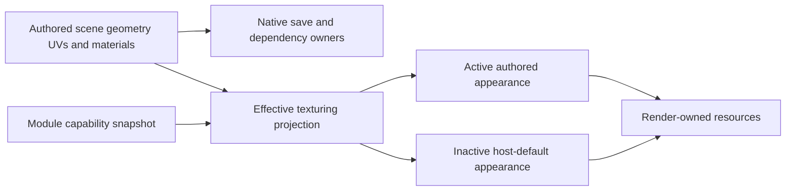

<!--
Copyright (c) 2026 Francesco Di Blasi. All rights reserved.
This document is part of Quader and is protected proprietary material.
-->

# Texturing as Quader's first optional module

Research and design: 9 October 2026. Audience: Quader's development team.

This document analyzes extracting **Quader's existing texturing functionality** into its first private feature module. “Texture Package” means that whole capability package; it does not mean channel packing, a new painting engine, or a Substance Painter implementation. This is a design document, not an implementation or a claim that live toggling works today.

It builds on [the Blender plugin architecture study](BLENDER_PLUGIN_SYSTEM_RESEARCH.md). The user's clarified requirement is decisive: **public 0.1 must be able to activate Texturing as a module**. Its default is off; Full's default is on. The present immutable texturing gates must be reworked. Keeping Texturing permanently unavailable in 0.1, or testing activation only in Full, would not satisfy this design.

## 1. Required outcome and recommended approach

Implement a private, initially linked Texturing module with runtime activation. Keep the data representation, preservation services and basic default-material rendering in the host. Turning the module off disables texturing authoring and presentation, while its authored materials, textures, assignments and UV data remain in their existing owners. Rendering consumes a default projection until reactivation.

This avoids turning disable/enable into a destructive reset followed by replaying an old scene backup. It also makes disabling useful for diagnostics without requiring a process restart or losing subsequent modeling edits.

| Requirement | Design commitment |
| --- | --- |
| Public 0.1 can use Texturing | Module is present and permitted in the experiment; default off; activation genuinely enables its APIs, tools and UI |
| Full can disable Texturing | Default on, with the same runtime off/on contract |
| Settings lists modules | Add a Modules category to the existing native Settings dialog |
| No normal restart | Apply the transition while the application runs; keep native implementation code resident |
| Off removes texturing effects | Hide/deactivate module contributions and use host-default material/mapping inputs |
| Off does not destroy work | Preserve authored data, references, preferences and unsaved material drafts |
| Off can survive save/reopen | Core IO understands and preserves current texturing data without active editing services |
| On restores work | Re-evaluate preserved current data; do not restore stale geometry or deleted objects |
| Future separately sold functionality | Separate runtime activation from installation/permission; do not implement a sales/licensing system in this experiment |
| Public APIs support the workflow | Add a module lifecycle/capability facade and extend existing owner APIs where identified below |

The normal path should not need a reload action. A controlled resource rebind can be part of the transition. If an owner cannot yet quiesce safely, report the failure and keep the module's prior effective state; do not silently restart, discard drafts or label a partial switch successful.

## 2. What Blender does when the add-on is missing

### 2.1 Evidence boundary

The same local Blender source snapshot was inspected again:

`C:/Users/Drako/Desktop/_QUADER_DEV/resources/_SOURCE_CODE/blender-main`

Its version header identifies **5.2.0 alpha**, patch 0, file subversion 26. There is no Git metadata, so no upstream commit is asserted. These are source-derived findings; Blender was not run for this task. The source fingerprints and navigation references at the end identify the evidence.

The important distinction is between an add-on's executable behavior and data stored in Blender's own document structures. Missing implementation does not automatically imply missing data, or identical output.

### 2.2 Ordinary data generally remains ordinary data

**Observed:** `material_blend_write` writes material data and its embedded node tree. `mesh_blend_write` writes mesh attributes, UV-map names and material-slot pointers. Neither serialization path requires the add-on that created them to remain enabled. Node-tree serialization writes supported nodes, properties, sockets and links through host code. [B01], [B02], [B03]

**Meaning:** if an add-on creates an ordinary material using built-in nodes, assigns it to a mesh and changes UVs, disabling/removing that add-on normally leaves those authored results in the scene. Built-in rendering can continue to use them. Blender's generic add-on disable operation does **not** automatically change every affected mesh to a default material or neutralize UV edits.

The generic loader calls the add-on's own `unregister()` function. A particular add-on can explicitly delete data in that function; the host's storage model does not prevent such custom behavior. [B04]

Quader's requested “off means default appearance” is therefore an explicit product policy to implement, not behavior inherited by imitating Blender's loader.

### 2.3 Stored property values can outlive Python type definitions

**Observed:** `BKE_id_blend_write` writes ordinary and system ID properties, and the generic read path reconstructs those stores. ID-property serialization supports groups, primitive values and arrays. Unregistering a `PropertyGroup` frees its runtime RNA definition; it does not walk every data-block and delete all stored values. Dynamic RNA property-definition removal is similarly distinct from deleting instance data. [B05], [B06], [B07], [B08], [B09]

The local Python example explicitly distinguishes saved assigned values from class definitions that must be registered again. [B10]

**Supported inference:** compatible, host-serialized values attached to retained owners can survive opening and saving while the add-on's definitions are absent. Re-registering compatible definitions can restore typed access. The former Python attribute is not necessarily usable while its definition is missing.

This guarantee is bounded:

- WindowManager properties are excluded from `.blend` persistence in the examined writer.
- Custom getter/setter callbacks can use external or custom storage; automatic property persistence cannot be assumed.
- A value never assigned may exist only as a runtime default, rather than stored document data.
- Incompatible replacement definitions can invalidate stored property values on access.
- Unknown property primitive types are not universally preserved as opaque bytes.
- Normal save can omit unused local data-blocks with zero users. References or another retention policy matter. [B05], [B07], [B11], [B12], [B13]

The transferable principle is durable host-owned data independent of editing UI. It is not a blanket claim that every add-on object survives every save/version combination.

### 2.4 Missing custom nodes retain some structure, not their evaluator

**Observed:** Blender stores node IDs, properties, sockets and links separately from runtime type information. Missing types receive undefined fallback type information. Type registration revisits matching existing nodes, allowing compatible implementations to reconnect. [B03]

However, unsupported socket representations/links can be removed, and unknown built-in nodes from newer Blender versions have explicit loss-of-type-specific-data paths. Native type-specific storage may also depend on the registered type's serialization callbacks. [B03]

**Meaning:** a recognizable graph can remain while its evaluator is unavailable. This does not establish universal lossless preservation of arbitrary unknown plugin data. Quader should keep current material/UV schemas readable in its core, rather than depending on a hypothetical opaque plugin format for this first module.

### 2.5 A missing renderer is an example of retained intent plus fallback

**Observed:** a scene stores its render-engine identifier. File-load reporting diagnoses an unavailable engine/add-on. Runtime engine lookup can fall back to EEVEE without rewriting that stored identifier; an explicit user choice of another engine does change it. [B14], [B15], [B16]

This is a useful analogy for Quader: retain the authored request and use a temporary effective fallback. It does not mean the fallback image matches the original rendering. Engine-specific settings survive only to the extent that they were stored in a supported persistent representation.

Likewise, serialized driver expressions can remain after their custom Python functions disappear, while evaluation fails or produces fallback results. Stored instructions are not the missing implementation. [B17], [B18]

### 2.6 Direct answer to the missing-plugin question

| What the add-on produced | Expected behavior from examined Blender paths |
| --- | --- |
| Ordinary mesh, UVs, material assignments, built-in shader graph | Data is serialized by Blender; absent authoring add-on does not by itself reset appearance |
| Assigned supported custom-property values on retained document owners | Values can survive; typed UI/access requires compatible definitions again |
| Python-only variables, arbitrary caches or WindowManager properties | No general `.blend` preservation guarantee |
| Custom node graph | Supported stored structure can remain with undefined types; evaluation and arbitrary type-specific preservation are not guaranteed |
| Missing render engine | Stored engine choice can remain while runtime fallback/reporting takes effect |
| External images or unsaved pixels | Survival depends on actual saved/packed data and available dependencies; an add-on manifest does not embed them |
| Explicit destructive unregister code | Behavior depends on that add-on; the generic disable path does not prevent it |

For Quader, adopt three explicit contracts: **preserve authored texturing**, **substitute default effective appearance**, and **restore interpretation on activation**. Saving must use the authored representation, never the temporary default projection.

## 3. Define the Texturing module's boundary

### 3.1 Existing functionality to include

| Existing capability | Current entry points/owners |
| --- | --- |
| Standard material authoring: albedo, roughness, metallic, normal textures, normal strength/convention, diffuse model, texture transforms | `QuaderStandardMaterialDocumentsApi`, `StandardMaterialEditSessionService` |
| Material/texture discovery, import, thumbnails, information and asset organization | `QuaderProjectAssetsApi`, project asset/material services and existing browser/editor widgets |
| Object and per-face material assignment, sampling, current material, transfer and find/replace | `QuaderModelingApi`, `QuaderToolsApi`, `QuaderMaterialsApi`, `MaterialReferenceService` |
| Select faces with the same material | `QuaderSelectionApi::select_faces_with_same_material` |
| Face texture fields, canvas gestures, scale/shift/rotation and mapping actions | `QuaderModelingApi` face-texture methods and the Face Texture panel/canvas |
| Projection, fit/justify, flips and face-to-face continuation | Existing face-texture action/transfer owners |
| UV Peel and its tool options | `UvPeelToolService`, existing native viewport tool lifecycle |
| Texture Lock and Texture Lock Scale authoring controls | `QuaderPreferencesApi`, `ViewportSettings`, transform integration |
| Texturing presentation | Material/texture windows, relevant Inspector fields, toolbars, menus, context actions and shortcuts |

These are existing behaviors to encapsulate, not algorithms to rewrite. The module primarily introduces composition, runtime availability and coherent suspension. [Q01], [Q02], [Q03], [Q04], [Q05], [Q06]

### 3.2 Adjacent features need explicit treatment

**Proposed membership:** include the existing material inspection modes and Rendered viewport presentation needed to inspect authored materials. Split their effective availability from the current broad release-only `RenderedViewport` gate. This grants material presentation, not permission to author lights, environments, fog, camera settings or postprocessing. Verify rendering with the base scene/default environment when those other capabilities remain unavailable. [Q07], [Q08]

Mesh Surface Grid is a separate existing feature with Grid settings. Leave its current availability unchanged in this experiment. Texture painting, layer compositing, channel packing, baking, procedural materials and a node editor are also outside this extraction.

If implementation finds that a specific material inspection mode requires another subsystem, expose the necessary read/render service narrowly; do not enable every Full feature as an implicit dependency.

### 3.3 What must remain in the host while the module is off

- Mesh UV/material attribute storage, stable identities, attribute remapping and history replay.
- Current QDR/QMAT/project readers and writers, dependency discovery and safe file operations.
- Default Quader material bootstrap and ordinary Wireframe/Solid/Shaded rendering.
- The existing application default-image preference; changing that preference is already base 0.1 behavior.
- Core asset retention/reference accounting, including hidden texturing dependencies.
- Generic scene/folder browsing; the Asset Browser itself remains available.
- Shared lifecycle code needed to preserve, recover or save already-authored material drafts.

“Move the whole texturing package behind a module” means its optional authoring/evaluation/presentation behavior. It cannot mean removing the data substrate required to preserve textured projects in the plain modeler. The host may know how to store UVs and materials while refusing new texturing authoring requests. [Q09], [Q10], [Q11]

## 4. Required rework of release gating

### 4.1 Why an extra checkbox is insufficient today

`Materials` and `UvEditing` are currently unreleased immutable `ReleaseFeature` values. `QuaderEditorApi::feature_available()` reports that release policy. Calls to `release_has_feature()` exist in APIs, owner services, command/input catalogs, UI construction, rendering and file-open validation. In public 0.1 they reject before the feature runs. [Q12], [Q13]

Adding `module_enabled && release_has_feature(Materials)` would leave 0.1 permanently unable to enable the module. That is explicitly rejected by the requirement.

### 4.2 New effective policy

Introduce one application-owned capability policy, available to headless sessions as well as the Qt application:

```text
For Texturing-owned capabilities:
candidate_activation = implementation_present
                       AND permitted_for_this_installation
                       AND desired_enabled

effective = last_successfully_committed_capability_snapshot

For unrelated capabilities:
keep the existing product-release policy
```

Pending desired state is separate from the committed snapshot. Requesting disable must not revoke the capability needed to settle existing tools; requesting enable must not permit authoring before preparation finishes. Publish a new effective snapshot only at the transition's commit point.

For the first experiment, both Full and public 0.1 have the implementation and permission. The only default difference is requested state. Future paid entitlement can supply `permitted_for_this_installation`; it must remain distinct from the preference. This document does not propose license servers, checkout UI or DRM implementation.

Do not change `current_product_release()` to Full, mutate the release enum, or make all historical release checks return true. Move Texturing-owned decisions to the new policy deliberately and leave unrelated capabilities alone.

| Profile/state | Texturing | Unrelated Full-only functionality |
| --- | --- | --- |
| Full, no stored preference | Active | Existing Full policy |
| Full, disabled | Inactive/default appearance | Existing Full policy |
| Public 0.1, no stored preference | Inactive/default appearance | Remains unavailable |
| Public 0.1, enabled | Fully usable Texturing module | Remains unavailable |
| Either, implementation absent or incompatible | Data preservation/default appearance where format supported; no authoring | Independent policy |

### 4.3 Scope of the gate migration

| Layer | Required work |
| --- | --- |
| API and service mutations | Migrate material/texture/UV-specific release checks to effective Texturing capability; reject before mutation, IO or preview settlement for ordinary denied requests |
| Command and input ownership | Update material assignment, `texture.*`, UV tools/actions, same-material selection and texture-lock requirements; retire pending texturing gesture/chord reservations on disable |
| UI | Replace construction-only assumptions with capability-aware retained composition; restoring a layout cannot expose an inactive module panel |
| Catalogs | Eliminate once-filtered static lists where runtime availability must change |
| Rendering | Use effective material/mapping policy and a capability revision in outer and inner cache gates |
| File IO | Separate supported texturing data from permission to author it; disabled module must not make preserved material content unopenable |
| Headless/automation | Apply the same owner policy even without the Settings dialog or `QuaderEditorApi` UI attachment |

`viewport_settings_sections()` and related functions currently construct static filtered lists for immutable release availability. Merely replacing their condition with a runtime boolean would freeze the first result. Keep full descriptors with filtered projections keyed by capability revision, or rebuild the retained projection on policy changes. [Q14]

### 4.4 Preserve existing API meanings

Keep `release_info()` and its immutable release identity. Do not silently reinterpret a documented release-only query as runtime activation. Add an effective-capability query and migrate callers that need actual current availability. Historical release descriptors can remain for compatibility while module membership is represented explicitly.

Both the direct document/modeling API and whole-editor API must share this policy. A toggle applied only in `UISystem` would leave automation, alternate entry points and owner callbacks able to execute disabled features.

## 5. Authored state and effective state

### 5.1 Disable is suspension, not resetting assignments

Keep one authoritative copy of materials, UVs, assignments and mapping data in the existing document/modeling/asset owners. Do not replace every assignment with the default and maintain a second mutable “texturing backup scene.”

The effective render state chooses between authored interpretation and host defaults:



Native save/dependency queries deliberately bypass the effective-default substitution. Reactivation switches interpretation back to the **current preserved data**, including legitimate modeling edits made while the module was off.

### 5.2 What off means visibly

**Proposed contract:** no authored material albedo/tint, normal, roughness, metallic, material transform or authored face-mapping effect contributes to appearance while off. Use the host default material, including the user's existing global default-image preference where that mode normally uses it. Solid retains its normal flat-color behavior; generic scene/object display colors, selection and overlays are not erased merely because Texturing is off.

Material-only debug modes and other module-owned presentation become unavailable. Retain the requested per-pane mode and use an effective supported fallback such as Shaded. If the user explicitly chooses another available mode while off, that newer choice wins; reactivation must not overwrite it with a stale remembered mode.

Close/hide module windows and sections through their owners. Preserve user panel-placement and shortcut preferences without keeping active texturing pointer routes, hover behavior or expensive thumbnail/material-preview jobs.

### 5.3 Default UV appearance needs its own solution

The current public render path already substitutes default material evaluation without changing authored assets. However, render extraction still consumes effective authored texture sampling, and compiled geometry retains authored UVs. Therefore, material substitution alone does **not** prove that a default checker will ignore previous UV edits. [Q15], [Q16], [Q17]

If off must remove all authored texturing effects, provide a host-owned **derived default mapping projection** for the current geometry. It should follow the plain modeler's agreed default scale/orientation policy, bypass authored face/material mapping transforms and leave stored UVs untouched. Cache it by geometry/occurrence/default-policy revisions. Do not recompute or upload it on every unchanged frame.

The first implementation must define and test the mapping convention for imported meshes, generated geometry, instances and previews. Never substitute zeros blindly or bake fallback UVs back into the modeling document. Existing public material-fallback tests are a starting point, not evidence that this stronger mapping requirement is already satisfied.

### 5.4 Exact restoration has a precise boundary

| Action while off | Reactivation result |
| --- | --- |
| Only inspect, toggle, save and reopen | Authored values/references return unchanged, subject to supported schema and available source assets |
| Move/rotate/scale geometry | Keep the new geometry and apply the existing owner-defined passive UV/texture-lock maintenance policy |
| Duplicate/split/extrude/delete faces | Surviving attributes and remaps follow modeling contracts; new elements receive defined defaults/inheritance; deleted elements are not resurrected |
| Delete a textured object | The object remains deleted; undo is the explicit route to recover it |
| Change the global default-image preference | Off appearance changes; original authored materials remain unchanged |
| Move/change an external asset | Resolve by stable identity and source revision; diagnose missing/conflicting data rather than fabricate an exact restoration |

An immutable backup of pre-disable geometry would fail this contract. Core modeling still needs passive attribute/reference maintenance while Texturing is inactive. Disable removes feature interaction and visible evaluation, not every CPU operation touching a UV field.

**Chosen passive-maintenance policy:** retain the user's stored Texture Lock and Texture Lock Scale settings and continue using them for dormant authored attributes during ordinary modeling. With no stored preference, the plain/base defaults remain Texture Lock on and Texture Lock Scale off. Each gesture captures its maintenance settings at its start, as the existing mapping owner expects. Hiding the controls must not change those captured settings or previously authored compensation. [Q14], [Q44]

Today some getters substitute immutable public defaults. The gate migration must give the maintenance owner access to the retained preservation settings instead of accidentally routing it through an inactive-UI getter. Effective default rendering remains independent and ignores authored mapping even while those attributes are maintained. Preferences retain their existing installation/profile scope; opening a file does not invent a missing preference from the originating machine.

## 6. Live activation and deactivation

### 6.1 Keep the first module linked and its data services resident

The module can be a private CMake feature target with an internal descriptor and factories. Its UI, active tool sessions and expensive preview resources are optional. The code required by document readers and existing history entries stays loaded.

This is sufficient for live toggling and encapsulation. Physically unloading a DLL is a different problem: history commands, queued Qt callbacks, image jobs and upload-completion callbacks can retain code/data references. No native binary hot-unload or public plugin ABI is needed for this experiment.

Keep stable command identities and user binding overrides registered. Effective availability suppresses their discovery/dispatch while off. Re-enabling must not recreate shortcuts from defaults or overwrite user customizations.

### 6.2 Disable sequence

1. **Validate intent and guard the transition.** Resolve module identity and requested state. An identical request is a no-op. Reject overlapping transitions or incompatible state. Immediately prevent new affected authoring and conflicting scene/project replacement while allowing trusted coordinator settlement; keep the prior effective snapshot active.
2. **Prepare preservation and fallback.** Check all open scenes, active previews, the project-owned material document, pending imports and output consumers. Capture identities/generations and prepare the fallback policy/resources and draft-recovery operation. Revalidate them after asynchronous work before committing.
3. **Settle active texturing interactions while capability is still active.** Finish the face-canvas gesture or UV Peel through its existing lifecycle. Accept a valid pending operation according to Quader's tool policy; only explicit Cancel/Discard rolls authored work back. Settle a material picker into its existing draft, not automatically into its saved `.qmat`.
4. **Secure dirty material state.** Preserve the draft and imported bytes in its current owner and complete its durable suspension checkpoint. A storage failure prevents successful deactivation.
5. **Quiesce and commit persistence.** Retire pointer/chord reservations and cancel or invalidate thumbnail, preview and image tasks. Keep safe ownership for already-running work. Finish all fallible preparation, revalidate generations and atomically persist the desired preference as the last fallible transition step. If it fails, abandon candidate resources, release the guard and retain the prior effective policy and accepted authored work.
6. **Publish inactive effective capability and a new presentation generation.** Perform a prepared, non-failing host policy swap; defer subscriber notifications until that swap completes. All retained consumers switch coherently: UI, tools, material binding, default UV projection, viewports and effective export policy. Their required fallible preparation belongs before this commit.
7. **Retire unused presentation resources safely.** Release old material/texture resources only after retained render submissions and asynchronous uploads are safe. Hide module UI without discarding documents or settings.
8. **Release the guard and report completion.** A successful result means effective state and stored preference agree. If the process exits between durable preference commit and in-memory publication, the next startup applies the committed preference using the preserved document/recovery state.

Order matters: `UvPeelToolService::apply()` and material preview/edit methods currently check feature availability. Flipping the capability first can prevent their proper completion. [Q06], [Q02]

The effective switch should be atomic from consumers' perspective, using one published policy snapshot. Preparation/settlement can still accept a legitimate pending edit before a later failure. If that happens, retain the accepted authored edit and its history, keep the module active and report the failure accurately. Do not claim the entire editor state is unchanged or invoke ordinary Undo as a hidden rollback mechanism.

### 6.3 Enable sequence

1. Validate implementation presence, permission and compatibility; neither the current selection nor a focused viewport is required merely to activate.
2. Read preserved authored data and validate any suspended draft's baseline/recovery metadata.
3. Prepare module contributions and required presentation resources under a scoped activation lifetime and transition guard; reject conflicting new work and revalidate captured generations after asynchronous preparation.
4. Rebind current document/material sessions with fresh generations, never stale pointers from before disable.
5. Finish all fallible preparation and atomically commit the requested preference before the prepared non-failing policy swap, following the same persistence/guard rules as disable. Publish effective capability and increment the presentation generation; restore authored evaluation in every affected viewport.
6. Restore applicable user UI/tool preferences without overriding choices explicitly changed while off. Release the guard and notify subscribers after publication.

Failure leaves preserved data intact and the default projection active. Missing source textures use the existing missing-asset diagnostic/fallback policy; do not erase references or pretend a lost external file has been restored.

### 6.4 What a “reload” may mean

A resource-only rebind can recreate panel bindings, material instances, decoded-image caches and module subscriptions from preserved owner data. That can support future diagnostics if needed. It must not reload the project from disk over unsaved geometry or material drafts.

No separate Reload button is necessary for the first design. Add one only if implementation demonstrates a specific transition that cannot be safely completed by the normal owner-driven rebind. Replacing binary code remains a restart operation, distinct from activating existing functionality.

### 6.5 History while inactive

Existing scene history remains chronological. Undo/redo of an earlier UV/material assignment updates dormant authored data while rendering remains default. Do not skip texture entries, clear history, or make an undo implicitly activate the module.

Gate new explicit texturing requests; permit trusted owner restoration paths. Existing face-texture history commands already restore captured state after first execution, which is useful for this separation. Structural snapshots include material and texture-mapping components. [Q18], [Q19]

The Standard Material editor is project-owned, while scene history is scene-owned. This extraction must preserve their current semantics; it must not silently add shared material-draft edits into multiple independent scene histories. Cross-domain history generalization is not required to toggle today's package.

## 7. Unsaved material drafts require new preservation work

### 7.1 What the current code actually retains

`StandardMaterialEditSessionService` owns a draft independently of the saved catalog. Its private draft retains pending imported-image data, including encoded bytes and metadata. The public snapshot exposes pending source paths, which are insufficient to recover an import after the source file disappears. [Q02], [Q20]

`close(false)` settles the color picker and then rejects a dirty draft; `close(true)` discards it. Neither is a suspension operation. Material `save`, `save_as` and `save_to` currently reject when Materials is unavailable. [Q02]

Also, current scene Save All and scene autosave do **not** save dirty Standard Material drafts. Project-close handling has separate dirty-material resolution. Disabling the UI cannot bypass that obligation. [Q21], [Q22], [Q23], [Q24]

### 7.2 Required draft suspension contract

During the current process, keep the same authored draft, dirty status, pending imported bytes and source baseline. Release only derived previews that can be recreated. Accept the active picker into the draft through its owner before hiding it.

For survival across restart, add an atomic, versioned **host-owned draft recovery checkpoint**. It should include:

- Project identity and draft/material identity.
- Saved asset identity/path, when any, and expected source content revision.
- Complete material draft document and dirty state.
- Pending imported encoded bytes and the metadata needed to finish the import.
- Schema/version and validation information.

Use existing project containment/recovery conventions, with an explicitly owned reserved recovery location; do not create a second normal `.qmat` catalog or overwrite the user's material file during disable. For an unnamed draft, recovery identity must not depend on an eventual filename. A recovered runtime session gets a fresh generation.

A complete checkpoint must precede successful deactivation when a dirty material draft exists. Later startup can restore that draft in a suspended state even if Texturing remains off. Saving it is an explicit document-lifecycle action, not an automatic side effect of reactivation.

Before a recovered draft overwrites its saved target, compare the baseline revision and validate identity/deletion records. If the `.qmat` changed externally, retain both the recoverable draft and the current file and report a conflict. Do not overwrite newer material data merely because a checkpoint exists.

Recovery records also need a complete lifecycle. Use monotonic draft/checkpoint generations, and durably supersede or complete a record after successful save, Save As or explicit discard. Asset moves update identity/path metadata through their owner; deletion records prevent revival of retired assets. When editing resumes, the old suspension checkpoint must not outrank newer recovery or a later saved baseline. Integrate saved-generation identity or a completion marker with recovery reconciliation so a successful `.qmat` save followed by failed checkpoint cleanup cannot resurrect the old dirty draft. File deletion alone is not a sufficient completion protocol. A crash before completion reconciliation must detect the saved generation or report a recovery conflict, never silently replay obsolete work.

### 7.3 Core lifecycle operations while editing is disabled

The shell must still be able to list hidden dirty documents, recover them, explicitly save an already-authored draft or explicitly discard it during close. Those operations need a preservation/lifecycle route independent of permission to create/edit new materials. This is not a general bypass allowing inactive texturing mutation.

Do not auto-save drafts as `.qmat`, invoke scene Save All as a substitute, or call `close(true)` as cleanup. An explicit user discard can retire its checkpoint. Ordinary disable cannot.

The first implementation should keep the existing meaning of scene Save All unless deliberately expanded and documented. Recovery protects hidden drafts separately. A checkpoint is recoverable work, not proof that the user completed a normal save.

## 8. Save/open with Texturing disabled or absent

### 8.1 Existing authored storage is already in the right broad owners

| Data | Current authority |
| --- | --- |
| Per-corner UVs, face slots and face texture transforms | Portable modeling document/QGEO |
| Object material and slot bindings | Scene material components |
| Entity/occurrence texture sampling compensation | Scene texture-mapping owner |
| Embedded material and texture definitions | Asset registry and native QDR serialization |
| Reusable project material definitions | `.qmat` and project material catalog |
| Project texture identities/paths/retirement records | Project manifest and texture catalog |
| Dirty material and staged imports | Material edit-session owner; new recovery checkpoint required |

Keep these current schemas readable and writable by the plain host. No duplicate opaque texturing blob is needed to preserve today's known fields. Native save serializes those authored owners even while rendering defaults. [Q25], [Q26]

### 8.2 Three existing compatibility barriers must change

1. `ProjectSession::preflight_open()` checks the project manifest's minimum product release.
2. `QdrDocumentReader` checks the scene container's minimum product release.
3. `unsupported_authoring_content()` separately rejects non-default material references when Materials is unavailable, even when the release tag passes. [Q21], [Q27]

Save capture also raises requirements using the current executable release. A Full save can therefore remain marked Full regardless of whether Texturing was disabled at the time. Project manifest creation has a related executable-release assumption. [Q21], [Q28]

Consequently, changing the renderer and command gates alone would still fail the required workflow: **author textures, turn off the module, save, reopen in 0.1, reactivate**.

### 8.3 Required compatibility policy

Separate these questions:

| Question | Governing policy |
| --- | --- |
| Can this build decode and preserve the file? | Supported file/container/schema revisions and required preservation contracts |
| Does it support the non-module authored scene features? | Core feature compatibility, retaining independent restrictions |
| Is the Texturing implementation installed/compatible? | Module catalog/build compatibility |
| May the user author with it now? | Effective runtime capability, later optionally entitlement |
| How should the scene currently look? | Active authored versus inactive default projection |

Known Texturing data must be loadable and preservable in the new 0.1 host while the module is inactive. Missing permission or disabled preference cannot be treated as a malformed material file. Unknown/unsupported schemas remain a compatibility issue and must reject safely if the host cannot preserve them.

For newly written files, derive the requirement from supported authored content and format contracts, not simply the executable that last saved them. Record optional module involvement separately from mandatory reader support. Update QDR and project manifest policies together; add versioned metadata only where needed to express the contract, with fixtures for old readers and older files.

Enabling Texturing in 0.1 must not permit unrelated authored Lights, Curves, Instances, Layers or unsupported scene settings through file-open validation. Keep those checks independent. Disabling Texturing also must not lower technical file requirements or falsely label unrelated Full content as public-compatible.

### 8.4 Legacy Full-tagged files

Do not globally treat the existing Full sentinel as public-compatible or remove the minimum-release check. A legacy file may contain many unrelated Full-only features.

Provide a validated inspection/migration route that inventories the actual content and establishes a new compatibility descriptor. Only base-compatible content plus supported Texturing data qualifies for the new 0.1 workflow. Preserve originals on failed conversion. A pure header patch is insufficient because both content and dependent project assets require validation.

This migration is required if existing compatible Full-authored textured projects must open in the new 0.1; the implementation is not complete by demonstrating only freshly created files. Testing must include both manifest and scene requirements.

### 8.5 “Module absent” still requires a data-preserving host

An installation without active Texturing editing code can honor the contract if the host retains the known material/UV codecs and dependency services. It cannot honor it by refusing to deserialize all texturing data or by serializing only visible/default material records.

Current QDR tolerance of unknown noncritical chunks is insufficient for arbitrary future plugins: the write snapshot has no opaque extension store and the writer reconstructs known metadata/geometry chunks. Such chunks can be accepted without being retained on a later save. [Q29], [Q30]

That future generalization needs a real payload/reference/migration contract. It is not a reason to move current UV/material truth out of existing schemas. This targeted design strengthens the first report's exploratory missing-module policy: **recognized current Texturing data must survive; rejection is reserved for genuinely unsupported data or unrelated incompatible features**.

### 8.6 Dependencies remain live even when their appearance is hidden

Dependency collection must read authored references, including dormant slots and hidden material drafts. Visible material usage and safe-deletion dependency sets are not interchangeable. A material can have no current effective pixels and still be required for reactivation. [Q31]

Disabling must not retire IDs, recycle texture files, clean “unused” authored materials or rewrite saved scenes to defaults. Generic folder moves/deletes still need conservative dependency checks. If a bulk operation cannot preserve hidden dependencies, reject that operation with its existing safety semantics rather than silently dropping them.

Restoration can only reproduce external textures that remain available or were actually imported/retained. Treat missing image bytes separately from a disabled module; neither should cause material references to be deleted.

## 9. Public API work

These names are proposed design sketches, not implemented declarations. Here “public API” means Quader's existing native consumer-facing facades for UI, automation and tests; it does not mean publishing a third-party module SDK.

### 9.1 New module facade

Add `QuaderEditorApi::modules()` returning a small `QuaderModulesApi` facade over an application-owned module service.

| Proposed operation/data | Required contract |
| --- | --- |
| `catalog()` | Stable descriptors/IDs, implementation presence, default state and available transitions; no expensive scene traversal |
| `state(module_id)` | Requested and effective state, availability/permission, transition state and failure reason |
| `revision()` | Cheap monotonic capability/presentation stamp |
| `set_enabled(module_id, enabled)` | Owner-driven checked transition used by Settings, automation and tests; standard `ok()`, `changed()`, `value()`, `error_message()` result conventions |
| Transition result | Distinguish completed, pending and failed; never call a pending request “active” |
| State-change notification | Publish only after coherent state changes, with module ID and revision |

Use one stable ID, for example `quader.texturing`, with a typed C++ constant. Do not expose registrar internals, Qt objects, renderer pointers or mutable session owners. A long transition may return a tracked pending operation with completion notification; it must not block the GUI indefinitely waiting for a worker.

The service should exist independently of scene focus and remain queryable on the home screen. Standalone/headless editors need an explicit initial policy and the same transition contract, not a dependency on a Qt-only callback.

### 9.2 Effective capability queries and revisions

Add an explicit effective-capability query. Preserve `release_info()` and the documented release-only meaning of existing queries until callers are deliberately migrated. Return useful distinctions such as unavailable implementation, inactive module, transitioning and unsupported context instead of one ambiguous boolean where a diagnostic is required.

Propagate the capability revision into relevant command/tool availability caches, material presentation, face-texture interactive snapshots, viewport state and render source stamps. The current general `QuaderRevisionStamp` does not include it. An idle scene must update immediately after a toggle without changing selection or geometry to force refresh. [Q13], [Q32], [Q33]

Extend the existing events API with a module/capability change event and appropriate payload; reuse its subscription model. Do not invent an unrelated event bus. [Q34]

### 9.3 Existing authoring APIs should remain the entry points

Reuse material, project asset, modeling, texture gesture, selection and tool APIs. They already express the feature's operations. Migrate their owner gates; do not add a second `TexturingScene` or duplicate every method in a new facade.

Add a private transition coordinator that can preflight/settle/suspend the relevant existing owners. Public callers request a module transition; they should not manually discover and cancel every panel/tool themselves.

Extend `QuaderStandardMaterialDocumentsApi` with the lifecycle needed for suspend/recover and saving/discarding an existing suspended draft. Keep new material creation/edit/import denied while inactive. Checkpoint serialization belongs with the document/recovery owner, not in Settings.

### 9.4 Authored inspection must remain distinct from effective output

Current authored queries include materials/textures, entity material/mapping, compiled object mesh data and material-use information. Preserve their meaning while the module is off; returning default data there would corrupt diagnostics, dependency decisions and save workflows. [Q35]

Interactive canvas/options queries can report inactive/unavailable, since they represent an editing surface. Effective render/export queries need explicit projection policy. Do not silently change an authored query such as `compiled_object_mesh()` into a fallback mesh because a UI preference changed.

Generic mesh creation/replacement can carry UVs and material-slot attributes. These paths must continue to support imports and passive data preservation. They are not a security boundary preventing every possible UV byte change by a native client. Scope the capability to explicit authoring workflows and effective output, with clear contracts for generic data operations; do not erase valid UVs simply because they arrive through a geometry API.

### 9.5 Export needs an explicit policy too

The current OBJ exporter writes geometry, UVs and normals; it does not write an MTL or material references. Before writing, the project export path composes authored entity/occurrence texture mapping into the mesh. Renderer fallback does not affect that path. [Q36], [Q37]

**Proposed first-module contract:** ordinary user export while Texturing is off uses the effective default/base mapping policy, while native project save preserves authored texturing. Add an output-purpose/policy input to the export projection owner and apply it to a detached output value. Reuse the same default mapping semantics as the viewport where applicable.

This is a deliberate output-policy change that needs tests. Keep authored inspection/native serialization separate; do not rewrite SDK UVs to make an export appear untextured. If a future export feature writes material files, it must consume the same effective capability explicitly rather than inheriting accidental behavior.

### 9.6 Host-internal additions

| Owner | Needed extension |
| --- | --- |
| App/module composition | Descriptor, effective policy, transition orchestration and persisted requested state |
| Commands/tools/input | Capability-aware availability, transition settlement, stale gesture/generation rejection |
| UI | Retained panel/action contribution activation and suspension; safe draft binding teardown |
| Render/material presentation | Immutable module policy snapshot, revision propagation, authored/default projection and safe cache retirement |
| Project/IO | Preservation-capable content policy, revised compatibility metadata/validation and legacy migration |
| Material document/recovery | Durable draft checkpoint containing staged bytes and conflict-safe recovery |
| Asset safety | Dependency access unaffected by module visibility; no cleanup based on fallback appearance |

None of these requires exposing low-level SDK internals, Filament or Qt through the native public APIs.

## 10. Settings > Modules

Add one category, **Modules**, to the existing Settings dialog. Initially it lists one module, **Texturing**, with its enabled state and the native feedback needed when a transition is pending or fails. Use the existing palette, scaled layout, keyboard/focus behavior and localization. No marketplace, install browser, payment controls or unrelated redesign is needed.

**Recommended interaction:** keep the dialog's existing Apply/OK draft convention. Changing the row records the requested setting; Apply or OK performs the live transition without restarting Quader. Cancel before applying leaves actual module state unchanged. A failed transition keeps the dialog open and reports the owner error; it must not display a successful inactive state while authored presentation is still active. [Q38], [Q39]

This satisfies real-time use without making the Modules row an undocumented immediate-setting exception. API callers invoke the same transition directly. Capability events update the row when automation changes state, while retaining unrelated Settings drafts.

On the first run without a saved module preference, Full starts enabled and public 0.1 starts disabled. **The 0.1 row is usable**, not permanently locked by its historical release flags. Module state is an application preference, not an authored scene field; opening a textured project does not silently turn it on.

Full and Public already use separate settings roots: `%LOCALAPPDATA%/Quader` and `%LOCALAPPDATA%/Quader/Public` on Windows, with matching fallback separation. Reuse that existing isolation rather than introducing another directory scheme. The public root is shared across public releases, not one folder per version. [Q40], [Q41]

Layout restoration and module state must reconcile in the right order at startup. An inactive Face Texture panel must not reappear through a saved dock layout. On reactivation, restore applicable panel preferences without reopening every auxiliary window unconditionally or stealing focus.

## 11. Incremental implementation plan

This plan is future work. The current task produces only this document.

| Stage | Changes | Completion evidence |
| --- | --- | --- |
| 1. Establish runtime policy | Module descriptor/service, public lifecycle facade, Full-on/Public-off defaults, scoped gate migration | Actual Public-profile API tests activate Texturing and still reject unrelated Full features |
| 2. Extract composition | Private linked Texturing target/factories and contribution ownership; retain shared data/IO/history owners | Existing authoring behavior remains unchanged when active; no parallel scene or material state |
| 3. Support safe suspension | Aggregate settlement, dirty draft retention/checkpoint, worker generations and history behavior | Pending UV/material interactions survive checked disable; failures do not lose work |
| 4. Switch effective output live | Capability-aware UI/render/export, default material and derived mapping, retained cache invalidation | Real Qt/GPU evidence for stationary views, previews and repeated on/off cycles |
| 5. Make files module-independent | Supported dormant Texturing content in new 0.1, project/QDR compatibility policy and validated legacy migration | Full-compatible textured project opens/saves in 0.1 off and reactivates with preserved data |
| 6. Expose Settings workflow | Native Modules category wired only through lifecycle API; persistence/layout reconciliation | Apply/OK/Cancel, failed transition, API-driven change and restart tests |
| 7. Complete handoff | Ownership/style checks, risk-appropriate regression gate, both canonical Release builds | Verified Full and public 0.1 artifacts with documented feature behavior |

Stages can be developed together, but the deliverable is incomplete until dormant saving/reopening and actual 0.1 activation pass. A Full-only toggle demo does not meet the requirement.

Do not move all of `src/assets`, `src/render`, project IO or the portable modeling core into a new plugin directory. Feature composition may collect its adapters while package owners keep shared truth. Prefer narrow refactoring around existing owners over a rewrite of working material/UV algorithms.

If gate migration touches widely used headers or dispatch, preserve typed identifiers and existing naming policy from the first change. New command behavior and public-off/public-on baselines must be reviewed deliberately, not regenerated blindly to accept regressions.

## 12. Required verification

### 12.1 Profile and lifecycle matrix

| Test case | Required result |
| --- | --- |
| Fresh public 0.1 | Texturing off; base default-image and plain modeling workflows still work |
| Public 0.1 enables module | Material/texture creation, assignment, face texture editing, UV tools and module UI become usable through real APIs |
| Public 0.1 enables module | Lights, Environment, Curves, Instancing, Layers and other unrelated Full features remain gated |
| Fresh Full | Existing complete Texturing behavior |
| Full disables module | Same default/suppression contract as public-off, while unrelated Full capabilities retain their policy |
| Off/on with unchanged scene | Authored payload, references, binding overrides and stored preferences unchanged; appearance returns |
| Redundant same-state request | No dirtying, cache rebuild, image decode, event storm or preference rewrite |
| Failed transition | Prior effective state remains coherent; all accepted edits/drafts retained; accurate result describes any settlement |
| Toggle from home screen | Works without active scene; later documents inherit effective policy |
| Restart | Persisted requested state honored independently in Full/Public settings roots |

Run public activation tests in the actual public-profile test executable. Changing a Full test's mock checkbox is not evidence that the real 0.1 gates were migrated.

### 12.2 Preservation and file matrix

1. Author all supported material channels, transforms, per-face assignments and UV settings; disable; save; close; reopen while off; reactivate and compare authored values and pixels.
2. Repeat with embedded assets and project `.qmat`/texture references, multiple scenes and shared materials.
3. While off, transform, duplicate, extrude/split, delete and undo/redo through public APIs. Reactivation preserves the resulting geometry and the operation-defined dormant attributes.
   Include nondefault stored Texture Lock/Scale settings: disable, transform and re-enable must preserve their maintenance semantics while off pixels remain default.
4. Save compatible textured content in Full, open it in public 0.1 off, save there and enable. Cover new-format files and validated legacy conversion separately.
5. Attempt a legacy Full file with unsupported unrelated content. Reject safely before live publication; do not silently drop those features or rewrite its compatibility tag.
6. Disable with an unsaved material, active color picker, focused field draft and staged import. Preserve dirty state and actual imported bytes. Remove the original import source, restart, recover while off, enable, and explicitly save successfully.
7. Modify the saved `.qmat` externally while its draft is suspended. Recovery/save detects the baseline conflict without overwriting either version.
   Also simulate a successful Save/Save As followed by failed recovery-file cleanup; startup must not resurrect the superseded dirty generation. Cover explicit discard, asset moves/deletion and resumed editing.
8. Close or replace a project with hidden dirty material work. The shell still invokes dirty-document resolution; Cancel preserves the project and checkpoint.
9. Dependency/deletion tests continue to see dormant references; default rendering never makes a used material safe to delete.
10. Test module implementation absent with the preservation-capable host. Unsupported schemas fail conservatively; supported current material/UV data survives.

History is not currently serialized by normal project save. Preserve live history through toggles; do not claim reopening reconstructs the undo stack. The restart promise concerns authored data and the newly designed draft recovery record.

### 12.3 Visual, input and resource matrix

- Real viewport pixels for authored versus default output across meshes, instances where the build permits them, curves where permitted, retained batches and live previews.
- Authored UV projection deliberately changed before disable; off default mapping must not inherit it. Re-enable restores it without modifying document attributes.
- Material shading/normal/roughness/metallic and any depth/opacity-related consumers switch coherently; geometry, selection, picking and outlines remain correct.
- Stationary scene and stationary preview update on capability revision alone; unchanged later frames reuse caches and uploads.
- Pending UV Peel, face-canvas gesture, field edit and material picker settle before the gate changes. Late callbacks and worker completions cannot republish authored appearance while off.
- Repeated toggles retire obsolete material/texture resources safely and do not accumulate widgets, subscriptions, decoder jobs or GPU uploads.
- Existing custom keybindings survive; inactive texturing shortcuts/pointer targets cannot execute through hidden controls or saved layout state.
- Native Settings at 100% and 200%, narrow supported width, keyboard navigation, focus, High Contrast and scale-down; no widget lifetime errors on activation while Settings is open.
- OBJ output follows the chosen effective default UV contract while disabled, while `.qdr`/`.qmat` preserve authored data. Verify that the current exporter is not incorrectly assumed to emit MTL files.

Existing suites provide useful fixtures: [public render][T01], [public modeling][T02], [public UI][T03], [public asset browser][T04], [public scene assets][T05], [face canvas API][T06], [material documents][T07], [Settings dialog][T08] and [QDR IO][T09]. In particular, current tests already cover passive UV storage and default-material rendering without authored asset mutation. They must be extended for the runtime state matrix, not simply removed because public activation is now allowed.

This implementation would change shared capability/dispatch and persistence behavior. Plan the full regression gate for its delivery, with focused tests during iteration according to repository policy; do not stack equivalent unchanged verification runs. Both Full and Public Release executables are required when implementation is delivered. No native build is needed for this research-only document.

## 13. Design decisions and limits

**Fixed by the request:** public 0.1 activation, runtime Settings control, default appearance while off, preserved authored data, restoration after reactivation, and documenting necessary API/gate changes.

**Recommended here:** linked module first; Materials/UV authoring plus material-inspection presentation; core data preservation; Apply/OK live transition; one default mapping policy; native saves preserve authored state while ordinary disabled exports use effective output; dirty material suspension checkpoints; validated compatibility migration.

**Not included in this experiment:** public plugin installation, licensing/payment implementation, arbitrary binary hot reload, a new painter, general shader graphs, arbitrary unknown-plugin payload editing, or unlocking unrelated Full functionality.

Implementation still needs to select the exact canonical default mapping convention and compatibility metadata encoding from their owner constraints. Those are bounded implementation decisions; they cannot weaken the fixed restoration or public-activation requirements.

The most important architectural result is that **feature availability, saved-data compatibility and visible appearance become separate policies**. Current release gating often combines them. This first module succeeds only when they are separated consistently across APIs, services, UI, render, export, project IO and recovery.

## 14. Evidence and validation record

Quader evidence describes the current working tree based on commit `72d353a0a0b36e68bdbe8f833a087ef639931093`, including pre-existing uncommitted changes. That commit alone does not reproduce the working-tree observations. No existing implementation files were changed by this task.

Blender source was inspected independently for behavior; no source implementation, asset, shader or temporary reference prototype was copied into Quader. This report's architecture is a proposal developed for Quader's owners. The source establishes the described mechanisms; it does not replace runtime tests of the future implementation.

### 14.1 Blender navigation

| Ref | Source | Relevant behavior/location in this snapshot |
| --- | --- | --- |
| B01 | [Material serialization][B01] | `material_blend_write`, lines 202–230 |
| B02 | [Mesh serialization][B02] | `mesh_blend_write`, lines 328–425 |
| B03 | [Node storage and runtime types][B03] | Serialization 1227–1322; unsupported sockets 1362–1397/1859–1882; reconstruction 2013–2049; type updates 2484–2602; unknown nodes 5510–5556 |
| B04 | [Add-on loader][B04] | `disable`, lines 566–613 |
| B05 | [ID writer][B05] | `BKE_id_blend_write`, lines 2640–2660; WindowManager exclusion |
| B06 | [Generic file reader][B06] | Property stores, lines 2292–2301 |
| B07 | [ID-property codec][B07] | Recursive write 1500–1539; read 1696–1773; unknown-type handling |
| B08 | [PropertyGroup registration][B08] | Runtime group definition/unregistration, lines 667–680 |
| B09 | [RNA property-definition removal][B09] | Dynamic definition removal, lines 5011–5052 |
| B10 | [PropertyGroup example][B10] | Saved values versus class definitions, lines 5–21 |
| B11 | [RNA access validation][B11] | Incompatible stored properties 444–504/562–574; pointer group interpretation 4510–4545 |
| B12 | [Custom property callbacks][B12] | Custom storage semantics, lines 135–143 |
| B13 | [File writer][B13] | Zero-user local data-block handling, lines 1665–1679 |
| B14 | [File-load report][B14] | Missing render-engine reporting, lines 631–654 |
| B15 | [Render engine lookup][B15] | `RE_engines_find`, lines 102–111 |
| B16 | [Scene engine RNA][B16] | Stored engine getter/setter, lines 1844–1890 |
| B17 | [FCurve storage][B17] | Driver data write/read, lines 2595–2610/2648–2659 |
| B18 | [Python driver evaluation][B18] | Missing-function/evaluation failure paths, lines 275–294 and 543–578 |

Selected SHA-256 source fingerprints:

| File relative to Blender source root | SHA-256 |
| --- | --- |
| `source/blender/blenkernel/intern/lib_id.cc` | `8d18e67ab1f6b55e2f8fb407f3e2a8024a0a9948869fc7441136418a3896c041` |
| `source/blender/blenkernel/intern/idprop.cc` | `7d28eb95826436bb0f3fe3e7eab68ccb5ad93d81cacb7155bb18a2b422331a5f` |
| `source/blender/blenkernel/intern/node.cc` | `329a81fde832149eb2305e8a4de2d5d6693caee757ec4e6db913cf56c79450e7` |
| `source/blender/blenkernel/intern/material.cc` | `f1e393a8bf14bcb2390c62fddd51a4064e55aa352c5ee7e188e05ad928f3b378` |
| `source/blender/blenkernel/intern/mesh.cc` | `02a9583b159c7347adef6a5f61024a97537bb38073e542a4b2195c1894ba6c51` |
| `source/blender/render/intern/engine.cc` | `5ab3c55c8b1ca8c50cf9c84c084fe6985d3b75694197b65829d74fe67094e3a2` |

### 14.2 Quader navigation

| Ref | Source | Relevance |
| --- | --- | --- |
| Q01–Q06 | [Material document API][Q01], [material session][Q02], [project assets API][Q03], [modeling API][Q04], [materials API][Q05], [UV Peel][Q06] | Existing Texturing operations and owner lifecycles |
| Q07–Q08 | [Viewport API][Q07], [viewport workspace][Q08] | Current shading-mode gating |
| Q09–Q11 | [Default bootstrap][Q09], [preferences API][Q10], [architecture map][Q11] | Base behavior and ownership retained while off |
| Q12–Q14 | [Release catalog][Q12], [editor API][Q13], [viewport settings][Q14] | Immutable gates, query meaning and once-filtered catalogs |
| Q15–Q17 | [Render extraction][Q15], [material binding][Q16], [project material resolver][Q17] | Existing fallback plus authored sampling and render policy seam |
| Q18–Q19 | [Face-texture history][Q18], [scene entity state][Q19] | Dormant data in restoration/structural workflows |
| Q20 | [Imported image representation][Q20] | Encoded bytes needed to recover staged imports |
| Q21–Q24 | [Project session][Q21], [scene documents API][Q22], [scene autosave][Q23], [UI system][Q24] | Save/open requirements, scene-only Save All/autosave, hidden dirty-document handling |
| Q25–Q26 | [QDR contract][Q25], [modeling payloads][Q26] | Existing authored material/UV representation |
| Q27–Q30 | [QDR reader][Q27], [project manifest][Q28], [binary scene codec][Q29], [write snapshot][Q30] | Compatibility barriers and limits of unknown-chunk preservation |
| Q31 | [Material ownership contract][Q31] | Usage versus dependency safety |
| Q32–Q34 | [API revisions][Q32], [render source stamp][Q33], [events API][Q34] | Required capability invalidation and notification |
| Q35–Q37 | [Authored queries][Q35], [project export API][Q36], [OBJ writer][Q37] | Authored versus effective output and current UV-only export behavior |
| Q38–Q41 | [Settings dialog][Q38], [Settings controller][Q39], [UI preference paths][Q40], [profile config roots][Q41] | Existing Settings conventions and Full/Public isolation |
| Q42–Q43 | [Release requirement translation][Q42], [asset mutation owner][Q43] | Gate migration in command/input and direct mutation paths |
| Q44 | [Texture mapping plan][Q44] | Gesture-captured passive texture-lock policy |

Validation for this document: source-path/reference checks, fingerprint checks, Markdown structure review, and independent source/design review. No native build or runtime toggle test was performed or claimed. Daily Filament metadata check completed successfully without new output. The public manual is unchanged because no feature has been implemented; a later implementation must update its Settings and affected texturing workflow documentation.

[B01]: C:/Users/Drako/Desktop/_QUADER_DEV/resources/_SOURCE_CODE/blender-main/source/blender/blenkernel/intern/material.cc
[B02]: C:/Users/Drako/Desktop/_QUADER_DEV/resources/_SOURCE_CODE/blender-main/source/blender/blenkernel/intern/mesh.cc
[B03]: C:/Users/Drako/Desktop/_QUADER_DEV/resources/_SOURCE_CODE/blender-main/source/blender/blenkernel/intern/node.cc
[B04]: C:/Users/Drako/Desktop/_QUADER_DEV/resources/_SOURCE_CODE/blender-main/scripts/modules/addon_utils.py
[B05]: C:/Users/Drako/Desktop/_QUADER_DEV/resources/_SOURCE_CODE/blender-main/source/blender/blenkernel/intern/lib_id.cc
[B06]: C:/Users/Drako/Desktop/_QUADER_DEV/resources/_SOURCE_CODE/blender-main/source/blender/blenloader/intern/readfile.cc
[B07]: C:/Users/Drako/Desktop/_QUADER_DEV/resources/_SOURCE_CODE/blender-main/source/blender/blenkernel/intern/idprop.cc
[B08]: C:/Users/Drako/Desktop/_QUADER_DEV/resources/_SOURCE_CODE/blender-main/source/blender/makesrna/intern/rna_ID.cc
[B09]: C:/Users/Drako/Desktop/_QUADER_DEV/resources/_SOURCE_CODE/blender-main/source/blender/makesrna/intern/rna_define.cc
[B10]: C:/Users/Drako/Desktop/_QUADER_DEV/resources/_SOURCE_CODE/blender-main/doc/python_api/examples/bpy.types.PropertyGroup.0.py
[B11]: C:/Users/Drako/Desktop/_QUADER_DEV/resources/_SOURCE_CODE/blender-main/source/blender/makesrna/intern/rna_access.cc
[B12]: C:/Users/Drako/Desktop/_QUADER_DEV/resources/_SOURCE_CODE/blender-main/source/blender/python/intern/bpy_props.cc
[B13]: C:/Users/Drako/Desktop/_QUADER_DEV/resources/_SOURCE_CODE/blender-main/source/blender/blenloader/intern/writefile.cc
[B14]: C:/Users/Drako/Desktop/_QUADER_DEV/resources/_SOURCE_CODE/blender-main/source/blender/windowmanager/intern/wm_files.cc
[B15]: C:/Users/Drako/Desktop/_QUADER_DEV/resources/_SOURCE_CODE/blender-main/source/blender/render/intern/engine.cc
[B16]: C:/Users/Drako/Desktop/_QUADER_DEV/resources/_SOURCE_CODE/blender-main/source/blender/makesrna/intern/rna_scene.cc
[B17]: C:/Users/Drako/Desktop/_QUADER_DEV/resources/_SOURCE_CODE/blender-main/source/blender/blenkernel/intern/fcurve.cc
[B18]: C:/Users/Drako/Desktop/_QUADER_DEV/resources/_SOURCE_CODE/blender-main/source/blender/python/intern/bpy_driver.cc
[Q01]: src/api/quader_standard_material_documents_api.hpp
[Q02]: src/editor/material/standard_material_edit_session_service.cpp
[Q03]: src/api/quader_project_assets_api.hpp
[Q04]: src/api/quader_modeling_api.hpp
[Q05]: src/api/quader_materials_api.hpp
[Q06]: src/editor/tools/uv_peel_tool_service.cpp
[Q07]: src/api/quader_viewport_api.cpp
[Q08]: src/viewport/viewport_workspace_service.cpp
[Q09]: src/editor/session/project_asset_bootstrap_service.cpp
[Q10]: src/api/quader_preferences_api.hpp
[Q11]: architecture-review.md
[Q12]: src/core/release_features.cpp
[Q13]: src/api/quader_editor_api.hpp
[Q14]: src/viewport/viewport_settings.cpp
[Q15]: src/render/scene_render_extraction.cpp
[Q16]: src/render/material_binding_service.cpp
[Q17]: src/render/project_material_resolver.hpp
[Q18]: src/editor/history/face_texture_settings_history_command.hpp
[Q19]: src/scene/document/scene_entity_state.hpp
[Q20]: src/editor/material/project_image_decoder.hpp
[Q21]: src/editor/session/project_session.cpp
[Q22]: src/api/quader_scene_documents_api.cpp
[Q23]: src/editor/session/project_autosave_service.cpp
[Q24]: src/ui/ui_system.cpp
[Q25]: src/io/qdr/README.md
[Q26]: src/sdk/core/modeling/include/quader/modeling/payloads.hpp
[Q27]: src/io/qdr/qdr_document_reader.cpp
[Q28]: src/io/project/project_manifest.cpp
[Q29]: src/io/qdr/qdr_scene_binary_codec.cpp
[Q30]: src/io/qdr/qdr_project_write_snapshot.hpp
[Q31]: src/editor/material/README.md
[Q32]: src/api/quader_api_types.hpp
[Q33]: src/render/render_source_stamp.hpp
[Q34]: src/api/quader_events_api.hpp
[Q35]: src/api/quader_query_api.cpp
[Q36]: src/api/quader_project_api.cpp
[Q37]: src/io/mesh/obj_writer.cpp
[Q38]: src/ui/qt_settings_dialog.hpp
[Q39]: src/ui/qt_settings_controller.hpp
[Q40]: src/ui/ui_settings.cpp
[Q41]: src/core/user_config_paths.cpp
[Q42]: src/editor/metadata/release_feature_requirements.cpp
[Q43]: src/editor/commands/asset_command_service.cpp
[Q44]: src/editor/commands/document/scene_texture_mapping_plan.hpp
[T01]: tests/public_release_render_tests.cpp
[T02]: tests/public_release_modeling_tests.cpp
[T03]: tests/public_release_ui_tests.cpp
[T04]: tests/public_release_asset_browser_tests.cpp
[T05]: tests/public_release_scene_assets_tests.cpp
[T06]: tests/face_texture_canvas_api_tests.cpp
[T07]: tests/standard_material_documents_tests.cpp
[T08]: tests/qt_settings_dialog_tests.cpp
[T09]: tests/io_qdr_tests.cpp
